<div align="center">

# claude-bg-kit

**Plugins de Claude Code para tareas que no caben en un prompt.**
Diséñalas, planifícalas, constrúyelas con revisión independiente, ejecútalas en paralelo y sigue cada paso en vivo.

[English](README.md) · **Español** · [Historial de cambios](CHANGELOG.md)


</div>

---

## Contenido

- [Qué incluye](#qué-incluye)
- [Combínalos a tu manera](#combínalos-a-tu-manera)
- [Cómo encaja todo](#cómo-encaja-todo)
- [Instalación](#instalación)
- [Primeros pasos](#primeros-pasos)
- [Recorrido por las piezas](#recorrido-por-las-piezas)
- [Requisitos](#requisitos)
- [Estructura del repositorio](#estructura-del-repositorio)
- [Desarrollo](#desarrollo)

## Qué incluye

`bg-kit` es un marketplace de plugins de Claude Code con tres plugins. Cada uno sirve por sí solo, y juntos funcionan mejor.

| | Plugin | Qué aporta | Más información |
| --- | --- | --- | --- |
| 🧭 | **waypoint** | Documentos de diseño que se pulen en rondas de crítica, un `plan.yaml` de frentes, fases y tareas, un **roadmap vivo** publicado como artifact de claude.ai y sesiones en paralelo coordinadas sobre worktrees de git. | [plugins/waypoint](plugins/waypoint/README.es.md) |
| 🔨 | **forge** | Una forma de trabajar adaptativa: **triaje por tamaño**, el modelo adecuado para cada papel, primero tus propios validadores, **revisión independiente ponderada**, una **ejecución** de tareas en paralelo (con subagentes o con sesiones) y un **modo infinito** desatendido. | [plugins/forge](plugins/forge/README.es.md) |
| 🔍 | **lens** | Un **panel de progreso en vivo** dentro de Claude Code: **el modelo y el esfuerzo en uso**, roadmap, etapas y ejecuciones de forge, ejecuciones de superpowers, pendientes, subagentes, tareas de Claude Code y el **consumo en tokens y dólares** comparado con trabajar sin forge. | [plugins/lens](plugins/lens/README.es.md) |

## Combínalos a tu manera

Los plugins están desacoplados: instala solo los que quieras. La única dependencia obligatoria es forge → waypoint, porque forge planifica y coordina a través del roadmap de waypoint.

| Instalas | Qué obtienes |
| --- | --- |
| **waypoint** | Rondas de diseño, `plan.yaml`, el roadmap vivo, la banda y las sesiones en paralelo, sin el triaje ni la revisión de forge. |
| **waypoint + lens** | Lo anterior más el panel en vivo y el consumo, todavía sin forge. |
| **waypoint + forge** | El bucle de construcción completo y la ejecución en paralelo; lens no hace falta. |
| **lens** | El panel por sí solo: pendientes, subagentes, modelo, esfuerzo y consumo de cualquier sesión. |
| **cualquiera + [superpowers](https://github.com/obra/superpowers)** | Conviven con las skills de superpowers; lens además enseña sus planes y ejecuciones con subagentes. |

lens detecta waypoint, forge y superpowers por sus ficheros en el proyecto, así que nunca necesita ninguno de ellos.

## Cómo encaja todo

<p align="center">
  
</p>

Una tarea grande pasa por cuatro etapas. Por el camino tomas tres decisiones: apruebas el diseño, decides las propuestas y autorizas los merges.

1. **Diseño (waypoint).** `/waypoint:design` escribe un documento de diseño. El agente `design-critic` lo revisa por rondas y devuelve propuestas numeradas. Las aplicas, pides otra ronda, haces que Claude te entreviste o lo reescribes. Lo apruebas cuando está bien. Cada ronda tiene un presupuesto, así que el crítico converge; un cambio en un diseño aprobado es una enmienda o lo reabre.
2. **Plan (waypoint + forge).** `forge-planner` convierte el diseño aprobado en `plan.yaml`: **frentes** (líneas de trabajo independientes; *tracks* en inglés), fases y tareas pequeñas y verificables con los ficheros que toca cada una. `/waypoint:plan` lo publica como **roadmap vivo** en claude.ai. Cualquiera con el enlace ve el progreso, escribe notas y decide propuestas allí.
3. **Construir (forge).** `/forge:run` hace el triaje de cada tarea por tamaño y elige un camino. Los caminos más pesados pasan por un implementador elegido según la dificultad, luego por los validadores del propio proyecto (tests, lint, tipos, build) y después por hasta tres revisores independientes (correctness, security, perf). Su veredicto ponderado acepta el trabajo o lo devuelve en una ronda de arreglo, con un implementador más fuerte desde la ronda 3 y el más fuerte (`impl-heavy`, Opus con esfuerzo muy alto) solo para el último intento y el arreglo de la revisión final. Desde la ronda 2 los revisores miran el arreglo, no la tarea entera otra vez.
4. **Ejecución (forge).** Cuando el plan tiene tareas desbloqueadas, una coordinadora las ejecuta hasta `swarm.parallel` a la vez (3 por defecto). Cada tarea tiene su propio worktree de git y un subagente (modo *subagents*, el de por defecto) o una sesión propia en segundo plano (modo *sessions*, lanzada con `/forge:member` al esfuerzo que fija `swarm.member`, medium por defecto), y un planificador decide qué se ejecuta a continuación; una tarea cada vez es simplemente N = 1. Cualquier otra sesión puede unirse a la ejecución como miembro manual y coger una tarea pendiente. El trabajo terminado se integra **de un merge en uno** en la rama de ejecución `forge/run-<proyecto>`, pasando los validadores tras cada merge y comparándolos con lo que ya fallaba allí. Tu checkout no se toca hasta la fusión final, que te pide permiso.

El **modo infinito** (`/forge:infinite`) sigue haciendo ciclos dentro de un presupuesto de ciclos u horas. Un scout propone mejoras con pruebas. Las de bajo riesgo y verificables se aprueban solas y el resto te esperan. Las propuestas aprobadas se convierten en tareas nuevas.

**lens** observa todo el flujo sin gastar tokens: lee los mismos ficheros locales y los eventos de Claude Code. El roadmap enseña ese mismo estado a cualquiera con el enlace.

## Instalación

Añade el marketplace directamente desde GitHub e instala los plugins que quieras:

```bash
claude plugin marketplace add borja-glez/claude-bg-kit

claude plugin install waypoint@bg-kit
claude plugin install forge@bg-kit     # instala waypoint ^0.35.0 como dependencia
claude plugin install lens@bg-kit
```

Dentro de una sesión, `/plugin marketplace add borja-glez/claude-bg-kit` hace lo mismo. Para recibir versiones nuevas más adelante, ejecuta `claude plugin marketplace update bg-kit`.

<details>
<summary><b>Desde un clon local</b> (para trabajar en los propios plugins)</summary>

```bash
git clone https://github.com/borja-glez/claude-bg-kit.git
claude plugin marketplace add ./claude-bg-kit
```

</details>

Reinicia Claude Code después de instalar o actualizar un plugin.

<details>
<summary><b>Permisos recomendados</b> (opcionales, para que las llamadas rutinarias no pregunten)</summary>

Añádelos a `permissions` en `~/.claude/settings.json`:

```json
{
  "permissions": {
    "allow": [
      "Bash(node *waypoint.cjs*)",
      "ArtifactData",
      "Bash(git status *)",
      "Bash(git diff *)",
      "Bash(git log *)",
      "Bash(git show *)",
      "Bash(git rev-parse *)",
      "Bash(git merge-base *)",
      "Bash(git ls-files *)",
      "Bash(git worktree list *)",
      "Bash(git branch --show-current)",
      "Bash(git add *)",
      "Bash(git commit *)"
    ],
    "deny": [
      "Bash(git push *)",
      "Bash(git reset --hard *)",
      "Bash(git clean *)",
      "Bash(git -c *)"
    ]
  }
}
```

Si Claude Code muestra `ArtifactData` con otro nombre (por ejemplo `mcp__…__ArtifactData`), usa ese. Cada entrada de `allow` deja que Claude use esa herramienta sin preguntar; quita las que prefieras aprobar a mano. `deny` manda sobre cualquier `allow`, también sobre el `allowed-tools` de una skill.

- **`git -C <dir> …` queda fuera a propósito**, así que Claude Code la pregunta: las skills de waypoint la usan para actuar sobre el checkout principal desde un worktree (la delegación, la fusión de una fase), y esa pregunta es tu decisión sobre una fusión en él. Un `deny` como `Bash(git * push *)` bloquearía también un commit cuyo mensaje diga «push», por eso no está.
- **forge.** `"Bash(node *forge.cjs*)"` en `allow` deja que forge se ejecute sin que Claude Code pregunte. forge te pregunta él mismo antes de ejecutar los comandos de `.forge/config.yaml` (tu confianza va ligada a su hash), pero pon esa entrada en `.claude/settings.local.json` de los proyectos en los que confías, no en tu `~/.claude/settings.json`. Con ella, añade `"deny": ["Bash(*forge.cjs* hook *)"]`, que impide que Claude llame a mano a los comandos de hook de forge (por ejemplo `hook answer`, que registra tus respuestas) y no toca los hooks reales, porque las reglas de permisos nunca se les aplican.
- **Que Claude Code pregunte también cada integración final** (opcional): añade `"ask": ["Bash(*forge.cjs* swarm merge*)", "Bash(*forge.cjs* local set*)"]` junto a `allow`: la primera te pregunta antes de cada integración final, la segunda antes de que Claude registre un permiso o tu confianza en los comandos de `.forge/config.yaml`. `ask` manda sobre `allow`.

</details>

## Primeros pasos

**Una funcionalidad grande, de principio a fin:**

```text
/forge:run Añade reintentos de webhooks con backoff exponencial y una cola de mensajes fallidos
```

forge la clasifica como Large, así que empieza con `/waypoint:design`. Itera el diseño con los botones de la banda y apruébalo; forge planifica, publica el roadmap y trabaja las tareas. Con dos o más frentes desbloqueados, los ejecuta en paralelo como una ejecución.

**Solo el roadmap, sin forge:**

```text
/waypoint:design new        # escribir y pulir el diseño
/waypoint:design approve
/waypoint:plan              # plan.yaml + roadmap vivo
/waypoint:work              # tomar tareas una a una
/waypoint:launch api        # una sesión en segundo plano en el frente «api»
```

**Un cambio pequeño:**

```text
/forge:run Renombra getUser a fetchUser en el módulo de auth
```

Se clasifica como Trivial o Small: lo hace la sesión principal o un implementador ligero, lo comprueban los validadores y no se paga revisión.

**Mejora desatendida:**

```text
/forge:infinite --cycles 10
```

**Ver qué está pasando:** `/lens`, o el botón **Panel** de la banda.

## Recorrido por las piezas

### El roadmap vivo (waypoint)

<p align="center"></p>

Un artifact de claude.ai que se actualiza mientras Claude trabaja. Tiene seis vistas, Resumen, Plan, Cronograma, Ejecuciones, Sesiones y Conversación, bajo una franja de estado, y el Resumen dice qué te necesita. También trae filtros, una línea temporal con zoom, una capa de dependencias, un minimapa, exportación y diseño para móvil. Quien tiene acceso escribe notas y comenta propuestas allí, y solo el dueño del roadmap las aprueba; Claude las lee como información, nunca como órdenes.

### La banda (waypoint)

<p align="center"></p>

La banda es una línea sobre el prompt que cambia según lo que estés haciendo. En modo diseño enseña propuestas y puntos críticos; en modo trabajo, tu frente, la tarea en curso y el porcentaje global; en modo ejecución, las tareas en marcha, su etapa y cuántas están integradas. Cada botón ejecuta el comando correspondiente.

### Caminos y agentes de forge

<p align="center"></p>

Lo pequeño sigue siendo barato y lo grande recibe el tratamiento completo: una Small siempre se delega, a `mech` o `impl-light`. Cada agente fija su propio modelo y esfuerzo, así que ninguno hereda los de tu sesión. Los implementadores suben por una escalera de cinco peldaños, desde Haiku para el trabajo mecánico, pasando por `impl-high` (Opus con esfuerzo alto, donde empieza el trabajo sensible), hasta `impl-heavy` (Opus con esfuerzo muy alto), reservado para el último intento y el arreglo de la revisión final. Los revisores usan Opus, solo actúan cuando los validadores han pasado y su esfuerzo depende del riesgo de la tarea: alto por defecto, muy alto en trabajo sensible o delicado y en la revisión final, medio para perf. Una ronda de arreglo revisa solo el arreglo; un hallazgo important en código que el arreglo no tocó ya no abre una ronda por sí solo y te llega como `deferred`. Una prueba en sombra (`FORGE shadow`) lanza gemelos con esfuerzo muy alto de los revisores en alto sobre trabajo real, para que compruebes que el alto encuentra lo mismo.

### Ejecución en paralelo (forge)

<p align="center"> lanza un subagente implementador por tarea lista, cada uno en su worktree de tarea; las tareas se integran en la rama de ejecución de una en una y se fusionan en tu rama al final" width="100%"></p>

Las peticiones sueltas e independientes de un mensaje también van en paralelo, como una ejecución efímera que integra cada tarea en tu rama actual; si hay roadmap, salen allí como tareas sueltas.

### El panel (lens)

<p align="center"></p>

## Requisitos

- **Claude Code** con soporte de plugins. La banda y el panel se dibujan en la terminal y en la pestaña Code de la app de escritorio; en el panel de VS Code y con `-p`, usa los comandos directamente.
- **Sesión iniciada en claude.ai**, para los artifacts del roadmap y del diseño.
- **Node.js ≥ 20** y **git**.
- Opcional: el plugin [superpowers](https://github.com/obra/superpowers), cuyos planes y ejecuciones con subagentes también enseña lens.

## Estructura del repositorio

```text
.claude-plugin/marketplace.json   el marketplace bg-kit
plugins/
  waypoint/   skills, agente design-critic, hooks, plantillas del roadmap y del diseño, CLI compilada
  forge/      skills, agentes implementadores, revisores, planificador y scout, hooks, CLI compilada
  lens/       el mod del panel (hooks/register.js) y sus tests contra el motor
src/          fuentes TypeScript: lib/ (compartido), page/ (roadmap), mod/ (banda de waypoint), lens/, forge/
tests/        suites de vitest
docs/
  assets/     las imágenes de los README (las genera art.mjs)
build.mjs     compila todos los plugins
```

## Desarrollo

```bash
npm ci                   # las dependencias del lockfile; los tests piden Node ≥ 22.12 (vitest 5)
npm run mod-types:update # los tipos del motor contra los que compila typecheck:mod (fuera de git; ver abajo)
npm run ci               # lo que comprueba el CI: tipos, tipos de los mods, tests, frescura del build, claude plugin validate y test
npm test                 # vitest: los proyectos unit y slow
npm run test:unit        # el bucle rápido, sin los ficheros lentos
npm run test:e2e         # el claude real contra una API local con guion (tests/e2e/README.md); se salta sin claude
npm run typecheck        # las CLI y las fuentes compartidas
npm run typecheck:mod    # los mods (src/mod, src/lens)
npm run build            # regenera dist/, hooks/ y assets/ de cada plugin; sube el resultado
npm run clean-temp       # cuenta lo que dejaron en el temporal las ejecuciones viejas de los tests; npm run clean-temp -- --apply lo borra
npm run art              # regenera los SVG de los README en docs/assets
node scripts/usage-report.mjs <proyecto>/.forge/usage   # coste por agente y por sesión, de los ficheros de consumo de lens

claude plugin validate plugins/<nombre>
claude plugin test plugins/<nombre>
```

`scripts/tui-snapshots.mjs` es un script manual, fuera de `npm test` y del CI. Hace instantáneas de lo que pintan de verdad las bandas y el panel en un pty, a varios tamaños, en fullscreen y en la pantalla principal, y comprueba los comportamientos del motor que el kit de tests no ve. Lanza sesiones reales de `claude` (34 en una pasada completa) con los plugins de este repositorio y, salvo que pases `--config-dir`, con tu `~/.claude` real. Lee antes su cabecera. Necesita `node-pty` y `@xterm/headless`, instalados fuera del repositorio, y los plugins construidos:

```bash
npm run build
node scripts/tui-snapshots.mjs --sizes 80x24 --modes main --config-dir <un directorio de configuración aislado>
```

Sube la versión del plugin en su `plugin.json` con cada cambio: Claude Code guarda en caché los plugins instalados por versión.

- **Los tipos del motor** (`types/claude-code/index.d.ts`) no están en git: `npm run mod-types:update` los copia de la copia que escribe Claude Code al cargar la carpeta de un mod (abre una vez una sesión con `claude --plugin-dir plugins/waypoint`) o del checkout principal, y forge prepara sus worktrees con él.
- **CI.** `.github/workflows/ci.yml` corre `npm run ci` en Ubuntu y Windows, con Node 22 y una versión fija de Claude Code, en cada push a `main` y en cada pull request. Sin los tipos del motor se salta `typecheck:mod` con un aviso. `npm run ci` es también la comprobación que cierra cada cambio aquí.
- **Los tests y el temporal.** Cada ejecución de los tests tiene su propia raíz de temporales, que se borra al acabar, y un test crea sus directorios temporales con `useTempDirs()` de `tests/helpers/tmp.ts`.
- **Tags.** Tras integrar un cambio en `main` con el árbol limpio, etiqueta cada plugin que cambió de versión: `node scripts/tag-plugins.mjs <plugin…>` enseña los tags `<nombre>--v<versión>` que crearía `claude plugin tag`, y `--apply` los crea en local. Nada de aquí los publica.
