<div align="center">

# claude-bg-kit

**Claude Code plugins for tasks too big for one prompt.**
Design them, plan them, build them with independent review, run them in parallel and watch every step live.

**English** · [Español](README.es.md)


</div>

---

## Contents

- [What's inside](#whats-inside)
- [How it all fits together](#how-it-all-fits-together)
- [Install](#install)
- [Quick start](#quick-start)
- [A tour of the pieces](#a-tour-of-the-pieces)
- [Requirements](#requirements)
- [Repository layout](#repository-layout)
- [Develop](#develop)

## What's inside

`bg-kit` is a Claude Code plugin marketplace with three plugins. Each one is useful on its own, and they work best together.

| | Plugin | What it gives you | Read more |
| --- | --- | --- | --- |
| 🧭 | **waypoint** | Design docs refined in critic rounds, a `plan.yaml` of tracks, phases and tasks, a **live roadmap** published as a claude.ai artifact, and parallel sessions coordinated across git worktrees. | [plugins/waypoint](plugins/waypoint/README.md) |
| 🔨 | **forge** | An adaptive way of working: **triage by size**, the right model for each role, your own validators first, **independent weighted review**, a parallel **swarm** of sessions and an unattended **infinite mode**. | [plugins/forge](plugins/forge/README.md) |
| 🔍 | **lens** | A **live progress panel** inside Claude Code: roadmap, forge stages, superpowers runs, todos, subagents, **model and effort in use**, and **token and dollar usage** compared with working without forge. | [plugins/lens](plugins/lens/README.md) |

## How it all fits together

<p align="center">
  
</p>

A large task goes through four stages. You make three decisions along the way: you approve the design, you decide on proposals, and you authorize merges.

1. **Design (waypoint).** `/waypoint:design` writes a design document. The `design-critic` agent reviews it in rounds and returns numbered proposals. You apply them, ask for another round, have Claude interview you, or rewrite. You approve it when it is right.
2. **Plan (waypoint + forge).** `forge-planner` turns the approved design into `plan.yaml`: **tracks** (independent lines of work, called *frentes* in Spanish), phases and small, verifiable tasks with the files each one touches. `/waypoint:plan` publishes it as a **live roadmap** on claude.ai. Everyone with the link sees progress, writes notes and decides proposals there.
3. **Build (forge).** `/forge:run` triages each task by size and picks a path. The heavier paths go through an implementer chosen by difficulty, then the project's own validators (tests, lint, types, build), then up to three independent reviewers (correctness, security, perf). Their weighted verdict accepts the work or sends it back for a fix round, with a stronger model from round 3.
4. **Parallel (forge swarm).** When the plan has several unblocked tracks, a coordinator session launches one background session per track, each in its own git worktree, up to `swarm.parallel` at once (5 by default). It integrates finished work into your branch **one merge at a time**, running the validators after each merge and rolling back on conflict.

**Infinite mode** (`/forge:infinite`) keeps cycling within a budget of cycles or hours. A scout proposes improvements with evidence. Low-risk, verifiable ones are approved automatically and the rest wait for you. Approved proposals become new tasks.

**lens** observes the whole flow without spending tokens: it reads the same local files and Claude Code events. The roadmap shows the same state to anyone with the link.

## Install

Add the marketplace straight from GitHub, then install the plugins you want:

```bash
claude plugin marketplace add borja-glez/claude-bg-kit

claude plugin install waypoint@bg-kit
claude plugin install forge@bg-kit     # pulls in waypoint ^0.10.0 as a dependency
claude plugin install lens@bg-kit
```

Inside a session, `/plugin marketplace add borja-glez/claude-bg-kit` does the same. To get new versions later, run `claude plugin marketplace update bg-kit`.

<details>
<summary><b>From a local clone</b> (to work on the plugins themselves)</summary>

```bash
git clone https://github.com/borja-glez/claude-bg-kit.git
claude plugin marketplace add ./claude-bg-kit
```

</details>

Restart Claude Code after installing or updating a plugin.

<details>
<summary><b>Recommended permissions</b> (optional, so routine calls do not prompt)</summary>

Add to `permissions.allow` in `~/.claude/settings.json`:

```json
{
  "permissions": {
    "allow": [
      "Bash(node *waypoint.cjs*)",
      "Bash(node *forge.cjs*)",
      "ArtifactData",
      "Bash(git *)"
    ]
  }
}
```

If Claude Code lists `ArtifactData` under another name (for example `mcp__…__ArtifactData`), use that name. Each entry lets Claude run that tool without asking; leave out any you prefer to approve by hand.

</details>

## Quick start

**A large feature, start to finish:**

```text
/forge:run Add webhook retries with exponential backoff and a dead-letter queue
```

forge triages it as Large, so it starts `/waypoint:design`. Iterate on the design with the band's buttons, approve it, and forge plans, publishes the roadmap and works the tasks. With two or more unblocked tracks it runs them as a swarm.

**Just the roadmap, without forge:**

```text
/waypoint:design new        # write and refine the design
/waypoint:design approve
/waypoint:plan              # plan.yaml + live roadmap
/waypoint:work              # take tasks one by one
/waypoint:launch api        # a background session on the "api" track
```

**A small change:**

```text
/forge:run Rename getUser to fetchUser in the auth module
```

Triaged Trivial or Small: done in the main session or by a light implementer, checked by the validators, with no review overhead.

**Unattended improvement:**

```text
/forge:infinite --cycles 10
```

**See what's going on:** `/lens`, or the **Panel** button in the band.

## A tour of the pieces

### The live roadmap (waypoint)

<p align="center"></p>

A claude.ai artifact that updates while Claude works. It has five views: Tracking (by phase or by track), Versions, Sessions, Notes and Proposals. It also has filters, a zoomable timeline, a dependency layer, a minimap, export and a phone layout. People with access write notes and approve proposals there; Claude reads them as information, never as orders.

### The band (waypoint)

<p align="center"></p>

The band is a line above the prompt that changes with what you are doing. In design mode it shows proposals and critical points; in work mode, your track, the task in progress and the overall percentage; in swarm mode, the live fronts and how many tracks are integrated. Each button runs the matching command.

### forge paths and agents

<p align="center"></p>

Small things stay cheap and big things get the full treatment. Implementers range from Haiku for mechanical work to Opus at extra-high effort for delicate work. Reviewers always run on Opus at extra-high effort, and only after the validators pass.

### The swarm (forge)

<p align="center"></p>

### The panel (lens)

<p align="center"></p>

## Requirements

- **Claude Code** with plugin support. The band and the panel are drawn in the terminal and in the Code tab of the desktop app; in the VS Code panel and with `-p`, use the slash commands.
- **A claude.ai login**, for the roadmap and design artifacts.
- **Node.js ≥ 20** and **git**.
- Optional: the [superpowers](https://github.com/obra/superpowers) plugin, whose plans and subagent-driven runs lens also shows.

## Repository layout

```text
.claude-plugin/marketplace.json   the bg-kit marketplace
plugins/
  waypoint/   skills, design-critic agent, hooks, roadmap and design page templates, built CLI
  forge/      skills, implementer, reviewer, planner and scout agents, hooks, built CLI
  lens/       the panel mod (hooks/register.js) and its engine tests
src/          TypeScript sources: lib/ (shared), page/ (roadmap), mod/ (waypoint band), lens/, forge/
tests/        vitest suites
docs/
  assets/     the README art (generated by art.mjs)
  superpowers/ specs and implementation plans
build.mjs     bundles every plugin
```

## Develop

```bash
npm install
npm test                 # vitest
npm run typecheck        # the CLIs and shared sources
npm run typecheck:mod    # the mods (src/mod, src/lens)
npm run build            # rebuilds every plugin's dist/, hooks/ and assets/; commit the output
npm run art              # regenerates the README SVGs in docs/assets

claude plugin validate plugins/<name>
claude plugin test plugins/<name>
```

Bump the plugin's version in its `plugin.json` on every change: Claude Code caches installed plugins by version.
