<div align="center">

# 🔨 forge

**Una forma de trabajar adaptativa para Claude Code.**
Triaje por tamaño, el modelo adecuado para cada papel, primero tus propias herramientas, revisión independiente ponderada, y ejecuciones en paralelo o desatendidas cuando el trabajo es grande.

[English](README.md) · **Español** · [← bg-kit](../../README.es.md)


</div>

<p align="center"></p>

## Contenido

- [Por qué forge](#por-qué-forge)
- [Instalación](#instalación)
- [Uso](#uso)
- [Caminos](#caminos)
- [Agentes](#agentes)
- [El camino Large](#el-camino-large)
- [Con superpowers](#con-superpowers)
- [Enrutado y modo auto](#enrutado-y-modo-auto)
- [Modos de ejecución](#modos-de-ejecución)
- [Modo infinito](#modo-infinito)
- [Propuestas](#propuestas)
- [Verificación](#verificación)
- [Validación](#validación)
- [Configuración](#configuración)
- [Referencia de la CLI](#referencia-de-la-cli)

## Por qué forge

Hacer todas las tareas igual malgasta esfuerzo. Una revisión completa de un arreglo de una línea cuesta más de lo que ahorra, y un cambio grande sin revisión rompe cosas. forge mide cada tarea primero y gasta en proporción:

- **Proporcionado.** El trabajo trivial se queda en la sesión principal. Solo el trabajo Medium y Large paga revisión independiente.
- **Herramientas antes que opiniones.** Tus tests, linters, comprobador de tipos y build se ejecutan antes de que ningún revisor lea el diff.
- **Revisión independiente.** Los revisores son agentes aparte que no escribieron el código. Lo juzgan contra el brief y devuelven veredictos con nota, y forge los pondera en una decisión.
- **El modelo adecuado para cada papel.** El trabajo mecánico va a Haiku, el sensible empieza en Opus con esfuerzo alto y el esfuerzo muy alto se reserva para el último intento, el arreglo de la revisión final de Large y el perfil `quality`. Cada agente fija su modelo y su esfuerzo, así que ninguno hereda los de tu sesión.
- **Escala.** Los planes grandes se ejecutan como una ejecución de tareas en paralelo, y el modo infinito sigue mejorando el proyecto dentro de un presupuesto.

## Instalación

```bash
claude plugin marketplace add borja-glez/claude-bg-kit
claude plugin install forge@bg-kit
```

forge depende de [waypoint](../waypoint/README.es.md) ^0.26.0, que se instala con él. [lens](../lens/README.es.md) es opcional y recomendable. Reinicia Claude Code después de instalar o actualizar. Permiso recomendado: `Bash(node *forge.cjs*)`.

## Uso

| Comando | Qué hace |
| --- | --- |
| `/forge:run <tarea>` | Hace el triaje de la tarea y la trabaja por el camino que pide su tamaño. |
| `/forge:run --parallel N <tarea>` | Lo mismo, ejecutando hasta N tareas a la vez en el camino Large (3 por defecto, máximo 10). |
| `/forge:run --from-spec <spec> [<tarea>]` | Empieza el camino Large desde un spec de superpowers, importado como primera versión del diseño. |
| `/forge:run --superpowers-plan <plan>` | Ejecuta un plan de superpowers tarea a tarea por el camino Medium, con validadores, revisión y veredicto. |
| `/forge:run --auto <tarea>` | Trabaja la tarea en modo auto: preguntas solo al arrancar y cada decisión anotada. |
| `/forge:review [<base>]` | Revisa una rama con los validadores y revisores de forge, sin arreglar nada. |
| `/forge:infinite [--cycles N] [--hours H]` | Ciclos de mejora desatendidos dentro de un presupuesto. |
| `/forge:decide <id> approve\|reject\|comment <texto>` | Decide o comenta una propuesta desde cualquier sesión. |
| `/forge:decisions [revert <n>]` | Lista lo que forge decidió sin preguntar y deshace una decisión tras tu confirmación. |
| `/forge:verify [superficie]` | Comprueba el trabajo usándolo (web, emulador, CLI...), o crea y edita superficies de verificación. |
| `/forge:stop` | Para la ejecución infinita o una ejecución activa, y cierra una terminada que aún no esté cerrada. |

```text
/forge:run Corrige el error por uno en la paginación      → Trivial o Small
/forge:run Añade límite de peticiones a la API pública     → Medium: plan corto, implementador, validadores, revisión
/forge:run Rehaz el checkout con soporte multimoneda       → Large: diseño, plan, roadmap y luego cada tarea
```

## Caminos

| Camino | Puerta | Ejecutor | Validación | Revisión |
| --- | --- | --- | --- | --- |
| **Trivial** | ninguna | la sesión principal; `mech` cuando es una petición de un lote | validadores del fichero cambiado | ninguna |
| **Small** | ninguna | siempre delegada: `mech` (Haiku) para trabajo mecánico, `impl-light` (Sonnet) en el resto; la propia sesión solo cuando todo el cambio ya está en su contexto y son 10 líneas o menos | todos los validadores + leer el diff | ninguna |
| **Medium** | plan corto, sigue salvo que lo pares | `impl`, `impl-high` en zona sensible | todos los validadores | correctness (+ security si es sensible) |
| **Large** | aprobación obligatoria del diseño | `/waypoint:design`, `/waypoint:plan` y luego cada tarea según su tamaño (Trivial `mech`, Small `mech` / `impl-light`, Medium y Large `impl`, `impl-high` en zona sensible) | todos los validadores | por tarea, según su diff real: una revisión ligera de correctness en Sonnet para Small o menos; si no, correctness (+ security si es sensible, + perf en tareas de rendimiento); y revisión final de toda la rama |

El triaje lee el texto de la tarea, los ficheros que probablemente toque y las zonas sensibles (auth, datos y migraciones, API pública, dependencias, CI), y elige los validadores que aplican. `forge triage` imprime además el `implementer` del tamaño (su rol, agente, si lo hace la propia sesión y por qué), resuelto con el perfil; `--batch` marca una petición de varias.

**El bucle de revisión.** Los revisores escriben veredictos en JSON. `forge verdict` los pondera en una nota, y `forge round` decide el siguiente paso: `done`, `resume` (arreglar con el mismo implementador), `fresh-stronger` (un implementador nuevo, un nivel más arriba), `redo`, `breaker` o `stalled`. Un brief tiene hasta 4 revisiones en Medium y 5 en Large (`reviews: {n, max}` en la salida y en el ledger); desde la tercera sube de nivel, y el último intento, el que comprueba la última revisión, va siempre a `impl-heavy`, venga del peldaño que venga. `round` imprime además el `implementer` del siguiente intento, leído del ledger y resuelto con el perfil. Un revisor solo falla con un hallazgo critical o important (un fail sin ninguno es `invalid` y se relanza una vez), `redo` exige un revisor que falla y dice que el enfoque es erróneo, y `stalled` significa los mismos hallazgos que bloquean, por id, dos veces seguidas. Antes de que empiece el implementador, `FORGE prep` registra `BASE`, la fase y la línea base de los validadores en una sola llamada. Después la sesión hace cada revisión con dos llamadas: `FORGE review-prep` (validadores, diff, quién revisa y cómo) y, cuando vuelven los revisores, `FORGE review-close` (veredicto, ronda y los hallazgos para el implementador).

**Rondas de arreglo.** Desde la revisión 2, la revisión mira el arreglo, no la tarea entera otra vez. Un revisor que falló repite en modo `delta`: recibe el brief, el diff completo como contexto, el diff del arreglo y sus propios hallazgos abiertos con sus ids, y marca cada hallazgo con su `origin` (`previous`, `fix` o `untouched`), y con `regression` lo que el arreglo rompió. correctness repite siempre; security y perf que pasaron solo repiten si el arreglo entra en su terreno, y si no se arrastra su resultado. Un resultado que era solo un borrador o perdió hallazgos nunca se arrastra (el revisor repite en `delta`), y uno que no se pudo leer repite en `full`. Cada hallazgo critical o important conserva un id durante todo el brief (`F1`, `F2`… en `findings-index-<n>.json`). Qué bloquea: un critical siempre; un important en la revisión 1, uno previo todavía abierto en la revisión 2 y cualquier problema nuevo que trajo el arreglo (un hallazgo del arreglo que no empareja con nada ya cerrado, o uno que el revisor marca `regression`); desde la revisión 3, solo los critical y esos problemas nuevos. El resto lleva un `residual`: `untouched` (código que el arreglo no tocó), `docs` (solo en `review.personDocs`), `late-round`, `hardening` (otra variante de una clase que el mismo revisor ya cerró), `out-of-model`, `architecture` (un arreglo que pide un cambio de arquitectura que decidiste no hacer) o `cap` (aún abierto en la última revisión, que acepta un fix con validadores en verde y sin critical). Los residuales baratos van al implementador si la ronda se abre igualmente; todos te llegan como `deferred`, con id, fichero y línea, también los hallazgos fuera del modelo de amenazas (que siguen siendo menores en el veredicto), y un residual que nadie vuelve a comprobar (`hardening`, `architecture`) sigue abierto hasta que se acepta el brief. Cuando security encuentra otra variante de un problema ya arreglado, forge te pregunta si entra en tu modelo de amenazas (`review-close --out-of-model` si no). Cuando solo quedan uno o dos hallazgos important con fichero y línea, ninguno de security, la revisión siguiente es exprés: un revisor de correctness en Sonnet con effort medium los comprueba mientras los validadores corren en segundo plano (`review.express: false` la apaga). Un implementador nuevo (`fresh-stronger` o `redo`) recibe `handover-<n>-<round>.md`, la historia de las revisiones del brief, y un redo se deshace con el comando `revert` que imprime review-close; la revisión que sigue a un redo juzga el intento nuevo como una primera revisión (nada del intento revertido queda abierto, cerrado ni emparejado, ni entonces ni en revisiones posteriores), aunque cuenta entre las revisiones del brief. Los gemelos en sombra nunca retienen una revisión: los que faltan salen en `shadowPending`, y `forge shadow collect` los guarda cuando vuelven.

## Agentes

| Agente | Modelo | Esfuerzo | Uso |
| --- | --- | --- | --- |
| `forge-mech` | Haiku | bajo | trabajo mecánico: renombrados, datos, código ya escrito, builds |
| `forge-impl-light` | Sonnet | medio | cambios pequeños y acotados |
| `forge-impl` | Opus | medio | implementación media e investigación |
| `forge-impl-high` | Opus | alto | implementación sensible: donde empieza una tarea Medium o del plan con zona sensible |
| `forge-impl-heavy` | Opus | muy alto | el último intento de un bucle de revisión y el arreglo de la revisión final de Large |
| `forge-fable` | Fable | alto | solo cuando lo pides expresamente |
| `forge-review-correctness` | Opus | alto (según el riesgo) | revisión de corrección |
| `forge-review-security` | Opus | alto (según el riesgo) | revisión de seguridad |
| `forge-review-perf` | Opus | alto (según el riesgo) | revisión de rendimiento |
| `forge-review-final` | Opus | muy alto | la revisión final de Large y su segunda revisión |
| `forge-verify` | Sonnet | alto | usa el trabajo a través de una superficie e informa con pruebas (`forge-verify-heavy`, Opus, también alto, con el perfil `quality`) |
| `forge-planner` | Opus | muy alto | camino Large: convierte un diseño aprobado en un plan de waypoint |
| `forge-scout` | Opus | medio | modo infinito: propuestas de mejora con pruebas |

Cada agente fija su `model` y su `effort`, así que ninguno hereda los de tu sesión. Los implementadores escriben su informe en `report-<n>.txt` y también lo incluyen en su respuesta. Suben por una escalera de cinco peldaños: `mech` → `impl-light` → `impl` → `impl-high` → `impl-heavy`. El perfil `economy` baja un peldaño a los implementadores (`impl-heavy` → `forge-impl-high`, `impl-high` → `forge-impl`, `impl` → `forge-impl-light`) y `quality` los sube (`impl` e `impl-high` → `forge-impl-heavy`, `impl-light` → `forge-impl`, `mech` → `forge-impl-light`).

**Esfuerzo de los revisores según el riesgo.** Cada revisor se lanza con el esfuerzo que le da el `review` del triaje (todo triaje imprime `review`, también el de una tarea Medium fuera de un plan):

| Revisor | Por defecto | xhigh cuando |
| --- | --- | --- |
| correctness | high | la tarea es sensible o delicada |
| security | high | la zona sensible es `auth` (incluye cripto y secretos) |
| perf | medium | nunca |

Los revisores escriben pronto un primer veredicto, un borrador con `"complete": false` escrito en sus cinco primeras llamadas a herramientas, lo actualizan cuando encuentran o descartan algo y terminan con la escritura final, `"complete": true`. Un revisor que se queda sin turnos deja su borrador: el veredicto lo puntúa tal cual, lo lista en `incomplete`, y el revisor relanzado retoma el borrador en vez de empezar de cero.

El perfil `quality` deja todos los revisores en xhigh. La revisión ligera de una tarea pequeña del plan ejecuta `forge-review-correctness` en Sonnet con esfuerzo medio.

**La prueba en sombra.** `FORGE shadow start [--tasks N]` (10 por defecto) abre una prueba en el proyecto: en los N briefs siguientes de tamaño Medium o mayor que tengan un revisor en high, `review-prep` añade a la ronda 1 un gemelo de cada revisor en high, el mismo agente en xhigh con las mismas entradas. El gemelo nunca cuenta en el veredicto; `review-close` empareja sus hallazgos bloqueantes con los del revisor en high y guarda el caso en `.forge/shadow.json`. `FORGE shadow report` imprime por revisor los casos, los bloqueantes que encontró xhigh, la parte que recuperó high, los critical que perdió y cada caso perdido; `FORGE shadow stop` cierra la prueba antes de tiempo. La regla para leerlo: high se queda para un revisor si recupera al menos el 90 % de los bloqueantes de su gemelo y no pierde ningún critical; si no, ese revisor vuelve a xhigh. Cuesta unos 0,9 $ por brief.

## El camino Large

1. `/forge:run` ejecuta `/waypoint:design` y **espera a que apruebes el diseño**.
2. `forge-planner` escribe `plan.yaml` a partir del diseño y de `FORGE stats --json` (el coste fijo de una tarea en este repositorio): ninguna tarea de menos de unos 15 minutos, cadenas cortas, un fichero de test por tarea y `delicate: true` en una tarea cuyos errores salen caros o se ven mal (forge le da `impl-high` y correctness en xhigh). `/waypoint:plan` publica el roadmap vivo.
3. `/waypoint:work` reclama cada tarea, y su paso «hacer el trabajo» se convierte en el bucle de forge: `brief --plan`, `triage --plan` (quién la implementa, según el tamaño de la tarea), un implementador, los validadores, `triage --base` (otra vez el tamaño, ahora solo a partir del diff real) y los revisores que pide ese tamaño, durante hasta 5 revisiones. Un diff de 3 ficheros o menos y 200 líneas cambiadas o menos, fuera de zonas sensibles, recibe una revisión ligera de correctness en Sonnet, salvo que la tarea toque una zona sensible (por su texto, sus zonas del plan o su diff); uno mayor recibe correctness, más security en zonas sensibles y perf en tareas de rendimiento.
4. Al acabar las tareas, `forge-review-final` (Opus, xhigh, 80 turnos) revisa toda la rama contra el diseño y el plan, con como mucho un arreglo y una segunda revisión. La segunda revisión recibe validadores y diff nuevos, y un veredicto `redo` se trata como un arreglo.

La base de la ejecución se guarda en `.forge/work/<proyecto>/run.json`, que se escribe una vez tras aprobar el diseño. Mientras una tarea corre, la coordinadora renueva una concesión (`leaseUntil`, 10 minutos) en el estado de la tarea y en su propia sesión de waypoint, para que las sesiones en paralelo no le quiten una tarea que sigue en marcha. Además de la concesión, la coordinadora deja una señal local en `.forge/live/` (mira [Señal en vivo](#señal-en-vivo)).

## Con superpowers

forge trabaja junto a [superpowers](https://github.com/obra/superpowers) y aprovecha lo que ya escribió. Lo encuentra en `installed_plugins.json` (bajo `CLAUDE_CONFIG_DIR` si está definida); si superpowers no está o está desactivado, estos puentes no hacen nada.

- **Un spec se convierte en el diseño.** `/forge:run --from-spec <spec>` (o `/waypoint:design new --from <spec>`) importa un spec de brainstorming como primera versión del diseño: las mismas secciones, «Importado de» en su página y los pilares sacados del spec. forge recomienda una ronda del crítico y sigue por el camino Large. Sin el flag, el camino Large ofrece una vez partir de un spec que superpowers escribió en los últimos 14 días.
- **Un plan pasa por forge.** `/forge:run --superpowers-plan <plan>` toma las `### Task N` sin terminar del plan, en orden y de una en una, por el camino Medium: cada una se convierte en un brief con sus pasos literales, pasa por validadores, verify, revisores y veredicto, y sus casillas se marcan al aceptarse.
- **TDD.** Con `tdd: superpowers` en `.forge/config.yaml`, cada brief de implementador pide seguir la skill `test-driven-development` de superpowers e informar de la ejecución en rojo y después de la ejecución en verde; el revisor de corrección marca como importante que falte.
- **Revisar cualquier rama.** `/forge:review [<base>]` revisa una rama contra su base (por defecto, donde salió de la rama principal): validadores contra una línea base de la base, la revisión que pide su triaje, medida por el diff real de la rama (una revisión ligera en Sonnet por debajo de Medium; si no, los revisores con el esfuerzo de la tabla de esfuerzo de revisores: corrección, y seguridad en zonas sensibles; rendimiento si se pide, con cualquier tamaño), y un veredicto puntuado. Nunca arregla ni integra; ofrece `/forge:run` con los hallazgos.

## Enrutado y modo auto

**Enrutado.** forge pone una regla corta en cada sesión nueva (un hook `SessionStart`) y, en los prompts que parecen trabajo de código, una pista de una línea (`UserPromptSubmit`): antes que cualquier otra skill de proceso, incluidas las de superpowers, la sesión ejecuta `forge:route`. Hace el triaje de la petición, y el trabajo trivial y pequeño sigue sin ella. Para el trabajo Medium o mayor pregunta una vez quién lo hace: forge, superpowers, «superpowers diseña, forge construye» (brainstorming escribe el spec y forge construye a partir de él) o «superpowers planifica, forge ejecuta» (superpowers escribe el plan y forge lo ejecuta); sin superpowers, forge o sin forge. La opción recomendada va primero. Mientras superpowers diseña o planifica, el hook de prompts recuerda a la sesión que eligió la ruta que pase el relevo a forge. Un spec reciente solo se recomienda cuando la petición pide construirlo. Los hooks callan dentro de las ejecuciones y del modo infinito de forge, y con `workflow: superpowers` o `workflow: off`.

**Rutas por sesión.** Una ruta vive en `.forge/route/<session>.json`: cada conversación recibe solo el recordatorio de la suya, `route stage` nunca mueve la de otra, y la que un forge anterior guardó en `.forge/route.json` solo cuenta para la sesión que nombra. La regla no entra en los worktrees de tarea ni de ejecución de forge, ni mientras la conversación tiene una tarea de forge abierta; tras `/clear`, o en un fork, a la conversación nueva se le dice qué ruta dejó a medias la anterior. Tras `/clear`, solo se arrastra la ruta de una conversación que `/clear` cerró en los últimos 2 minutos.

**Estado y agentes de cada tarea.** forge guarda el estado de cada tarea en `.forge/status/<key>.json` (`<project>__<T>` para una tarea de plan, `<T>` para una suelta; 200 como mucho, se quedan los 150 más recientes), junto al ledger que sigue, así que los estados de un miembro de una ejecución llegan al checkout principal; `.forge/status.json` es la tarea que cambió la última, para los lectores antiguos. `review-prep` y `swarm step` imprimen un `taskLine` por cada agente que reparten (`forge-task: <T>-<n> @<project>`). Los pasos de la tarea, `forge:member` y `forge:review` empiezan el prompt de cada agente con esa línea; en los demás casos lens recurre al id de la tarea o a la ruta de trabajo. En cualquier caso, lens enseña cada agente bajo su tarea.

**Preferencias.** `workflow:` (`ask`, `forge`, `superpowers`, `superpowers-design`, `superpowers-plan`, u `off` para no usar forge) y `autonomy:` (`ask`, `auto`) van en `.forge/config.yaml` (las del equipo) o en `.forge/local.yaml` (las tuyas: `forge local set workflow <w>|none`, `forge local set autonomy ask|auto|none`). Gana lo que dice la petición, luego `local.yaml`, luego `config.yaml` y luego `ask`; `forge prefs` imprime el resultado y de dónde sale cada valor.

**Modo auto.** Con `autonomy: auto`, `/forge:run --auto` o una petición que lo dice, forge pregunta solo al arrancar, en un único mensaje: los cambios del árbol que no son de la tarea, si integra la rama de ejecución al acabar (Large) y el presupuesto (modo infinito). Después decide solo y anota cada decisión (`triage --autonomy auto`, `swarm start --autonomy auto`): el enrutado, subir de camino, aplicar las propuestas critical y major del crítico (hasta 3 rondas), aprobar el diseño cuando `waypoint design-gate` lo permite, confirmar el plan y elegir el modo. Cualquier otra duda se convierte en una nota-pregunta y en el camino seguro. Nunca integra en main sin la respuesta del arranque, no hace push, no borra, no publica más allá del roadmap privado, no toca cambios ajenos a la tarea ni permisos de superficies, no arranca el infinito sin presupuesto, no cierra escalados ni decide propuestas fuera de la política. En el modo infinito con auto, una tarea Large se diseña, se aprueba y se planifica en la rama del infinito en lugar de bloquearse.

## Modos de ejecución

<p align="center"> lanza un subagente implementador por tarea lista, cada uno en su worktree de tarea; las tareas se integran en la rama de ejecución de una en una y se fusionan en tu rama al final" width="100%"></p>

En el camino Large y en el modo infinito, forge ejecuta las tareas del plan con **un planificador** que trabaja por tareas: `forge swarm tick` decide qué tareas están listas (sus dependencias están integradas y sus zonas no se solapan) y qué trabajo terminado integrar, hasta `swarm.parallel` a la vez. Hay dos modos:

- **subagents** (el de por defecto). La sesión coordinadora trabaja cada tarea con subagentes en un worktree de git propio.
- **sessions**. Cada tarea corre en su propia sesión `claude --bg`, llamada `wp-<proyecto>-<T>`, en el worktree `.claude/worktrees/task-<T>`. Esa sesión hace el bucle forge de su única tarea con el skill `forge:member` (solo lo que necesita un miembro, con los pasos de la tarea en `references/task-steps.md`), publica su etapa y nunca integra: integra la coordinadora. Se lanza con su propio esfuerzo, `swarm.member.effort` (medium por defecto), y con `swarm.member.model` si lo fijas (si no, tu modelo por defecto), no con los de tu sesión; `swarm tick` y `swarm relaunch` imprimen los argumentos completos de `launch`.

La ejecución secuencial no es un tercer modo: es subagents con N = 1.

**Cuándo elegir cada modo.** Subagents es el de por defecto: cuesta menos y todo ocurre en una sola sesión. Elige sessions para planes muy largos o cuando quieres hablar con cada tarea.

**Cómo se elige el modo.** forge propone uno (`forge swarm propose --plan <plan>` dice cuán ancho es el plan y recomienda un modo y una N), o lo dices tú («en enjambre», «con subagentes», «en paralelo», «secuencial»), o lo fijas con `swarm.mode` en `.forge/config.yaml`. N es tu `--parallel N` si lo das, y si no la recomendación, con el tope de `swarm.parallel`. `propose` imprime además el ancho del plan por tandas (`profile`), su cadena más larga, las zonas que lo serializan y `mostlySerial`; el modo, la fusión final y dónde corre la coordinadora se preguntan en una sola pregunta, y un plan casi en serie ofrece además replanificar.

**La rama de ejecución.** Una ejecución trabaja en `forge/run-<proyecto>`, en el worktree `.claude/worktrees/run`. Abre la app desde ahí para ver el trabajo de la ejecución según crece. Tu checkout no se toca hasta la fusión final, que te pide permiso o usa el que diste al empezar (`--merge-on-finish`). `swarm start` rechaza la rama por defecto como `--branch`, y nunca hace push.

**Una sesión limpia.** El plan se hace en la sesión que diseñó; la ejecución puede arrancar en una limpia. forge guarda las respuestas a las preguntas de arranque en `.forge/work/<proyecto>/launch.json` y te dice que ejecutes `/clear` y después `/forge:run --execute <project>`, que arranca la ejecución con ellas (valen 24 horas). La coordinadora vive siempre en el checkout principal, en una sesión con la que puedes hablar: nunca se lanza con `claude --bg`.

**Avanzar en segundo plano.** La coordinadora avanza una ejecución de plan con `forge swarm step`, en segundo plano: un solo comando renueva los leases, prepara la revisión de cada implementador que volvió (o entrega su informe), cierra las revisiones que han vuelto, arranca las tareas que programa el tick (worktree, brief, triaje y prep) e integra como mucho una; imprime las acciones que hacer y los datos de un único batch del roadmap. Solo corre un paso a la vez (`.forge/jobs/step.lock`; otro responde `busy`). Cuando una revisión te pregunta algo (un tema de seguridad que se repite, un cambio de arquitectura), tu respuesta llega al paso siguiente como `--ruling <T>:fix|out-of-model|defer:F3|review`, y hasta entonces no cierra nada de esa tarea. Si `verify-plan --dir` eligió superficies, el paso espera también al agente de verificación y la cierra con `verify-close`, con un commit de sus notas aprendidas en el worktree de la tarea. La tarea de un miembro adoptada tras un conflicto solo necesita su brief y su implementador: el paso la revisa desde donde se separa de la rama de ejecución. `prep`, `review-prep`, `validate` y `swarm integrate` aceptan también `--out <file>`: mientras corre, cada uno es un trabajo en `.forge/jobs/`, el hook Stop no bloquea, y como mucho `swarm.validateJobs` de ellos (2 por defecto) corren sus validadores a la vez. Toda escritura de `.forge/execution.json` toma `.forge/execution.lock`, así que un tick y una integración en segundo plano nunca se pisan; un cerrojo caducado lo toma un solo proceso a la vez, y el hook Stop lo espera como mucho unos 2 s. Una integración tiene `.forge/execution/merging.json` desde su línea base hasta su commit o su retroceso (y vuelve a comprobar HEAD en cuanto lo tiene), y `swarm merge` responde `busy` mientras haya una viva. Si su proceso murió a mitad del merge, la siguiente integración en ese worktree aborta ese merge y lo dice con `recovered`, y ningún tick integra mientras haya un merge en vuelo. Una duda que no bloquea se convierte en una nota-pregunta, y la ejecución sigue. Cada turno de la coordinadora termina con una espera marcada (`swarm sleep --mark`), y los ciclos de `/forge:infinite` corren los comandos sueltos en primer plano.

**Worktrees por tarea.** Cada tarea tiene `.claude/worktrees/task-<tarea>` en la rama `task/<tarea>` (`forge swarm worktree <tarea>`). Nada más crear un worktree, forge instala sus dependencias con `swarm.setup` de `.forge/config.yaml`. Sin él, el comando se deduce del lockfile: `npm ci` para `package-lock.json`, `pnpm install --frozen-lockfile` para `pnpm-lock.yaml`, `yarn install --frozen-lockfile` para `yarn.lock`. Un `.venv` de Python no tiene un valor por defecto seguro: pon `swarm.setup`. El resultado (su comando y las últimas líneas de salida) se te enseña, y una instalación fallida nunca para la ejecución. `swarm start` y `swarm worktree` añaden `.claude/worktrees/` a `.git/info/exclude` si nada lo ignora, así los worktrees nunca salen en `git status`.

**Integración.** Una tarea terminada se fusiona en la rama de ejecución con `forge swarm integrate <tarea>`, de un merge en uno, pasando los validadores tras cada uno. Los fallos que **ya existían** en la rama de ejecución no bloquean: los validadores se comparan con una base guardada por ámbito, destino y commit en `.forge/execution/baseline/`, y solo los fallos nuevos deshacen el merge (un conflicto también). El `forge swarm merge` final a tu rama hace lo mismo y responde `merged`, `needs-authorization`, `busy`, `main-dirty` o `conflict`.

**Parar.** `/forge:stop` (o `forge stop`) termina la ejecución: la coordinadora ve la parada y acaba su paso, y una ejecución cuya sesión ya no existe se cierra igualmente. Tras una parada por un conflicto o una tarea bloqueada, `forge swarm retry <tarea>` reactiva la ejecución sin volver a lanzar `/forge:run`; solo revive una ejecución parada por estancamiento que no esté cerrada. `/forge:stop` sobre una ejecución terminada la cierra, y una ejecución cerrada es definitiva.

**Estado y visibilidad.** El estado vive en `.forge/execution/` (la ejecución y un fichero por tarea) y se refleja en el `meta/run` del roadmap. Lo enseñan el roadmap, lens y la banda: una fila por tarea en marcha con su etapa, agente, duración y vida. Las sesiones ejecutoras y manuales aparecen con su propia vida.

**Frentes parados (modo sessions).** El planificador vigila cada sesión. Tras 15 minutos sin cambio de etapa, si la sesión está inactiva, `swarm nudge` le manda un recordatorio. Si la sesión se paró, `swarm relaunch` la vuelve a lanzar con una nota de relevo, `.forge/work/<project>/<T>/handover.md` (una tarea que empezó una ejecución anterior guarda sus ficheros en `.forge/work/<T>/`, y la nota nombra esa carpeta), como mucho 2 veces; al tercer fallo la tarea se bloquea. Una sesión relanzada tiene una ventana de 10 minutos antes de volver a juzgarla. Una tarea que su sesión marca como bloqueada queda bloqueada también en la ejecución: libera su plaza y nunca se le recuerda ni se relanza. Cuando la última tarea la ha reclamado otra sesión viva, la ejecución espera en vez de pararse.

**Carpetas de trabajo y tareas reanudadas.** Una tarea de plan guarda sus briefs, informes, pasadas de validadores y revisiones en `.forge/work/<project>/<T>/`, así que dos planes con una `T001` nunca los comparten (una tarea suelta sigue en `.forge/work/<T>/`; las carpetas antiguas se siguen leyendo); `triage --task` y `swarm worktree` la imprimen como `work`. Cuando una tarea vuelve a empezar en una rama que conservó commits de un intento anterior, `swarm worktree` los lista en `prior` y toma la base de la tarea donde dejó la rama de ejecución: el brief gana una sección «Previous attempt» (`FORGE brief --prior-file`) y esos commits se revisan con la tarea.

**Parar y limpiar.** `/forge:stop` funciona desde el checkout principal o desde cualquier worktree: las tareas en curso pasan a `stopped`, sus leases terminan, los miembros del run reciben la orden de parar, y libera sus tareas en el roadmap y cierra la ejecución. Al terminar una ejecución, forge ofrece `swarm cleanup`, que quita sus worktrees y ramas ya integrados en tu rama (nunca con `-D` ni `--force`; lo que no está integrado, o tiene cambios, se queda y se lista) y el estado de las ejecuciones terminadas. Los eventos y la evidencia de verificación de un miembro van al checkout principal, así que quitar su worktree no pierde nada.

**Sesiones manuales.** Cualquier sesión donde ejecutes `/waypoint:work`, o le pidas «coge una tarea pendiente», se une a la ejecución con el rol `manual` en cualquier momento (`swarm join`). Coge tareas con el mismo planificador (`swarm next`), trabaja en su propio worktree de tarea (`swarm worktree <T> --member`) y publica sus etapas (`swarm report`); la coordinadora integra su trabajo. Un miembro solo actúa sobre su propia tarea y nunca escribe `execution.json`.

**Retomar y relevo.** `claude --resume` de la coordinadora o de una ejecutora recibe el contexto de la ejecución en SessionStart. Una sesión nueva toma el relevo de la coordinadora solo si está parada (`swarm takeover`); si no, se une como manual. Un miembro de la ejecución no puede tomar el relevo. `/forge:run --resume`, que es lo que lanza **Retomar** en la banda, toma el relevo de una ejecución cuya coordinadora terminó o se quedó en silencio, o explica por qué una ejecución se paró o se estancó. Si la rama de ejecución se ha quedado atrás respecto a su base, `swarm start` la pone al día (`baseSync`: `created`, `up-to-date`, `fast-forward` o `merged`); ante un conflicto se niega y no se pierde nada. `/forge:run`, `/forge:member` y `/forge:infinite` ligan además el asiento del roadmap de waypoint a su conversación (`waypoint bind --via forge-run`, `forge-member` o `forge-infinite`), así la banda y el contexto de arranque del roadmap son de la coordinadora y de los miembros, nunca de otra sesión. La coordinadora y el modo infinito se ligan antes de arrancar: si otra conversación viva ya tiene el asiento, preguntan una vez (un segundo asiento, recomendado; tomar el relevo; o parar; en automático, el segundo asiento), si una conversación ya terminada dejó allí una tarea la retoman, y el asiento que obtienen es el SID que usa la ejecución, así una ejecución nunca toma la tarea que trabaja otra conversación. Sus hooks mantienen vivo ese vínculo durante toda la ejecución, y un miembro relanzado recupera el asiento de su propia tarea.

**Desatendido.** En `/forge:infinite`, bajo `/goal` y en los miembros de la ejecución, forge no pregunta. Deja notas-pregunta en el roadmap y registra cada decisión que toma en tu lugar.

**Decisiones.** Cada decisión que forge toma sin preguntar queda registrada con lo que eligió, las alternativas, el porqué y cómo deshacerla (`forge decision add`). Con roadmap aparece también allí como nota de decisión con la etiqueta **auto**; sin roadmap va a `docs/forge/decisions/<ámbito>.md`, commiteado con el trabajo. Cada informe final acaba con una sección «Decisiones automáticas», lens y la banda enseñan cuántas hubo en el último día, y `/forge:decisions revert <n>` deshace una (un `git revert` de sus commits, reabrir el diseño, quitar las tareas del plan que añadió y no han empezado, o borrar su rama) tras preguntarte.

**Peticiones durante una ejecución.** El trabajo nuevo vive en la rama de ejecución, no en tu rama. En la sesión coordinadora, una petición Trivial o Small que quieres ya se hace en el worktree de la ejecución con su propio commit (o pasa a ser una tarea que depende de la que corre si los ficheros se solapan); una Medium pasa a ser una tarea nueva del plan que el siguiente tick arranca; una Large o un bloque nuevo tiene su propio diseño y plan sin parar la ejecución; las preguntas se responden en la sesión, y lo que debe quedar va como nota del roadmap. En otra sesión valen las mismas reglas como miembro manual.

**Varias peticiones a la vez.** Varias peticiones independientes de un mensaje, y los briefs independientes de una Medium, corren en paralelo como **ejecución efímera**: el mismo planificador, siempre con subagentes, con N = min(`swarm.parallel`, tareas en paralelo). Cada tarea trabaja en `.claude/worktrees/task-<id>` desde tu rama actual y se integra **en tu rama actual**, de una en una, en cuanto se acepta; no hay rama de ejecución ni pregunta de fusión. La integración se niega si tu checkout ya no está en la rama desde la que empezó la ejecución. Una tarea sin zonas corre sola, y se comprueban las dependencias y los ciclos. Se ve en lens y en la banda y, si el proyecto tiene roadmap, allí como **Tareas sueltas** (fuera de `plan.yaml` y del progreso del plan). Una petición Large sale del lote, y con una sola tarea no hay ejecución efímera. Al terminar, forge también ofrece aquí `swarm cleanup` (te pregunta, o en auto anota la decisión), porque un lote posterior que repita uno de sus ids se rechaza mientras siga el worktree de esa tarea. `swarm start` se niega mientras haya otra ejecución activa que no esté retomando. Un conflicto al integrar la tarea de una sesión ejecutora o manual tiene una ronda de arreglo con los subagentes de la coordinadora (`swarm retry <T> --adopt`, que se niega si el worktree de quien la tiene tiene cambios sin confirmar); a la segunda, se escala.

**El lanzador.** `swarm.launcher: bg | herdr` elige cómo se abre una sesión. Un sondeo acotado en el tiempo encontró que herdr no puede abrir paneles desde la línea de comandos, así que `--launcher herdr` devuelve un error (código 2) y la coordinadora usa `bg`. herdr aún no está soportado.

### Señal en vivo

`forge hook live` se ejecuta en SessionStart, SessionEnd, SubagentStart, SubagentStop y Stop. La coordinadora de una ejecución activa y los miembros registrados (`.forge/members/<SID>.json`: sesiones ejecutoras y manuales) escriben `.forge/live/<sessionId>.json` en el checkout principal, cada uno con su rol, el último evento, la hora y los subagentes en marcha. El hook trabaja siempre sobre el checkout principal, también desde un worktree de tarea. Solo la sesión ligada en `swarm start` o `swarm takeover` (`--hook-session`) escribe la señal de la coordinadora; los hooks nunca ligan ninguna. lens y la banda la leen: una sesión se muestra **sin señal** tras 7 minutos sin eventos y **parada** tras 12, salvo que la señal liste un subagente que empezó hace menos de 3 horas (una coordinadora que espera a un agente largo sigue viva). Los subagentes que empezaron hace más de 3 horas se descartan. El roadmap no lee `.forge/live`: usa las concesiones de `sessions/<SID>` de la coordinadora y de `state/<T>.exec` de cada tarea, que la coordinadora alarga hasta el presupuesto previsto del agente (90 minutos como mucho) al lanzarlo. El hook no imprime nada y nunca falla.

## Modo infinito

`/forge:infinite [--cycles N] [--hours H]` necesita un diseño de waypoint aprobado, un plan y un presupuesto. Si no le das presupuesto, lo pregunta una vez, y `forge infinite start` se niega a arrancar sin `--cycles` o `--hours`. Ejecuta `forge infinite start`, escribe `meta/infinite` en el roadmap y termina el turno. `infinite start` liga la sesión que lo ejecuta, así que usa una sola sesión por checkout.

**En cada ciclo** forge:

1. trae las decisiones del roadmap;
2. convierte las propuestas aprobadas en tareas del plan (`proposals to-task`);
3. trabaja una tarea con `/forge:run` dentro de `/waypoint:work`. Una tarea clasificada como Large no se diseña sin ti: queda bloqueada con una pregunta para ti, y la ejecución sigue;
4. cuando `waypoint next` no encuentra tarea, o cada 3 ciclos, lanza `forge-scout` para escribir propuestas nuevas (`proposals add`, `proposals policy`);
5. registra el ciclo con `forge cycle --progress yes|no`.

**Política.** Solo se autoaprueban las propuestas de bajo riesgo y verificables: un arreglo de tests que nombra un fichero de test, deuda de calidad pequeña, rendimiento con un benchmark en las pruebas o seguridad con un test en las pruebas; nunca una que propone borrar o migrar datos, ni una cuya ruta o cuyas palabras tocan una zona sensible (autenticación, datos, API pública, dependencias, CI). Las funcionalidades, las dependencias, la arquitectura y cualquier riesgo medio o alto te esperan (en el roadmap, en lens o con `/forge:decide`). Solo las aprobaciones del dueño del roadmap se convierten en tareas ([Propuestas](#propuestas)). Una propuesta parecida a otra rechazada se descarta salvo que traiga pruebas nuevas. Una parecida a otra abierta se descarta siempre; una v2 nombra la propuesta que revisa con `--revises`. **No se integra nada en main ni se hace push sin tu autorización.**

**Condiciones de parada:**

- existe el fichero `.forge/stop`;
- se agota el presupuesto (ciclos u horas);
- 3 ciclos seguidos sin progreso;
- el mismo error dos veces seguidas;
- el hook Stop bloqueó dos veces sin un ciclo registrado;
- no hay nada aprobado y la cola de pendientes está llena.

Cuando aparece una condición de parada por primera vez, el hook Stop marca la ejecución como inactiva y bloquea una vez, para que la sesión la cierre: apaga `meta/infinite` e informa. Una ejecución inactiva no vuelve a bloquear. `/forge:stop` marca la ejecución como inactiva por sí mismo, así que se puede parar una ejecución cuya sesión ya no existe y empezar otra. Una ejecución que se queda en reposo se reanuda cuando termina el siguiente turno de su sesión. El hook Stop de waypoint convive con el de forge, que solo bloquea mientras `run.json` está activo.

## Propuestas

Una propuesta es un documento con estos campos:

```json
{ "ts": "…", "category": "perf", "risk": "low", "title": "…", "rationale": "…", "evidence": "…",
  "pillar": "…", "estimate": "…", "path": "small", "status": "proposed", "source": "scout", "author": "…" }
```

| Campo | Valores |
| --- | --- |
| `category` | feature, security, perf, quality, tests, deps |
| `risk` | low, medium, high |
| `status` | proposed, discussing, approved, auto_approved, rejected, done |
| `source` | scout, user |

Solo se pueden decidir las propuestas `proposed` y `discussing`, y solo las decides tú (en la página del roadmap o con `/forge:decide`). Las sesiones solo crean propuestas y las comentan. Hay una copia local en `.forge/proposals/<id>.json`; la base de datos del roadmap manda en los campos de la decisión (`proposals pull`).

**Solo aprueba el dueño.** Una decisión cuenta para forge solo con la marca del dueño del roadmap, `approvals/<id>` (`{status, decidedAt, by, digest}`, donde `digest` es un SHA-256 del id de la propuesta y de sus campos decididos): una colección que solo puede escribir el dueño (`write: owner`, una regla de la base que aplica el servidor; los editores comentan, no aprueban). `/forge:decide` escribe la decisión y su marca en un solo batch; `proposals pull --approvals --page` copia las marcas a `.forge/approvals/`; `proposals to-task`, las autoaprobaciones del modo infinito y sus condiciones de parada solo cuentan las propuestas cuya marca coincide, y `proposals list` e `infinite status` cuentan las demás como `unowned`. Una marca solo cuenta si la última decisión de este checkout sobre la propuesta coincide con ella, y `to-task` rechaza una propuesta que ya se convirtió en tarea. Una decisión tomada antes de esta versión, o en la página del roadmap antes de que escriba la marca, la confirma el dueño con `/forge:decide <id> confirm`. Un roadmap publicado antes de waypoint 0.26.0 no tiene la regla: hasta que `/waypoint:plan` lo republique (hazlo tras actualizar), ninguna marca cuenta.

`/forge:decide` funciona desde cualquier sesión, incluso sin roadmap. En ese caso solo cambian la copia local y el registro, y el siguiente `proposals pull` sustituye la decisión local por el estado del roadmap. Con `--from <doc json de la db>`, la CLI comprueba la decisión contra ese documento y no registra nada. Cuando la actualización del roadmap sale bien, `/forge:decide` guarda el documento actualizado con `proposals save --from` y registra el `event` que imprimió `decide`, así que una escritura fallida o rechazada en el roadmap nunca deja una decisión local suelta. `proposals save` solo copia: un estado que escribió otra persona nunca se registra como decisión de este checkout.

**En el roadmap.** forge construye él mismo cada escritura del roadmap, y las skills solo las fijan (`if_version`). `roadmap-doc` escribe la actualización de `state/T` de la tarea: un bloque `forge` de 4 KB como mucho (brief, etapa, rondas de revisión con sus hallazgos por severidad y sus revisores, la ronda aceptada, validadores con tiempo y caché, verificación, tiempos por etapa, integración y hallazgos aplazados), su `evidence` por ronda y su `exec`; `swarm task`, `report`, `step`, `integrate` y `merge` imprimen el mismo `publish`. `swarm status` imprime `meta/run`; `infinite start`, `cycle` e `infinite status` imprimen `meta/infinite` con la sesión que conduce el run y su lease; `roadmap-run` escribe `runs/<runId>`, el resumen de una ejecución cuando termina, con las sesiones ejecutoras que hay que quitar; `decision add --session` imprime la nota de la decisión y cierra la pregunta que responde.

## Verificación

Los tests y los revisores leen el código; la verificación **usa** el resultado. Una **superficie** es algo del proyecto que se puede comprobar usándolo: una web, una app en un emulador, un dispositivo simulado, una CLI, una app de escritorio. No tiene tipo: es un fichero Markdown en `.forge/verify/<nombre>.md` que cuenta en texto libre cómo se arranca y cómo se prueba.

**Las superficies aparecen de tres formas:**

- **Por chat.** Cuéntale a la sesión cómo comprobar algo («arranca el emulador, empareja la báscula, pesa») y escribe el fichero por ti, sin preguntar.
- **Por detección.** forge reconoce una web, un proyecto Android o Flutter y similares, y propone un borrador de superficie para que lo aceptes.
- **Por experiencia.** `forge-verify` añade lo que aprende (un primer arranque lento, un ajuste que hay que activar) a la sección `Aprendido` de la superficie, así que la siguiente vez empieza sabiendo más.

**Cuándo se ejecuta.** En tareas Medium y Large, cuando el diff toca los globs `affects` de una superficie. Una superficie sin `affects` es siempre candidata y decide la sesión. En tareas Trivial y Small solo se ejecuta cuando la tarea lo pide. Una superficie solo se ejecuta si la has permitido (ver Configuración).

**El agente.** `forge-verify` (Sonnet; `forge-verify-heavy` en Opus con el perfil `quality`) arranca la superficie, prueba el flujo principal de la tarea y escribe `verify.json` y capturas en `.forge/work/<project>/<T>/` (las de una tarea suelta, en `.forge/work/<T>/`). Corre en paralelo con los revisores, y sus fallos cuentan en el veredicto como los de un revisor. Nunca edita ficheros del proyecto, nunca hace commit, push ni merge, y nunca instala dependencias del proyecto. `verify.limits` acota cuántas comprobaciones, capturas y minutos gasta.

**Pruebas en el roadmap.** Con `evidence: upload` (el valor por defecto) las capturas se suben al roadmap y aparecen en el detalle de la tarea. Subirlas hace que el roadmap sea **interno de la organización**, así que ya no se puede compartir públicamente; forge te lo avisa una vez. Con `evidence: local` no se sube nada y el roadmap sigue pudiendo compartirse públicamente. En ambos casos las pruebas quedan en `.forge/work/`.

## Validación

Tus propias herramientas se ejecutan antes de que ningún revisor lea el diff, y forge las hace baratas:

- **Una ejecución por árbol.** El resultado de un validador se guarda por el árbol sobre el que corrió (`.forge/cache/validate/` en el checkout principal): el árbol de un commit sin nada sin confirmar (salvo los ficheros de `generated`), el directorio en que corren los validadores (relativo a la raíz del checkout), el comando del validador, los lockfiles y la plataforma. `prep`, `review-prep`, `validate` y `swarm integrate` la leen y la escriben, así que el árbol que validó la revisión no se vuelve a validar en la línea base del brief siguiente ni en la integración. Un árbol sucio, una pasada `--affected`, un timeout, `bench` y un validador `e2e` nunca se cachean (un `e2e` sí, con `cache: true`); `validate --final` la escribe pero nunca la lee, y `--no-cache` o `validate.cache: false` la apagan.
- **El implementador corre los tests relacionados.** `prep` imprime `validate`, el comando que el implementador corre tal cual: `validate --affected --base <BASE>` corre los tests relacionados con lo que cambió desde la base del brief (`vitest related`, `jest --findRelatedTests`, los ficheros de test cambiados con pytest, los paquetes cambiados con go, o el `affected_cmd` de un validador), el typecheck y el lint, nunca la suite completa. Un validador de tests sin comando de tests relacionados se salta ahí (`skipped: "not-affected"`); `review-prep` lo corre completo.
- **En paralelo.** Los validadores `typecheck`, `lint`, `test` y `other` corren a la vez (`validate.parallel`, 3 por defecto); `build`, `e2e` y `bench` corren después, de uno en uno. Un fallo se repite solo si ese validador salió `flaky` en los últimos 30 días (`validate.retry: flaky`), o siempre, o nunca.
- **Fallos que ya estaban.** Un validador en rojo en la base solo se excusa si todos los tests que falla ya fallaban allí (por nombre de test, o por sus líneas de fallo si no se pueden leer los nombres); un test nuevo en rojo sale en `newFailing` y bloquea.
- **Una ronda de validadores.** Cuando `review-prep` encuentra validadores en rojo que la base no tenía, nadie revisa: imprime `validatorsRound` y el implementador los arregla primero. Como mucho dos rondas así por revisión, y no cuentan en el tope de revisiones.
- **El reloj.** Cada evento `validate` del ledger lleva `durationMs`, `cached` y `scope`, y se registran las fases `implement`, `validate`, `review`, `verdict` y `fix`; `forge stats` las convierte en el tiempo que se lleva cada etapa.

## Configuración

`.forge/` en el proyecto contiene `config.yaml`, `verify/` (las superficies), el registro, `local.yaml` (tus preferencias y los permisos de las superficies), `learned.jsonl` (las líneas de `Aprendido` que añadió forge), `status/` (un estado por tarea, con `taskStartedAt`, `stageSince`, `stages` (segundos por fase) y `doneAt` para los tiempos de lens) y `status.json` (la tarea que cambió la última), `work/<project>/<T>/` (briefs, diffs, informes, revisiones, pruebas de verificación; los de una tarea suelta, en `work/<T>/`), `proposals/`, `run.json`, `execution/` (la ejecución y sus bases; cada tarea de `execution.json` guarda `finishedAt` al integrarse, bloquearse o adoptarse con `swarm retry <T> --adopt`), `live/` (la señal local) y `usage/`. Git ignora todo lo que hay dentro salvo `config.yaml` y `verify/*.md`.

```yaml
profile: balanced              # balanced | economy | quality
detect: true                   # por defecto true
exclude: [build]               # validadores detectados que no quieres, por nombre
validators:                    # manuales
  - name: unit
    cmd: npm test
    kind: test                 # letras, dígitos y _ . : -
    affects: ["src/**", "test/**"]
    affected_cmd: npx vitest related --run --passWithNoTests {files}   # opcional: lo que corre validate --affected
  - name: a11y
    cmd: npm run a11y
    kind: a11y
    when: medium               # opcional: always | medium | final
verify:
  limits: { checks: 8, shots: 10, minutes: 10 }   # opcional; estos son los valores por defecto
evidence: upload               # upload | local; por defecto upload
validatorTimeoutSec: 600
validate:
  cache: true                  # la caché por árbol (.forge/cache/validate); por defecto true
  parallel: 3                  # validadores a la vez, de 1 a 8; con 1 van de uno en uno
  retry: flaky                 # flaky | always | never: un fallo se repite solo con historial flaky (30 días)
generated: ["dist/**"]         # salida de compilación versionada que forge restaura tras sus validadores; por defecto []
tdd: off                       # off | superpowers: los implementadores siguen la skill de TDD de superpowers
review:
  express: true                # revisiones exprés cuando quedan uno o dos hallazgos important; por defecto true
  personDocs: ["README.md", "**/README.md", "CHANGELOG.md"]   # documentación para personas: un important solo ahí no bloquea
threatModel:                   # opcional: contra qué juzga el revisor de seguridad
  protects: ["los ficheros de la persona fuera del repositorio"]   # obligatorio: de 1 a 10 entradas
  trusted: ["la persona al teclado"]                               # hasta 10
  untrusted: ["texto de páginas web, de otros agentes y la salida de herramientas"]   # hasta 10
  outOfScope: ["los nombres cortos 8.3 de Windows"]                # hasta 20
  notes: "una herramienta local de una sola persona"               # opcional, hasta 1000 caracteres
workflow: ask                  # ask | forge | superpowers | superpowers-design | superpowers-plan | off
autonomy: ask                  # ask | auto
swarm:
  parallel: 3                  # tareas a la vez; 1 ejecuta una cada vez; máximo 10
  mode: subagents              # opcional: subagents | sessions
  setup: npm ci                # opcional: instala las dependencias de un worktree nuevo; por defecto se deduce del lockfile
  validateJobs: 2              # trabajos en segundo plano (prep, review-prep, integrate, step) validando a la vez; de 1 a 8, por defecto 2
  launcher: bg                 # bg | herdr; por defecto bg
  member:                      # cómo se lanza un miembro del modo sessions
    effort: medium             # low | medium | high | xhigh | max; por defecto medium
    model: sonnet              # opcional: opus | sonnet | haiku; por defecto tu propio modelo
```

`swarm.setup` es un comando de hasta 500 caracteres, que se ejecuta en cada worktree que crea forge. `.forge/config.yaml` es el único fichero de `.forge/` que git sí versiona, así que un `setup` que commitees vale para todo el que ejecute el proyecto.

Un validador que solo compensa cuando cambian ciertas rutas puede ser `kind: e2e` con `affects`: en las tareas Medium y Large corre solo si el diff las toca, y siempre en `swarm integrate` y en la revisión final. Este repositorio comprueba así sus propios mods:

```yaml
validators:
  - name: mod-tests
    cmd: npm run build && claude plugin test plugins/lens && claude plugin test plugins/waypoint
    kind: e2e
    affects: ["src/mod/**", "src/lens/**", "src/lib/**"]
```

> **Cambio en 0.6.0:** una lista `validators` en `.forge/config.yaml` ya no desactiva la detección; también se usan los validadores detectados, y los tuyos ganan por nombre. Pon `detect: false` para el comportamiento anterior.

**Validadores.** Con `detect: true` (el valor por defecto), forge detecta las herramientas del proyecto y mezcla tu lista `validators` con ellas; un validador manual sustituye a uno detectado con el mismo nombre, y `exclude` quita los detectados por nombre. Con `detect: false` solo se ejecuta la lista, y `validators: []` significa ninguno.

- `kind` es cualquier nombre hecho de letras, dígitos y `_ . : -` (`test`, `lint`, `e2e`, `a11y`...). `when` dice cuándo se ejecuta un validador: `always`, `medium` (tareas Medium y Large y la revisión final) o `final` (solo la revisión final de una ejecución Large). Un `kind` que forge no conoce vale `medium` por defecto.
- `verify.limits` admite como máximo `checks: 20`, `shots: 30` y `minutes: 60`.
- `evidence` es `upload` o `local`, como se describe en [Verificación](#verificación).
- `generated` lista globs (relativos al repositorio, con `/`, la sintaxis de `affects`; como máximo 50) que nombran ficheros versionados que son salida de compilación, como un bundle que reescribe un validador `build`. Tras cada ejecución de validadores en cualquier checkout (el tuyo incluido: `validate`, `prep`, `review-prep`, un `swarm integrate` efímero), forge restaura los ficheros que coinciden, que la ejecución cambió y que no tenían un cambio tuyo antes, y dice cuáles (`restored`). Su propio worktree de ejecución siempre queda limpio de todo fichero versionado que regeneraron sus validadores, esté en la lista o no.
- `validate.cache` (por defecto `true`), `validate.parallel` (de 1 a 8, por defecto 3) y `validate.retry` (`flaky`, `always` o `never`, por defecto `flaky`) se describen en [Validación](#validación).
- El `affected_cmd` de un validador es lo que corre `validate --affected` para un validador `test` en lugar de `cmd`: debe llevar `{files}` (los ficheros cambiados), `{tests}` (los ficheros de test cambiados) o `{packages}` (los paquetes de go cambiados), y forge pone cada ruta entre comillas. `cache: true` deja que un validador `e2e` use la caché por árbol, cuando su resultado solo depende del árbol; `cache: false` deja fuera de ella a cualquier validador.

**Revisión.** `review.express` (por defecto `true`) permite la revisión exprés de [Caminos](#caminos). `review.personDocs` lista globs (la sintaxis de `affects`; como mucho 50) de la documentación escrita para personas: un hallazgo important solo en esos ficheros no abre ronda; por defecto `README.md`, `README.*.md`, `**/README.md`, `**/README.*.md`, `CHANGELOG.md` y `**/CHANGELOG.md`. `threatModel` es contra lo que juzga el revisor de seguridad: `protects` (obligatorio, de 1 a 10 entradas: una sección con solo `outOfScope` deja la configuración inválida), `trusted` y `untrusted` (hasta 10 cada una), `outOfScope` (hasta 20) y `notes`, cada entrada de 200 caracteres como mucho. Sin él, security da por fiables a la persona al teclado y a su máquina local (sistema de ficheros, configuración de git, entorno), y toma como atacante lo que el cambio lee de fuera (la red, ficheros de otras personas, la salida de herramientas y modelos).

**Las superficies** viven en `.forge/verify/<nombre>.md`: una cabecera opcional (globs `affects` que hacen candidata a la superficie, y las `tools` que usa), instrucciones en texto libre y notas bajo `## Aprendido`.

```markdown
---
affects: ["src/ble/**", "src/devices/**"]
tools: [adb, chrome-mcp]
---
# Báscula Bluetooth

Arranca el emulador Pixel_7 y la app con `npx cap run android`.
La báscula se simula con `node tools/fake-scale.js` (anuncia "SCALE-01").
Empareja desde Ajustes > Dispositivos y pesa: debe salir el peso en la pantalla principal.

## Aprendido
- 2026-10-14: el emparejamiento falla si el emulador no tiene Bluetooth activado: `adb shell svc bluetooth enable`.
- 2026-10-15: la app tarda unos 40 s en arrancar la primera vez.
```

**Permisos.** `.forge/local.yaml` (fuera de git, uno para todos los worktrees del repositorio) guarda tu permiso o prohibición por superficie, y la primera vez que una superficie fuera a ejecutarse, la sesión te pregunta. El permiso queda ligado al contenido del fichero (un hash del fichero entero, salvo las líneas de `Aprendido` que añadió el propio forge): si alguien edita la superficie, por ejemplo en un commit, una PR o una tarea, vuelve a preguntar, te enseña el diff desde que la permitiste y te ofrece «sí, siempre», «no, esta vez» y «nunca en este proyecto». `surfaces learn` anota cada línea que añade en `.forge/learned.jsonl`, así que las notas del propio forge nunca provocan la pregunta, tampoco cuando tareas en paralelo añaden notas a su propia copia; las líneas que añada cualquier otra persona sí. El permiso solo lo das tú: la sesión nunca vuelve a permitir una superficie que cambió una tarea.

**Coincidencias.**

- `affects` es una lista de globs sobre rutas relativas al repo con separadores `/`. `*` casa dentro de un segmento de la ruta y `**` atraviesa segmentos (`src/**`, `web/*.ts`); no se admite otra sintaxis de glob.
- Un validador con `affects` solo se ejecuta en `validate --affected` si casa alguna de las rutas cambiadas. Sin `affects`, se ejecuta siempre.
- Qué validadores se ejecutan depende del tipo y del momento: `test`, `lint`, `typecheck` y `other` se ejecutan siempre; `build` se salta con `--affected`; `e2e` solo se ejecuta en tareas Medium y Large cuando sus `affects` casan con el diff (o no tiene), y en la revisión final; `bench` solo en la revisión final. Un tipo que forge no conoce se ejecuta en tareas Medium y Large y en la revisión final. El `when` de un validador manda sobre todo esto. Por eso `--all` no ejecuta todos los validadores.

## Referencia de la CLI

Se ejecuta como `node "${CLAUDE_PLUGIN_ROOT}/dist/forge.cjs" <comando>`.

<details>
<summary><b>Tareas y revisión</b></summary>

- `triage [--task id] [--batch] [--delicate] [--autonomy auto|ask] [--locale es|en] (<texto> | --text-file f)` - clasifica una tarea: camino, ficheros, zonas sensibles, validadores y el `implementer` (rol, agente, self, why). `--batch` marca una petición de varias, así que una Trivial va a `mech`. `--delicate` marca el trabajo como delicado, así que correctness revisa en xhigh. `--text-file` lee el texto de un fichero, para que nunca pase por un shell. `--autonomy auto` anota que la tarea va en modo auto. Imprime además `announce`, la línea que enseña la sesión (camino, motivo, implementador y validadores nuevos, en el idioma de `--locale` o, si no, en el del plan), `gate` (`plan` en Medium: primero va el plan corto) y, mientras `.forge/.gitignore` no esté en git, `untracked`. Una petición corta que cambia un texto entre comillas («cambia el título de la página a «X»») es Trivial. Una tarea de plan marcada `delicate: true` en `plan.yaml` recibe `impl-high` y correctness en xhigh sin el flag.
- `triage --plan p --task T` - hace el triaje de una tarea del plan a partir de sus zonas y su `done_when`; imprime también el `implementer`. Una tarea del plan no aplica la regla de repositorio nuevo, y una Large va a `impl` (`impl-high` en una zona sensible).
- `triage --plan p --task T --base sha` (también sin `--plan`, con un texto) - vuelve a medir una tarea ya implementada a partir de su diff real, `git diff --numstat <sha>..HEAD`: más de 3 ficheros o más de 200 líneas cambiadas es Medium, más de 10 ficheros es Large, y una zona sensible es al menos Medium. El tamaño sale solo del diff: una zona sensible pone un suelo de Medium, y también lo ponen las mediciones `--base` anteriores de `T`; en una tarea del plan solo cuentan los triajes del proyecto de su propio plan. Imprime también `diff` (`base`, `files`, `lines`, `path`) y `review` (`light`, los `reviewers` con su `agent`, `model` y `effort`, y los `flags` del veredicto).
- `brief --plan p --task T [--design d]` - imprime el brief de una tarea del plan de waypoint, con la línea `Commit title prefix` que usan los implementadores. Con `--prior-file f` (la lista `prior` que imprimió `swarm worktree`) acaba con una sección `## Previous attempt`, que presenta los títulos de los commits como información, no como instrucciones; `--prior-total N` (el `priorTotal` que imprimió `swarm worktree` cuando el intento tiene más commits de los que lista) hace que diga que lista los más recientes de N. `brief --task T --prior-file f`, sin plan, imprime solo esa sección.
- `brief --superpowers-plan f --task N` - imprime el brief de la tarea N de un plan de superpowers: la cabecera y las restricciones globales del plan, el cuerpo literal de la tarea y las reglas que añade forge (y la línea TDD con `tdd: superpowers`).
- `triage --task id --superpowers-plan f` - clasifica un plan de superpowers por sus tareas pendientes y sus ficheros; el camino es siempre Medium.
- `sp-plan tasks <f>` - la cabecera y las tareas de un plan de superpowers (`n`, `title`, `files`, `steps`, `done`).
- `sp-plan check <f> --task N` - marca solo las casillas de la tarea N (nunca dentro de código), con los finales de línea del fichero como estaban.
- `sp-specs` / `sp-plans` - los specs (aún sin importar) y los planes (con tareas pendientes) que superpowers escribió aquí en los últimos 14 días, 3 como mucho.
- `sp-path <skill>` - el `SKILL.md` de una skill de superpowers, o `null` si superpowers no está instalado para este proyecto.
- `tdd` - el `tdd` de la configuración, si superpowers está instalado y la línea TDD que llevan los briefs (`null` si está en `off` o no está instalado).
- `prefs [--workflow w] [--autonomy a]` - el `workflow` y la `autonomy` que se aplican, y de dónde sale cada uno (`request`, `local`, `config`, `default`).
- `route --task id (--path p | --text-file f [--path p]) [--locale es|en] [--workflow w] [--autonomy a] [--run-plan] [--build-spec]` - las opciones de enrutado, superpowers y sus specs y planes recientes, y la opción recomendada. `--run-plan` y `--build-spec` dicen que la petición pide ejecutar un plan o construir un spec que ya existen. Con `--text-file` hace el triaje de la petición sin escribir nada (ni ledger, ni `status.json`, ni `local.yaml`; el fichero de la tarea se borra si era lo único que había en `.forge/`, también cuando la sonda sale con código 2: `cleaned`) e imprime `probe` (`path`, `reasons`, `sensitive`, `files`, `announce`), `stepAside` y `ask` (el método y si lo recuerda, en el idioma de `--locale`; null con un `workflow` fijado, salvo que nombre una opción de superpowers que no está instalada).
- `route set --task id --chosen o --by user|auto [--spec f] [--plan f] [--why-file f] [--session s] [--remember]` - guarda la ruta elegida en `.forge/route/<session>.json` y anota la decisión `route` (`--why-file`: su motivo, que se lee antes de escribir nada); solo la sesión que nombra `--session` recibe su recordatorio. `--remember` guarda la opción como `workflow` del proyecto en `.forge/local.yaml` (`off` para `none`); `none` sin él no escribe nada (`{written: false}`). La sesión es `--session` o, si no, `CLAUDE_CODE_SESSION_ID`; sin ninguna sale con código 2 (`--chosen none` no la necesita).
- `route stage --stage s [--task id] [--spec f] [--plan f] [--session s]` - avanza la ruta pendiente de esta sesión (`designing`, `planning`, `handed-off`, `done`); nunca toca la de otra sesión. La sesión es `--session` o, si no, `CLAUDE_CODE_SESSION_ID`; sin ninguna sale con código 2.
- `hook route-session` / `hook route-prompt` - los hooks de enrutado (SessionStart, UserPromptSubmit); ante cualquier error no imprimen nada.
- `local set workflow <w>|none` / `local set autonomy ask|auto|none` - tus preferencias en `.forge/local.yaml`.
- `validate [--affected [a,b] | --all] [--path trivial|small|medium|large] [--base sha] [--final] [--task id] [--base-run | --baseline f] [--no-cache] [--out f]` - ejecuta los validadores del proyecto que tocan (ver Coincidencias y [Validación](#validación)); `--base` da el diff contra el que se casan los `affects` de e2e, `--final` elige el conjunto de la revisión final. `--affected` sin lista toma los ficheros cambiados desde `--base` (HEAD por defecto; con lo no confirmado y los ficheros sin seguir) y corre los tests relacionados. `--base-run` marca una ejecución sobre el commit base, antes de cualquier cambio; `--baseline f` toma el JSON de esa ejecución y marca `preexisting` un fallo que la base ya tenía, que no cuenta ni en el código de salida ni en el veredicto. Un runner de tests que no encuentra tests pasa como `skipped: "no-tests"`. `--no-cache` se salta la caché por árbol; `--out f` escribe además el JSON en `f`.
- `verdict --task id --dir d [--validators f] [--sensitive] [--perf]` - pondera los JSON de los revisores en una nota. Un revisor aparece con `invalid: true` si su salida no servía (`dropped: 0`, cuenta como abstención) o si se descartaron algunos de sus hallazgos (`dropped` > 0; la revisión mantiene su veredicto y puntúa, y la skill registra los hallazgos descartados como resolución). También imprime `invalid` e `incomplete`, los revisores cuyo fichero no sirve o es un borrador con `"complete": false` (puntúa tal cual).
- `round --task id --path medium|large` - decide el siguiente paso del bucle de revisión (`done`, `resume`, `fresh-stronger`, `redo`, `breaker`, `stalled`; `tierUp` desde la ronda 3), si el intento es el último (`last`) y el siguiente `implementer` (`role`, `agent`).
- `prep --task <id>-<n> --path p [--phase ph] [--dir d] [--no-baseline] [--no-cache]` - antes de que empiece un implementador: registra `BASE`, la fase y la línea base de los validadores sobre él en una sola llamada (de la caché por árbol si ese árbol ya se validó), e imprime `base`, `baseline`, `failing`, `cached`, `durationMs` y `validate`, el comando que corre el implementador. En una ejecución, las rondas de revisión que dejó una ejecución anterior para este brief pasan antes a `earlier-<runId>/`, apartadas por `<runId>` (la ejecución que vuelve a empezar el brief; también la copia del checkout principal, desde un worktree de tarea), e imprime `earlier`; si no puede mover alguna, sale con código 2. Así, una ejecución nueva de la misma tarea del plan solo cuenta sus propias revisiones y veredictos. `--no-baseline` (el camino Small) registra `BASE` y la fase sin validar; `--no-cache` ni lee ni escribe la caché por árbol (un resultado en rojo guardado pudo ser inestable). También escribe `threat-model.md` a partir del `threatModel` de la config e imprime su ruta como `threatModel` (`null` si no hay).
- `review-prep --task <id>-<n> --path p --base sha --baseline f --dir d [--locale es|en] [--no-cache]` - prepara una ronda de revisión: valida contra la línea base, escribe el diff (y desde la ronda 2 el diff del arreglo y los hallazgos anteriores de cada revisor), decide quién revisa y cómo y copia los resultados arrastrados; imprime `round`, `validators`, `say`, `spawn` (`agent`, `model`, `effort`, `mode` `full` o `delta`, `inputs`, `twin`) y `carried`. Con validadores en rojo que la base no tenía imprime en su lugar `validatorsRound` (`k`, `max`, `findings`) y un `spawn` vacío, como mucho dos veces por revisión. Imprime también `cached` y `durationMs`; `--no-cache` ni lee ni escribe la caché por árbol. Imprime `reviews` (`n` de `max`) y pasa el modelo de amenazas a security; una revisión exprés imprime `express: true`, `delegated` y `validators: {pending: true, cmd}`, la validación que se corre en segundo plano.
- `review-close --task <id>-<n> --dir d --path medium|large [--locale es|en] [--out-of-model F2,F5] [--defer F3]` - cierra la revisión: comprueba que cada revisor lanzado dejó su fichero, y una revisión exprés su fichero de validadores (sale con código 3 y `missing` si no), da a cada hallazgo su id en `findings-index-<n>.json`, pondera el veredicto, registra los hallazgos menores y los `deferred` como rulings, escribe `findings-<n>-<ronda>.json` e imprime `{action, score, next, last, implementer, reviews, findings, deferred, ask, handover, revert, invalid, incomplete}` (más `shadow`, `shadowSkipped` y `shadowPending`). `handover` es la nota para un implementador nuevo (`handover-<n>-<round>.md`) y `revert`, lo que deshace el intento de un redo: `args` para git o, si el intento fusionó la rama de ejecución (un merge en su rango), `steps` que devuelven el árbol de BASE en un solo commit (nunca `git revert -m 1`, que quitaría el trabajo de la rama de ejecución). `--out-of-model` vuelve a cerrar la misma revisión con esos ids como hallazgos menores fuera del modelo de amenazas y `--defer` los deja como residual `architecture`; los dos se guardan en `overrides.json` para el brief, y los dos rechazan un id que no está en esta revisión ni lo dejó abierto la anterior (código 2, sin escribir nada). `deferred` lista cada hallazgo que no bloquea con su `residual`, también los que quedan fuera del modelo de amenazas.
- `shadow start [--tasks N] [--reset] | stop | report [--locale es|en] | collect --task <id>-<n> --dir <review dir>` - la prueba en sombra de los revisores en high frente a gemelos en xhigh (ver [Agentes](#agentes)); abrirla de nuevo conserva los casos reunidos, `--reset` los borra; `collect` guarda los gemelos que volvieron después de `review-close`.
- `log --kind k [--task id] [--data json | --data-file f]` - añade una entrada al registro. Una entrada `triage` que sube el camino puede llevar un `why`, que nombra el siguiente `announce`.
- `decision add --data-file f [--task id] [--session SID]` - registra una decisión de forge (JSON estricto: `point`, `what`, `chosen`, `why`, `by` y, si hace falta, `alternatives`, `weight`, `revert`, `undo`, `safePath`, `revertOf`, `task`, `runId`); la imprime con su número `n` y mantiene `.forge/decisions.json`, el resumen que leen lens y la banda. Con una ejecución activa lleva su id. Con `--session`, imprime además `publish`: la nota de la decisión para el roadmap y, cuando el fichero dice qué nota de pregunta `resolves`, la actualización que la cierra.
- `decision list [--task id [--project P]] [--run id] [--since iso] [--all] [--auto]` - las decisiones numeradas; sin filtro, las del último ámbito. `--task` es esa tarea de su proyecto (`--project` o, si no, el que le da ahora el registro), nunca la tarea con el mismo id de otro plan. `--auto` deja fuera tus propias respuestas.
- `decision show <n>` - una decisión, con su `undo`.
- `decision md --scope s [--out f] [--locale es|en]` - escribe las decisiones automáticas de un ámbito en `docs/forge/decisions/<ámbito>.md` (o en `--out`); no escribe nada si no hay ninguna.
- `last --task id` - el camino, el último evento de fase, el último veredicto y la última ronda de una tarea.
- `stats [--days N | --since iso] [--json] [--locale es|en]` - el reloj de los briefs aceptados según el ledger del checkout principal: por brief y por camino, el tiempo en `implement`, `validate`, `review`, `verdict` y `fix`, la parte de los validadores y los aciertos de caché, el coste fijo de un brief aceptado a la primera (`overheadMin`) y, con 5 tareas de plan o más, el tiempo real entre el estimado (`estimate`).
- `agents` - los nombres de los agentes del perfil activo.
- `surfaces [learn --name N --notes-file F [--heading H] | proposed --name N]` - lista las superficies y los borradores detectados; añade notas a la sección `Aprendido` de una superficie; marca un borrador como propuesto.
- `tools [--surface N]` - comprueba las herramientas que lista una superficie: `found` (en el PATH o entre los servidores MCP configurados para Claude Code: plugins, `.claude.json`, `.mcp.json`), `missing` (un programa conocido que no está instalado) o `unknown`.
- `local get [surfaces.<nombre>] | set surfaces.<nombre> allowed|denied|none [--expect <hash>]` - lee o escribe los permisos de las superficies en `.forge/local.yaml`; `allowed` guarda además el texto permitido (un blob de git), para enseñar después un cambio como diff, y con `--expect` se niega si la superficie cambió después de que `verify-plan` imprimiera ese hash.
- `verify-plan --task id --path p --base sha [--asked] [--dir reviews-<n>-<round>] [--locale es|en]` - decide si se verifica y qué superficies son candidatas; una superficie cambiada llega con su `diff`, sus `commits` y la pregunta que hay que hacer (`ask`). Con `--dir`, cuando elige superficies escribe ahí `verify-pending.json`, para que `swarm step` espere al agente de verificación.
- `verify-result --task id --dir d` - registra el resultado de un `verify.json` fuera de un veredicto (una tarea Small, una comprobación a mano), para que lens enseñe la tarea terminada.
- `verify-cleanup --dir d` - detiene los procesos que dejó `forge-verify` (según `pids.json`).
- `verify-close --task <id>-<n> --dir d --evidence e [--db dir] [--locale es|en] [--cwd wt]` - cierra una verificación en una llamada: añade las notas aprendidas de cada superficie (como `surfaces learn`), detiene los procesos que dejó `forge-verify`, registra el resultado una sola vez e imprime `{result, learned, proposals, cleanup, evidence: {mode, shots, previous}, commit, say}` (una captura de más de 2 MB es `oversize`; `previous` son los ids de assets de `<db>/state/<T>.json` que ya no enlaza ninguna captura de la tarea: subidas que este checkout guardó para otra ejecución u otro brief; un id que no puede juzgar se queda).
- `setup [--cwd dir]` - instala las dependencias de un directorio como `swarm` instala las de un worktree de tarea (`swarm.setup`, si no el comando del lockfile) e imprime `{setup}`.
- `waypoint-cli` - imprime la ruta absoluta del `waypoint.cjs` de waypoint (el de mayor versión junto a este plugin); sale con 2 si no lo encuentra.
- `tree snapshot --task id [--cwd d] [--force]` / `tree check --task id --base sha [--cwd d]` - guarda el árbol al empezar una tarea (se conserva la primera foto) y, antes de cerrarla, lista los ficheros que contienen los commits de la tarea (`task`) aparte de los nuevos (`appeared`) y modificados (`changed`) que nadie de la tarea creó: esos son de la persona, y la sesión nunca los borra ni los revierte.
- `config get <clave>` - el valor actual de una clave de `.forge/config.yaml` del checkout principal, con los valores por defecto (`config get evidence` imprime `upload` o `local`); se lee justo antes de actuar, porque la persona puede cambiarlo mientras corre una tarea.
- `roadmap-doc <T> [--project p] [--plan plan.yaml] [--assets subidas.json] [--out fichero]` - escribe en un fichero la actualización de `state/T` de la tarea (bloque forge v2, evidencia, exec) e imprime su `write`; `--assets` toma las capturas subidas al roadmap (`[{path, id, url}]`) y las guarda para las actualizaciones siguientes, cada una para su ejecución y su ronda de verificación (la subida de una ejecución anterior nunca vale por una captura nueva en la misma ruta). Sale con 2 si forge no sabe nada de la tarea y con 3 si el bloque no cabe en 4 KB.
- `roadmap-run --run <runId> | --task <id> [--project p] [--session SID] [--out fichero]` - escribe `runs/<runId>`, el resumen de una ejecución terminada (o de una tarea Small, Medium o Large cerrada fuera de una), e imprime su `write` y `cleanup`, las sesiones ejecutoras de la ejecución que hay que borrar.

</details>

<details>
<summary><b>Propuestas</b></summary>

- `proposals add --file f [--author a]` - crea una propuesta local (id `p` + marca de tiempo + 4 caracteres); `--author` tiene prioridad sobre el `author` del fichero.
- `proposals list [--status s]` - las propuestas, de la más reciente a la más antigua, y `unowned`: las aprobadas sin la marca del dueño.
- `proposals decide <id> approve|reject|discuss [--reason-file f] [--by quién] [--reopen]` - decide la copia local, lo registra e imprime la escritura para el roadmap. Con `--from <doc json de la db>` solo comprueba ese documento e imprime la escritura y el `event` que se registra cuando el roadmap la aceptó. Una propuesta ya decidida se rechaza (dice quién y cuándo); `--reopen`, solo después de que la persona lo confirme, cambia una aprobación o un rechazo y guarda la decisión anterior en su `history` (nunca una propuesta `done` ni una ya convertida en tarea). Imprime además `approval`, la marca del dueño para `approvals/<id>` (sin `--from` la guarda en local); `confirm` imprime solo la marca de la decisión que ya tiene la propuesta. `--reopen`, y cualquier decisión mientras este checkout guarda una marca de ese id, imprimen además el borrado de la marca.
- `proposals save --from <doc json de la db> [--id id]` - guarda un documento del roadmap como copia local; no registra ninguna decisión.
- `proposals pull --dir d [--approvals d --page f]` - refresca la copia local desde los documentos `proposals` del roadmap; con `--approvals` (y `--page`, el `meta/page` del roadmap), también las marcas del dueño, y borra las locales que el roadmap no tiene (ninguna cuenta mientras la página no tenga la regla del dueño).
- `proposals policy`, `proposals to-task` - autoaprobación (imprime la marca, `approval`) y conversión de las propuestas aprobadas por el dueño en tareas del plan (sale con 2 sin la marca).

</details>

<details>
<summary><b>Modo infinito y ejecución</b></summary>

- `infinite start --cycles N | --hours H --session ID [--locale código]`, `infinite status`, `cycle --progress yes|no`, `stop` - `--session` es el id de Claude de la sesión que lleva el modo infinito (lo pasa la skill; si no, `CLAUDE_CODE_SESSION_ID`, y sin ninguno sale con código 2): solo su hook Stop encadena los ciclos. `--locale` anota el idioma de la persona: el hook Stop y cada despertar recuerdan a la sesión que conteste en él.
- `swarm start --project P --session SID --hook-session ID [--plan F] [--mode subagents|sessions] [--parallel N] [--merge-on-finish] [--branch B] [--kind plan|ephemeral] [--tasks F]` - empieza o reanuda una ejecución (`--kind ephemeral --tasks F` empieza una efímera con el fichero JSON F de tareas sueltas y escribe su estado en `.forge/loose.json`). `--hook-session` es el id de Claude de la sesión que lo ejecuta (si no, `CLAUDE_CODE_SESSION_ID`; sin ninguno sale con código 2): su hook Stop hace avanzar la ejecución. Con `--plan F` (el plan que ejecuta) sale con código 2 si el `project` del plan no es `--project`. Sobre una ejecución activa que coordina otra sesión sale con código 2 y nombra `swarm takeover`; sobre una terminada que nadie cerró imprime `replaced`. Crea la rama de ejecución y su worktree (o pone al día una atrasada respecto a su base, `baseSync`) e imprime el resultado de `setup` y `announce`, las líneas que enseña la sesión (modo y N, rama, dónde abrir la app, la fusión final y cómo pararla). `--locale <código>` anota el idioma de la persona, que se usa en esas líneas y se repite en cada bloqueo del hook y cada despertar. También activa la fusión por unión de git para `.forge/verify/*.md` (en `.git/info/attributes`), así que las notas de `Aprendido` que añaden tareas en paralelo se fusionan sin conflictos. Ejecútalo desde el checkout principal.
- `swarm status` - el estado de la ejecución del checkout principal, por tarea, desde cualquier worktree; `unbound: true` y un `warning` cuando una ejecución activa no tiene sesión que la conduzca. Imprime `work`, un mapa de cada tarea a su carpeta, y, para una ejecución sin cerrar, `coordinator: {hookSession, liveness}`: la sesión de Claude ligada a ella y lo viva que está, juzgada como si la ejecución estuviera activa (`/forge:run --resume` deja una ejecución terminada cuya coordinadora sigue en ella a esa conversación).
- `swarm propose --plan P | --tasks F [--locale es|en]` - el ancho del plan (o de las tareas sueltas) y el modo y la N recomendados, con `profile` (el ancho de cada tanda), `chain` (la cadena de dependencias más larga), `serializing` (las zonas que comparten tres tareas o más), `mostlySerial` y `say`.
- `swarm worktree <tarea> [--member SID]` - crea el worktree y la rama de la tarea (y ejecuta `swarm.setup`); `--member` es para una sesión miembro, que crea el suyo. Imprime `work` (la carpeta de la tarea), `base` (donde la tarea dejó la rama de ejecución) y `resumed` y `prior` (los commits de un intento anterior en su rama, los 50 más recientes; `priorTotal` cuando hay más). En una ejecución de plan sale con código 2 cuando `task/<T>` tiene commits que no registró ninguna fase implement de la `<T>` de este plan (los dejó la ejecución de otro plan).
- `swarm join --session SID --role executor|manual [--task T] [--name N] [--hook-session ID]` - registra un miembro en `.forge/members/<SID>.json`. `SID` es su id de sesión de waypoint; `--hook-session` es el id de sesión propio de Claude (lo pasan las skills; si no, `CLAUDE_CODE_SESSION_ID`), con el que los hooks reconocen al miembro; al volver a unirse sin él se conserva el anotado.
- `swarm report <tarea> --session SID --stage S [--status running|accepted|blocked] [--agent A | --no-agent] [--round N] [--lease ISO]` - un miembro publica su propia etapa y su señal en vivo (nunca escribe `execution.json`).
- `swarm next --plan p --db dir --session SID` - ofrece a un miembro manual una tarea lista.
- `swarm relaunch <tarea> --plan p` / `swarm nudge <tarea> [--plan p]` - relanza una tarea de sessions parada con una nota de relevo (como mucho 2 veces; imprime `work`, la carpeta de la tarea), o recuerda a una inactiva (el plan da el idioma del recordatorio).
- `swarm takeover --session SID --hook-session ID` - toma el relevo de la coordinadora cuando está parada; un miembro de la ejecución no puede. La coordinadora pasa a ser `SID`, y `--hook-session` (si no, `CLAUDE_CODE_SESSION_ID`; sin ninguno sale con código 2) liga esta sesión en ese momento.
- `swarm task <tarea> --stage S [--agent A | --no-agent] [--round N] [--status running|accepted|blocked] [--detail-file F] [--lease ISO]` - anota la etapa, el agente y la ronda de la tarea; `swarm task <tarea> --drop` olvida una tarea cuya reclamación se perdió.
- `swarm tick [--plan p --db dir] [--agents F]` - decide qué lanzar (un `start` en modo sessions lleva `launch`, los argumentos completos de `waypoint launch` con `--effort` y `--model` de `swarm.member`), recordar, relanzar e integrar; en una ejecución efímera no lleva `--plan` ni `--db` (`--db` es una copia de los documentos `state` y `sessions` del roadmap; `--agents` es un fichero JSON con las sesiones en segundo plano, `[{name, state: working|idle}]`).
- `swarm step --plan P --db DIR [--agents F] [--returned T1,T2] [--ruling T1:fix,T2:defer:F3+F5] [--versions F] [--locale es|en]` - un paso de una ejecución de plan en un solo comando (córrelo en segundo plano con `--out <file>`): leases, la revisión de lo que volvió, el tick, sus arranques y como mucho una integración; imprime `{actions, publish, running, parallel, wait, say}`, y `publish` son los datos del batch del roadmap (`--versions` da las versiones del roadmap que leyó la sesión). Espera a los revisores que relanzó y a una verificación planificada (que cierra con `verify-close`), retoma una tarea que quedó en `brief` o `validate`, tras reintentar un conflicto revisa desde la base que fusionó la tarea, revisa una tarea adoptada desde donde se separa de la rama de ejecución y vuelve a emitir `integrated` para una tarea cuyo estado en el roadmap no es `done`. `--ruling <T>:fix|out-of-model|defer:F3[+F5]|review` le da la respuesta de la persona a un `ask` (guardado en `asked.json`; hasta entonces no se cierra nada de esa tarea), «mantén la arquitectura» (`defer`) o «ya estaba arreglado, revisa otra vez» (`review`). Mientras corre otro paso imprime `{busy: {pid, startedAt}}` y no hace nada. Un plan cuyo `project` no es el de la ejecución sale con código 2 antes de ejecutar nada.
- `swarm integrate <tarea> [--retry-deps] [--no-cache]` - fusiona una tarea aceptada en la rama de ejecución, comparando los validadores con la base (`--no-cache`: ni lee ni escribe la caché por árbol). Vuelve a instalar las dependencias cuando la fusión trae o cambia un manifiesto o un lockfile (`setup`), las restaura tras una fusión que deshace, e imprime `newValidators` y `say`, las líneas que enseña la sesión (validadores nuevos, validadores que ya fallaban y no cuentan). Una instalación que falla responde `run-deps` y no se reintenta hasta que cambien los manifiestos, o con `--retry-deps`. Con `integrated` imprime también `commit` (`sha`, `ts`, `title`, `add`, `del`), la forma de `waypoint commit-info`, medido como lo que aporta la tarea. Un merge que dejó a medias una integración cuyo proceso murió, en el mismo worktree, se aborta primero (`recovered`); con otro merge en vuelo responde `run-dirty`.
- `swarm merge [--yes] [--retry-deps]` - fusiona la rama de ejecución en tu rama; sin `--yes` necesita el permiso dado al empezar. Mientras una integración está fusionando responde `busy`: córrelo otra vez cuando acabe. Si tu rama no se ha movido, el árbol fusionado es el de la rama de ejecución, así que los validadores se ejecutan en el worktree de ejecución y no se instala nada en tu checkout.
- `swarm retry <T> [--adopt] [--hook-session ID]` - devuelve al trabajo una tarea en conflicto o bloqueada (reactiva una ejecución estancada, `stalled`; una parada o cerrada sale con código 2). Reactivar una ejecución estancada desde otra sesión de Claude (`--hook-session` o, si no, `CLAUDE_CODE_SESSION_ID`) sale con código 2 mientras la sesión ligada a ella pueda seguir dándole pasos, como hace `swarm start`. `--adopt` da a la tarea en conflicto de una sesión ejecutora o manual una ronda de arreglo con los subagentes de la coordinadora; se niega si el worktree de quien la tiene está sucio.
- `.forge/loose.json` - el estado de una ejecución efímera (sus tareas sueltas, con título, zonas y dependencias).
- `swarm sleep <segundos> [--mark]` - espera entre ticks (hasta 900 s); `--mark` solo anota la hora de despertar.
- `--out <file>` en `prep`, `review-prep`, `validate`, `swarm integrate` y `swarm step` - escribe también el JSON en el fichero (`{error, code}` si el comando falló) mientras el comando corre como trabajo de `.forge/jobs/` y espera una plaza de validación; el JSON gana `waitedMs`.
- `swarm stop [--reason stopped|budget]`
- `swarm close` - cierra una ejecución terminada (desde cualquier worktree; sale con 2 si está activa o si no hay ninguna): imprime `release`, las tareas de la coordinadora que vuelven a libres en el roadmap, `members`, las de los miembros, y `sessions`, los miembros de la ejecución a los que avisar. Nunca toca git.
- `swarm cleanup [--dry-run]` - desde el checkout principal y sin ejecución activa: quita los worktrees `task-*` y `run` de forge y sus ramas `task/*` y `forge/run-*` ya integradas en la rama actual (`git worktree remove`, `git branch -d`; nunca `-D` ni `--force`), tras copiar la evidencia de verificación que guarde un worktree, y poda el estado de las ejecuciones terminadas, los diffs y pasadas de validadores de las tareas quitadas y las líneas base de más de 7 días. Imprime `{dryRun, removed: {worktrees, branches, files, bytes}, kept: [{path?, branch?, reason}]}`; `--dry-run` no cambia nada. Sale con código 2 mientras haya una ejecución activa, un merge en vuelo, un trabajo en segundo plano vivo o un paso con `step.lock`, y conserva, con su motivo, un worktree con cambios sin confirmar, una rama sin integrar, un worktree cuyo ledger tiene eventos que faltan en el principal (`unmerged ledger`) y una rama en uso en otro worktree; otros casos también se quedan, cada uno con su motivo: un worktree sin rama (detached), una carpeta que ya no existe, una rama que no es de forge, la rama del checkout principal, evidencia que no pudo copiar, una negativa de git, un frente de waypoint (aunque se llame `run` o `task-*`) y más ficheros bajo `.forge/work` de los que puede revisar. Vuelve a leer la ejecución antes de cada borrado y sale con código 2, nombrando lo que ya quitó, si alguna pasó a estar activa entretanto. `git worktree prune` solo se ejecuta cuando uno de sus propios worktrees está `prunable`, y `pruned` lista lo que quitó. Un `swarm start` nuevo poda el estado de las demás ejecuciones.
- `stop` - para la ejecución infinita y la ejecución del checkout principal, desde cualquier worktree: las tareas en curso pasan a `stopped` (su lease público termina y se apunta la fase `stopped`) y se quitan los miembros del run. Imprime `{main, run, execution, release, members, running}`: `release` lleva las escrituras de `state/T` que liberan las tareas de la coordinadora, y `running`, los trabajos en segundo plano de la ejecución que siguen en marcha (no mata ninguno).
- `hook live` - el hook de la señal en vivo (stdin: el evento del hook). No imprime nada.
- `--cwd <dir>` - en cualquier comando, lo ejecuta como si fuera desde ese directorio (validadores, git y ficheros del proyecto), para que una coordinadora nunca tenga que hacer `cd` a un worktree.

</details>
