<div align="center">

# 🔨 forge

**An adaptive way of working for Claude Code.**
Triage by size, the right model for each role, your own tools first, independent weighted review, and parallel or unattended runs when the work is big.

**English** · [Español](README.es.md) · [← bg-kit](../../README.md)


</div>

<p align="center"></p>

## Contents

- [Why forge](#why-forge)
- [Install](#install)
- [Usage](#usage)
- [Paths](#paths)
- [Agents](#agents)
- [The Large path](#the-large-path)
- [With superpowers](#with-superpowers)
- [Routing and auto mode](#routing-and-auto-mode)
- [Execution modes](#execution-modes)
- [Infinite mode](#infinite-mode)
- [Proposals](#proposals)
- [Verification](#verification)
- [Validation](#validation)
- [Configuration](#configuration)
- [Security](#security)
- [CLI reference](#cli-reference)

## Why forge

Doing every task the same way wastes effort. A full review of a one-line fix costs more than it saves, and a big change without one breaks things. forge sizes each task first and spends accordingly:

- **Proportionate.** Trivial work stays in the main session. Only Medium and Large work pays for independent review.
- **Tools before opinions.** Your tests, linters, type checker and build run before any reviewer reads the diff.
- **Independent review.** Reviewers are separate agents that never wrote the code. They judge it against the brief and return scored verdicts, and forge weighs those into a decision.
- **The right model for the role.** Mechanical work goes to Haiku, sensitive work starts on Opus at high effort, and extra-high effort is kept for the last attempt, the fix of Large's final review and the `quality` profile. Every agent pins its model and effort, so none inherits your session's.
- **Scales out.** Big plans run as an execution of parallel tasks, and infinite mode keeps improving the project within a budget.

## Install

```bash
claude plugin marketplace add borja-glez/claude-bg-kit
claude plugin install forge@bg-kit
```

forge depends on [waypoint](../waypoint/README.md) ^0.35.0, which is installed with it. [lens](../lens/README.md) is optional and recommended. Restart Claude Code after installing or updating. Recommended permissions, in `.claude/settings.local.json` of the projects you trust (not in your `~/.claude/settings.json`, which every project reads): `"allow": ["Bash(node *forge.cjs*)"]` so forge runs without a prompt, and `"deny": ["Bash(*forge.cjs* hook *)"]`, which stops Claude from calling forge's hook commands by hand (for example `hook answer`, which records your answers) and does not touch the real hooks, because permission rules never apply to them. Optionally add `"ask": ["Bash(*forge.cjs* swarm merge*)", "Bash(*forge.cjs* local set*)"]`: the first asks you before every final merge, the second before Claude records a surface permission or a preference (your trust in the commands is recorded only from your answer).

## Usage

| Command | What it does |
| --- | --- |
| `/forge:run <task>` | Triage the task and work it on the path its size calls for. |
| `/forge:run --parallel N <task>` | Same, running up to N tasks at once on the Large path (3 by default, max 10). |
| `/forge:run --from-spec <spec> [<task>]` | Start the Large path from a superpowers spec, imported as the design's first version. |
| `/forge:run --superpowers-plan <plan>` | Run a superpowers plan task by task on the Medium path, with validators, review and verdict. |
| `/forge:run --auto <task>` | Work the task in auto mode: questions only at launch, every decision recorded. |
| `/forge:review [<base>]` | Review a branch with forge's validators and reviewers, without fixing it. |
| `/forge:infinite [--cycles N] [--hours H]` | Unattended improvement cycles within a budget. |
| `/forge:infinite --profile spike\|product "<idea>" [--cycles N] [--hours H]` | An autonomous run from an idea, on its own branch and worktree. |
| `/forge:decide <id> approve\|reject\|comment <text>` | Decide or comment on a proposal from any session. |
| `/forge:decisions [revert <n>]` | List what forge decided without asking, and undo one after your confirmation. |
| `/forge:verify [surface]` | Check the work by using it (web, emulator, CLI...), or create and edit verification surfaces. |
| `/forge:stop` | Stop the infinite run or an active execution, and close an ended one that is not closed yet. |

```text
/forge:run Fix the off-by-one in pagination            → Trivial or Small
/forge:run Add rate limiting to the public API         → Medium: short plan, implementer, validators, review
/forge:run Rebuild checkout with multi-currency support → Large: design, plan, roadmap, then each task
```

## Paths

| Path | Gate | Executor | Validation | Review |
| --- | --- | --- | --- | --- |
| **Trivial** | none | the main session; `mech` when it is one request of a batch | validators on the changed file | none |
| **Small** | none | always delegated: `mech` (Haiku) for mechanical work, `impl-light` (Sonnet) otherwise; the session itself only when the whole change is already in its context and is 10 lines or fewer | all validators + reading the diff | none |
| **Medium** | short plan, continues unless stopped | `impl`, `impl-high` on a sensitive zone | all validators | correctness (+ security when sensitive) |
| **Large** | mandatory approval of the design | `/waypoint:design`, `/waypoint:plan`, then each task at its own size (Trivial `mech`, Small `mech` / `impl-light`, Medium and Large `impl`, `impl-high` on a sensitive zone) | all validators | per task, by its real diff: one light correctness review on Sonnet for Small or less, otherwise correctness (+ security when sensitive, + perf on performance tasks); final whole-branch review |

Triage reads the task text, the files it is likely to touch and the sensitive zones (auth, data and migrations, public API, dependencies, CI), and picks the validators that apply. `forge triage` also prints the `implementer` for the size (its role, agent, whether the session does it itself, and why), resolved through the profile; `--batch` marks one request of several.

**The review loop.** Reviewers write JSON verdicts. `forge verdict` weighs them into a score, and `forge round` decides the next step: `done`, `resume` (fix with the same implementer), `fresh-stronger` (a new implementer one tier up), `redo`, `breaker` or `stalled`. A brief gets up to 4 reviews on Medium and 5 on Large (`reviews: {n, max}` in the output and the ledger); from the third it moves up a tier, and the last attempt, the one the last review checks, always goes to `impl-heavy`, from any rung. `round` also prints the `implementer` of the next attempt, read from the ledger and resolved through the profile. A reviewer fails only with a critical or important finding (a fail without one is `invalid` and runs again once), `redo` needs a failing reviewer that says the approach is wrong, and `stalled` means the same blocking findings, by id, twice in a row. Before the implementer starts, `FORGE prep` records `BASE`, the phase and the validators' baseline in one call. The session then runs each review with two calls: `FORGE review-prep` (validators, diff, who reviews and how) and, when the reviewers are back, `FORGE review-close` (verdict, round and the findings for the implementer).

**Fix rounds.** From review 2 the review looks at the fix, not the whole task again. A reviewer that failed repeats in `delta` mode: it gets the brief, the full diff as context, the fix diff and its own open findings with their ids, and tags each finding with its `origin` (`previous`, `fix` or `untouched`), and one the fix broke with `regression`. Correctness always repeats; security and perf that passed repeat only when the fix enters their ground, otherwise their result is carried. A result that was only a draft or lost findings is never carried (the reviewer repeats in `delta`), and one that could not be read at all repeats in `full`. Every critical and important finding keeps an id for the whole brief (`F1`, `F2`… in `findings-index-<n>.json`). What blocks: a critical always; an important in review 1, a previous one still open in review 2, and any new problem the fix brought (a finding of the fix that matches nothing already closed, or one the reviewer marks `regression`); from review 3 only criticals and those new problems. The rest carries a `residual`: `untouched` (code the fix did not touch), `docs` (only in `review.personDocs`), `late-round`, `hardening` (another variant of a class the same reviewer already closed), `out-of-model`, `architecture` (a fix that needs an architectural change you chose not to make), `env-unverified` (a verify finding that a review where verify abstained, blocked or failing only by the environment, did not check again: it stays open, and is listed only when the review accepts) or `cap` (still open at the last review, which accepts a fix with green validators and no critical). The cheap residuals ride along to the implementer when a round opens anyway; all of them are handed to you as `deferred`, with id, file and line, the findings out of the threat model too (they stay minor in the verdict), and a residual nobody re-checks (`hardening`, `architecture`) stays open until the brief is accepted. When security finds another variant of a problem already fixed, forge asks whether it is inside your threat model (`review-close --out-of-model` when it is not). When only one or two important findings with file and line are left, none from security, the next review is an express one: one correctness reviewer on Sonnet at medium checks them while the validators run in the background (`review.express: false` turns it off). A new implementer (`fresh-stronger` or `redo`) gets `handover-<n>-<round>.md`, the history of the brief's reviews, and a redo is undone with the `revert` command review-close prints; the review after a redo judges the new attempt as a first review (nothing of the reverted one is open, closed or matched, then or in later reviews), though it still counts among the brief's reviews. Shadow twins never hold a review: the ones still out are listed in `shadowPending`, and `forge shadow collect` saves them when they are back.

## Agents

| Agent | Model | Effort | Use |
| --- | --- | --- | --- |
| `forge-mech` | Haiku | low | mechanical work: renames, data, code already written, builds |
| `forge-impl-light` | Sonnet | medium | small, bounded changes |
| `forge-impl` | Opus | medium | medium implementation and investigation |
| `forge-impl-high` | Opus | high | sensitive implementation: where a sensitive Medium task or plan task starts |
| `forge-impl-heavy` | Opus | xhigh | the last attempt of a review loop and the fix of Large's final review |
| `forge-fable` | Fable | high | only when you explicitly ask for it |
| `forge-review-correctness` | Opus | high (by risk) | correctness review |
| `forge-review-security` | Opus | high (by risk) | security review |
| `forge-review-perf` | Opus | high (by risk) | performance review |
| `forge-review-final` | Opus | xhigh | the Large final review and its re-review |
| `forge-verify` | Sonnet | high | uses the work through a surface and reports evidence (`forge-verify-heavy`, Opus, also high, on the `quality` profile) |
| `forge-planner` | Opus | xhigh | Large path: turns an approved design into a waypoint plan |
| `forge-scout` | Opus | medium | infinite mode: evidence-backed improvement proposals |
| `forge-critic` | Opus | high | infinite mode: judges a batch of proposals (keep, adapt, drop or clash) |
| `forge-market` | Sonnet | medium | product pilot: market research on the web, with a source for every finding |
| `forge-phase-review` | Opus | xhigh | product pilot: when a phase closes, reviews the whole roadmap and proposes the re-plan and any change to the vision |

Every agent pins its `model` and `effort`, so none inherits your session's. Implementers write their report to `report-<n>.txt` and also include it in their reply. They climb a five-rung ladder: `mech` → `impl-light` → `impl` → `impl-high` → `impl-heavy`. The `economy` profile steps implementers down one rung (`impl-heavy` → `forge-impl-high`, `impl-high` → `forge-impl`, `impl` → `forge-impl-light`) and `quality` steps them up (`impl` and `impl-high` → `forge-impl-heavy`, `impl-light` → `forge-impl`, `mech` → `forge-impl-light`).

**Reviewer effort by risk.** Each reviewer is launched with the effort the triage's `review` gives it (every triage prints `review`, also a Medium task outside a plan):

| Reviewer | Default | xhigh when |
| --- | --- | --- |
| correctness | high | the task is sensitive or delicate |
| security | high | the sensitive zone is `auth` (crypto and secrets included) |
| perf | medium | never |

Reviewers write a first verdict early, a draft with `"complete": false` written within their first five tool calls, update it as they find or clear something and end with the final write, `"complete": true`. A reviewer that runs out of turns leaves its draft: the verdict scores it as written, lists it in `incomplete`, and the respawned reviewer picks the draft up instead of starting over.

The `quality` profile puts every reviewer on xhigh. The light review of a small plan task runs `forge-review-correctness` on Sonnet at medium effort.

**The shadow trial.** `FORGE shadow start [--tasks N]` (10 by default) opens a trial in the project: for the next N briefs of Medium size or more that have a reviewer at high, `review-prep` adds to round 1 a twin of each reviewer at high, the same agent at xhigh with the same inputs. The twin never counts in the verdict; `review-close` pairs its blocking findings with the high reviewer's and saves the case in `.forge/shadow.json`. `FORGE shadow report` prints per reviewer the cases, the blockers xhigh found, the share high recovered, the criticals it missed and each missed case; `FORGE shadow stop` ends the trial early. The rule to read it: high stays for a reviewer when it recovers at least 90 % of its twin's blockers and misses no critical; otherwise that reviewer goes back to xhigh. About $0.9 per brief.

## The Large path

1. `/forge:run` runs `/waypoint:design` and **waits for you to approve the design**.
2. `forge-planner` writes `plan.yaml` from the design and from `FORGE stats --json` (the fixed cost of a task in this repository): no task under about 15 minutes, short chains, one test file per task, and `delicate: true` on a task whose mistakes are expensive or hard to see (forge gives it `impl-high` and correctness at xhigh). `/waypoint:plan` publishes the live roadmap. Each task can carry a `review_focus`: the failure modes no test covers, which its brief hands to the implementer and the reviewers.
3. `/waypoint:work` claims each task, and its "do the work" step becomes the forge loop: `brief --plan`, `triage --plan` (who implements it, by the task's size), an implementer, the validators, `triage --base` (the size again, now from the real diff alone) and the reviewers that size calls for, for up to 5 reviews. A diff of 3 files or fewer and 200 changed lines or fewer, outside sensitive zones, gets one light correctness review on Sonnet, unless the task touches a sensitive zone (its text, its plan zones or its diff); a larger one gets correctness, plus security on sensitive zones and perf on performance tasks. A diff that adds a strict sink (`eval` or `new Function`, TLS verification turned off, or unsafe deserialization: `pickle.loads`, `yaml.load` without `SafeLoader`, `ObjectInputStream`) goes to Medium with the security review, however small it is; launching `git` or any other process is not one.
4. When the tasks are done, `forge-review-final` (Opus, xhigh, 80 turns) reviews the whole branch against the design and the plan, with at most one fix and one re-review. The re-review gets fresh validators and a fresh diff, and a `redo` verdict is treated as a fix. Its verdict lists, as `deferred`, what the reviewer declined to judge and why, and the final report hands it to you.

The run's base is kept in `.forge/work/<project>/run.json`, written once after the design is approved. While a task runs, the coordinator renews a lease (`leaseUntil`, 10 minutes) on the task's state and on its own waypoint session, so parallel sessions do not recover a task that is still being worked. Besides the lease, the coordinator leaves a local signal in `.forge/live/` (see [Live signal](#live-signal)).

## With superpowers

forge works next to [superpowers](https://github.com/obra/superpowers) and reuses what it wrote. It finds it in `installed_plugins.json` (under `CLAUDE_CONFIG_DIR` when set); when superpowers is missing or turned off, these bridges stay quiet.

- **A spec becomes the design.** `/forge:run --from-spec <spec>` (or `/waypoint:design new --from <spec>`) imports a brainstorming spec as the design's first version: same sections, «Imported from» on its page, and the pillars taken from the spec. forge recommends a critic round, then follows the Large path. Without the flag, the Large path offers once to start from a spec superpowers wrote in the last 14 days.
- **A plan runs through forge.** `/forge:run --superpowers-plan <plan>` takes the plan's unfinished `### Task N`, in order and one at a time, on the Medium path: each one becomes a brief with its steps verbatim, goes through validators, verify, reviewers and the verdict, and its boxes are ticked when it is accepted.
- **TDD.** With `tdd: superpowers` in `.forge/config.yaml`, every implementer brief asks the implementer to follow superpowers' `test-driven-development` skill and to report the failing run and then the passing one; the correctness reviewer flags a missing one as important.
- **Review any branch.** `/forge:review [<base>]` reviews a branch against its base (by default, where it left the default branch): validators against a baseline of the base, the review its triage calls for, sized by the branch's real diff (one light Sonnet review below Medium, else the reviewers at the effort of the reviewer-effort table: correctness, security on sensitive zones; perf when asked, at any size), and a scored verdict. It never fixes or merges; it offers `/forge:run` with the findings. Its verification writes no surface (`verify-close --no-learn`): the report lists the notes, and `surfaces learn` adds the ones you want.

## Routing and auto mode

**Routing.** forge puts a short rule in each new session (a `SessionStart` hook) and, on prompts that look like coding work, a one-line hint (`UserPromptSubmit`): before any other process skill, superpowers' included, the session runs `forge:route`. It triages the request, and trivial and small work go on without it. For Medium and larger work it asks once who does it: forge, superpowers, «superpowers diseña, forge construye» (brainstorming writes the spec, forge builds from it) or «superpowers planifica, forge ejecuta» (superpowers writes the plan, forge executes it); without superpowers, forge or no forge. The recommended option comes first. While superpowers designs or plans, the prompt hook reminds the session that chose the route to hand over to forge. For a Large request forge is recommended (it designs with waypoint, critiques, plans and builds); «superpowers diseña, forge construye» only when the request asks to build a spec that already exists. The plan or spec the request names (its path, file name or title, the longest name it holds, accents aside) is the one recommended, else the most recent; when it names one that is no longer offered, none is; a plan finished elsewhere (the main checkout's ledger, forge's record, its `<title>: task N done` commits) and a spec a plan already cites or a route already handed off are no longer offered. The hooks stay quiet inside forge's own executions and infinite runs, and with `workflow: superpowers` or `workflow: off`. The hint leaves out messages from agents (a prompt that opens with a tag such as `<teammate-message>`), questions (unless they ask for a change: «¿puedes…?», "can you…?", "can we…?", or open with an order such as «añade…, ¿vale?») and prompts that open with «qué», «cómo», «por qué», what, how or why; `route.hint: off` in `.forge/config.yaml` turns it off (route-eval runs with `FORGE_ROUTE_HINT=off`), and a route half done is reminded anyway.

**Routes per session.** A route lives in `.forge/route/<session>.json`: each conversation is reminded only of its own, `route stage` never moves another one's, and a route an older forge kept in `.forge/route.json` counts only for the session it names. The rule stays out of forge's task and run worktrees and while the conversation has a forge task open; after `/clear`, or in a fork, the new conversation is told the route the earlier one left half done. After `/clear`, only a route whose conversation `/clear` ended in the last 2 minutes is carried.

**Task status and agents.** forge keeps each task's status in `.forge/status/<key>.json` (`<project>__<T>` for a plan task, `<T>` for a loose one; at most 200, the 150 newest kept), beside the ledger it follows, so a run member's statuses reach the main checkout; `.forge/status.json` is the task that changed last, for older readers. `review-prep` and `swarm step` print a `taskLine` for each agent they hand out (`forge-task: <T>-<n> @<project>`). The task steps, `forge:member` and `forge:review` start each agent's prompt with that line; elsewhere lens falls back to the task id or the work path. Either way lens shows each agent under its task.

**Preferences.** `workflow:` (`ask`, `forge`, `superpowers`, `superpowers-design`, `superpowers-plan`, or `off` for no forge) and `autonomy:` (`ask`, `auto`) go in `.forge/config.yaml` (the team's) or `.forge/local.yaml` (yours: `forge local set workflow <w>|none`, `forge local set autonomy ask|auto|none`). What the request says wins, then `local.yaml`, then `config.yaml`, then `ask`; `forge prefs` prints the result and where each value came from.

**Auto mode.** With `autonomy: auto`, `/forge:run --auto` or a request that says so, forge asks only at launch, in one message: changes in the tree that are not the task's, whether to merge the run branch at the end (Large), and the budget (infinite mode). Then it decides alone and records each decision (`triage --autonomy auto`, `swarm start --autonomy auto`): the route, raising the path, applying the critic's critical and major proposals and checking them with `round --verify` (up to 3 rounds in all), approving the design when `waypoint design-gate` allows it (nothing critical or major pending, no applied change the critic has not read), confirming the plan and choosing the mode. Any other doubt becomes a question note and the safe path. It never merges into main without the launch answer, pushes, deletes, publishes beyond the private roadmap, touches changes that are not the task's or surface permissions, starts infinite mode without a budget, closes escalations or decides proposals outside the policy. In infinite mode with auto, a Large task reopens the approved design with a section of its own, which goes through the critic, is approved again and is planned (each new task with its `design_ref`) on the infinite branch instead of being blocked. That happens once per task: when the critic's loop stops without approval, the design stays a draft and the task is blocked with a question for you, and no later cycle reopens the design or builds the task until you decide.

## Execution modes

<p align="center"> launches an implementer subagent per ready task, each in its own task worktree; tasks are integrated into the run branch one at a time and merged into your branch at the end" width="100%"></p>

On the Large path and in infinite mode, forge runs the plan's tasks through **one planner** that works per task: `forge swarm tick` decides which tasks are ready (their dependencies are integrated and their zones do not overlap) and which finished work to integrate, up to `swarm.parallel` at once. There are two modes:

- **subagents** (the default). The coordinator session works each task with subagents in a git worktree of its own.
- **sessions**. Each task runs in its own `claude --bg` session, named `wp-<project>-<T>`, in the worktree `.claude/worktrees/task-<T>`. That session runs the forge loop for its one task with the `forge:member` skill (only what a member needs, with the task's steps in `references/task-steps.md`), publishes its stage and never integrates: the coordinator does. It is launched at its own effort, `swarm.member.effort` (medium by default), and on `swarm.member.model` when you set one (else your default model), not at your session's; `swarm tick` and `swarm relaunch` print its `launch`, the member's session as forge composes it, and the coordinator runs its `run`.

Sequential execution is not a third mode: it is subagents with N = 1.

**When to pick each mode.** Subagents is the default: it costs less and everything happens in one session. Choose sessions for very long plans, or when you want to talk to each task.

**How the mode is chosen.** forge proposes one (`forge swarm propose --plan <plan>` says how wide the plan is and recommends a mode and N), or you say it ("en enjambre", "con subagentes", "en paralelo", "secuencial"), or you fix it with `swarm.mode` in `.forge/config.yaml`. N is your `--parallel N` if given, else the recommendation, capped by `swarm.parallel`. `propose` also prints the plan's width wave by wave (`profile`), its longest chain, the zones that serialize it and `mostlySerial`; the mode, the final merge and where the coordinator runs are asked in one question, and a mostly serial plan also offers to replan.

**The run branch.** An execution works on `forge/run-<project>`, in the worktree `.claude/worktrees/run`. Open the app from there to see the run's work as it grows. Your checkout is not touched until the final merge, which asks for your permission, or uses the one you gave when the run started (`--merge-on-finish`). That start permission merges by itself only once the run finished and its final review accepted it after the last integration: after a `fix` verdict, or in a run stopped or closed, the merge asks you again (see `swarm merge` in the CLI reference). forge tells «after» by the verdict's time against its own integrations, so a commit you make on the run branch by hand after the final review is not seen: run the final review again after one. `swarm start` refuses the default branch as `--branch`, and never pushes.

**A clean session.** The plan is made in the session that designed it; the run can start in a clean one. forge keeps the answers to the start questions in `.forge/work/<project>/launch.json` and tells you to run `/clear` and then `/forge:run --execute <project>`, which starts the run with them (they last 24 hours). The coordinator always lives in the main checkout, in a session you can talk to: it is never launched with `claude --bg`.

**Stepping in the background.** The coordinator advances a plan execution with `forge swarm step`, run in the background: one command renews the leases, prepares the review of each implementer that came back (or hands over its report), closes the reviews that are back, starts the tasks the tick schedules (worktree, brief, triage and prep) and integrates at most one; it prints the actions to take and the data of one roadmap batch. Only one step runs at a time (`.forge/jobs/step.lock`; another answers `busy`). When a review asks you something (a security theme that repeats, an architectural change), your answer reaches the next step as `--ruling <T>:fix|out-of-model|defer:F3|review`, and until then it closes nothing for that task. When `verify-plan --dir` chose surfaces, the step waits for the verify agent too and closes the verification with `verify-close`, committing its learned notes in the task's worktree. A member's task adopted after a conflict needs only its brief and its implementer: the step reviews it from where it forks from the run branch. `prep`, `review-prep`, `validate` and `swarm integrate` take `--out <file>` too: while one runs it is a job in `.forge/jobs/`, the Stop hook does not block, and at most `swarm.validateJobs` of them (2 by default) run their validators at once. Every write of `.forge/execution.json` takes `.forge/execution.lock`, so a tick and an integration in the background never overwrite each other; a stale lock is taken over by one process at a time, and the Stop hook waits for it at most about 2 s. An integration holds `.forge/execution/merging.json` from its baseline to its commit or rollback (it checks HEAD again once it holds it), and `swarm merge` answers `busy` while one is live. When its process died mid-merge, the next integration in that worktree aborts that merge and says `recovered`, and no tick integrates while a merge is in flight. A doubt that blocks nothing becomes a question note, and the run goes on. Every turn of the coordinator ends with a marked sleep (`swarm sleep --mark`), and the cycles of `/forge:infinite` run the single commands in the foreground.

**Task worktrees.** Each task gets `.claude/worktrees/task-<task>` on the branch `task/<task>` (`forge swarm worktree <task>`). Right after creating a worktree, forge installs its dependencies with `swarm.setup` in `.forge/config.yaml`. Without it, the command is deduced from the lockfile: `npm ci` for `package-lock.json`, `pnpm install --frozen-lockfile` for `pnpm-lock.yaml`, `yarn install --frozen-lockfile` for `yarn.lock`. A Python `.venv` has no safe default: set `swarm.setup`. The result (its command and the last lines of output) is shown to you, and a failed install never stops the run. `swarm start` and `swarm worktree` add `.claude/worktrees/` to `.git/info/exclude` when nothing ignores it, so the worktrees never show in `git status`.

**Integration.** A finished task is merged into the run branch with `forge swarm integrate <task>`, one merge at a time, running the validators after each one. Failures that **already existed** on the run branch do not block: the validators are compared with a baseline cached per scope, target and commit in `.forge/execution/baseline/`, and only new failures roll the merge back (a conflict does too). The final `forge swarm merge` into your branch does the same and answers `merged`, `needs-authorization`, `busy`, `main-dirty` or `conflict`.

**Stopping.** `/forge:stop` (or `forge stop`) ends the execution: the coordinator sees the stop and finishes its step, and a run whose session is gone is closed anyway. After a stall caused by a conflict or a blocked task, `forge swarm retry <task>` reactivates the execution without another `/forge:run`; it only revives a stalled execution that is not closed. `/forge:stop` on an ended execution closes it, and a closed execution is final.

**State and visibility.** The state lives in `.forge/execution/` (the run, one file per task) and is mirrored to the roadmap's `meta/run`. The roadmap, lens and the band show it: one row per running task with its stage, agent, duration and liveness. Executor and manual sessions appear with their own liveness.

**Stalled fronts (sessions mode).** The planner watches each session. After 15 minutes without a stage change, if the session is idle, `swarm nudge` sends it a reminder. If the session stopped, `swarm relaunch` starts it again with a handover note, `.forge/work/<project>/<T>/handover.md` (a task an older run started keeps its files in `.forge/work/<T>/`, and the note names that folder), at most 2 times; the third failure blocks the task. A relaunched session gets a 10-minute window before it is judged again. A task its session marks blocked is blocked in the execution too: it frees its slot and is never nudged nor relaunched. When the last task is claimed by another live session, the run waits instead of stopping.

**Work folders and resumed tasks.** A plan task keeps its briefs, reports, validator runs and reviews in `.forge/work/<project>/<T>/`, so two plans with a `T001` never share them (a loose task keeps `.forge/work/<T>/`; older folders are still read); `triage --task` and `swarm worktree` print it as `work`. When a task starts again on a branch that kept commits of an earlier attempt, `swarm worktree` lists them in `prior` and takes the task's base where it left the run branch: the brief gets a «Previous attempt» section (`FORGE brief --prior-file`) and those commits are reviewed with the task.

**Stopping and cleaning up.** `/forge:stop` works from the main checkout or any worktree: the running tasks become `stopped`, their leases end, the run's members are told to stop, and it releases their tasks on the roadmap and closes the run. At the end of a run forge offers `swarm cleanup`, which removes its worktrees and branches already merged into your branch (never with `-D` or `--force`; what is not merged, or has changes, stays and is listed), and the state of runs that ended. A member's events and verification evidence go to the main checkout, so removing its worktree loses nothing.

**Manual sessions.** Any session where you run `/waypoint:work`, or ask it to "take a pending task", joins the execution with the role `manual` at any time (`swarm join`). It takes tasks with the same planner (`swarm next`), works in its own task worktree (`swarm worktree <T> --member`) and reports its stages (`swarm report`); the coordinator integrates its work. A member only acts on its own task and never writes `execution.json`.

**Resume and handover.** `claude --resume` of the coordinator or of an executor receives the execution's context on SessionStart. A new session takes over from the coordinator only when it is stopped (`swarm takeover`); otherwise it joins as a manual member. A run member cannot take over. `/forge:run --resume`, which the band's **Resume** runs, takes over a run whose coordinator ended or went silent, or explains why a run stopped or stalled. If the run branch is behind its base, `swarm start` brings it up to date (`baseSync`: `created`, `up-to-date`, `fast-forward` or `merged`); on a conflict it refuses and nothing is lost. `/forge:run`, `/forge:member` and `/forge:infinite` also bind waypoint's roadmap seat to their conversation (`waypoint bind --via forge-run`, `forge-member` or `forge-infinite`), so the band and the start context of the roadmap are the coordinator's and the members', never another session's. The coordinator and the infinite run bind before they start: when another live conversation already holds the seat they ask once (a second seat, recommended; take over; or stop; in auto, the second seat), when an ended one left a task there they resume it, and the seat they get is the SID the run uses, so a run never takes over the task another conversation is working. Their hooks keep that binding alive for the whole run, and a relaunched member takes its own task's seat back.

**Unattended.** In `/forge:infinite`, under `/goal` and in run members, forge does not ask. It leaves question notes on the roadmap and records every decision it takes in your place.

**Decisions.** Each decision forge takes without asking is recorded with what it chose, the alternatives, each with why it was not taken and what it gains and loses (`whyNot`, `tradeoffs`), what the chosen option gains and loses (`tradeoffs`), why, how to undo it and what it costs if it turns out wrong (`ifWrong`: `low`, `medium` or `high`, with one line; `forge decision add`). With a roadmap it also appears there as a decision note tagged **auto**. Without one it goes to `docs/forge/decisions/<scope>.md`, committed with the work. Every final report ends with an «Automatic decisions» section, lens and the band show how many there were in the last day, and `/forge:decisions revert <n>` undoes one (a `git revert` of its commits, reopening the design, removing the plan tasks it added that have not started, or deleting its branch) after asking you.

**Requests during an execution.** New work lives on the run branch, not on your branch. In the coordinator session, a Trivial or Small request you want now is done in the run worktree with its own commit (or becomes a task that depends on the running one if the files overlap); a Medium request becomes a new plan task that the next tick starts; a Large one or a new block gets its own design and plan without stopping the execution; questions are answered in the session, and what must stay goes as a roadmap note. In another session the same rules apply as a manual member.

**Several requests at once.** Several independent requests in one message, and the independent briefs of a Medium task, run in parallel as an **ephemeral execution**: the same planner, always with subagents, with N = min(`swarm.parallel`, parallel tasks). Each task works in `.claude/worktrees/task-<id>` from your current branch and is integrated **into your current branch**, one at a time, as soon as it is accepted; there is no run branch and no merge question. Integration refuses if your checkout is no longer on the branch the run started from. A task with no zones runs alone, and dependencies and cycles are checked. You see it in lens and the band and, when the project has a roadmap, there as **Loose tasks** (outside `plan.yaml` and the plan's progress). A Large request leaves the batch, and with a single task there is no ephemeral execution. When it finishes, forge offers `swarm cleanup` here too (asking you, or recording the decision in auto), since a later batch that repeats one of its ids is refused while that task's worktree is still there. `swarm start` refuses while another run is active that it is not resuming. A conflict when integrating the task of an executor or manual session gets one fix round with the coordinator's subagents (`swarm retry <T> --adopt`, which refuses if the holder's worktree has uncommitted changes); on the second, it escalates.

**The launcher.** forge starts a sessions-mode member with `claude --bg` in its task worktree. herdr was removed: a `swarm.launcher: herdr` left in an old config still loads and reads as `bg`.

### Live signal

`forge hook live` runs on SessionStart, SessionEnd, SubagentStart, SubagentStop and Stop. The coordinator of an active execution and the registered members (`.forge/members/<SID>.json`: executor and manual sessions) write `.forge/live/<sessionId>.json` in the main checkout, each with its role, the last event, the time and the subagents that are running. The hook always works on the main checkout, also from a task worktree. Only the session bound at `swarm start` or `swarm takeover` (`--hook-session`) writes the coordinator's signal; the hooks never bind one. lens and the band read it: a session is shown as **silent** after 7 minutes without events and **stopped** after 12, unless the signal lists a subagent started less than 3 hours ago (a coordinator waiting on a long agent stays alive). Subagents that started more than 3 hours ago are dropped. The roadmap does not read `.forge/live`: it uses the leases in the coordinator's `sessions/<SID>` and in each task's `state/<T>.exec`, which the coordinator extends to the agent's expected budget (at most 90 minutes) when it dispatches one. The hook prints nothing and never fails.

## Infinite mode

`/forge:infinite [--cycles N] [--hours H]` needs an approved waypoint design, a plan and a budget. It asks once when no budget is given, and `forge infinite start` refuses to start without `--cycles` or `--hours`. It runs `forge infinite start`, writes `meta/infinite` to the roadmap and ends the turn. `infinite start` binds the session that runs it, so use one session per checkout.

**Each cycle** forge:

1. pulls decisions from the roadmap;
2. turns approved proposals into plan tasks (`proposals to-task`);
3. works one task through `/forge:run` inside `/waypoint:work`. A task triaged as Large is not designed unattended: it is blocked with a question for you, and the run moves on;
4. when `waypoint next` finds no task, or every 3 cycles, spawns `forge-scout` to write new proposals (`proposals add`, `proposals policy`);
5. records the cycle with `forge cycle --progress yes|no`.

**Policy.** Only low-risk, verifiable proposals are auto-approved: a tests fix that names a test file, small quality debt, perf with a benchmark in the evidence, or security with a test in the evidence; never one that proposes deleting or migrating data (in its words or its evidence), nor one whose path or words touch a sensitive zone (auth, data, public API, dependencies, CI). Its words are read in English and Spanish only: French, German, Portuguese and other languages are not supported, so write proposals in English or Spanish for the policy to judge them. A refusal says why in `reason` (`decided`, `origin` or `signals`). Features, dependencies, architecture and any medium or high risk wait for you (on the roadmap, in lens or with `/forge:decide`). Only the roadmap owner's approvals turn into tasks ([Proposals](#proposals)). A proposal similar to a rejected one is refused unless its evidence is new. One similar to an open proposal is always refused; a v2 names the proposal it revises with `--revises`. **Nothing is merged into main or pushed without your authorization.**

**Stop conditions:**

- the file `.forge/stop` exists;
- the budget (cycles or hours) is used up;
- in an autonomous profile, the run is `saturated` ([Autonomous profiles](#autonomous-profiles));
- 3 cycles in a row made no progress;
- the same error happened twice in a row;
- the Stop hook blocked twice without a recorded cycle;
- nothing is approved while the pending queue is full.

When a stop condition first appears, the Stop hook marks the run inactive and blocks once, so the session closes the run: it turns off `meta/infinite` and reports. An inactive run never blocks again. `/forge:stop` marks the run inactive itself, so a run whose session is gone can be stopped and a new one started. A run left idle resumes when the next turn in its session ends. waypoint's own Stop hook coexists; forge blocks only while `run.json` is active.

### Autonomous profiles

`/forge:infinite --profile spike "<idea>" --hours 8` (or `--profile product`, with `--cycles N` instead of the hours or besides them) starts a run from an idea, not from an approved design, and then works on its own. A `spike` writes a short design (what it wants to prove and its pillars); a `product` writes a vision (what it is, who it is for, its pillars, the quality criteria of a professional product of that kind, and what it is not). The budget is required, and the name (`--name N`, taken from the idea) is lowercase letters and digits joined by single hyphens, 40 characters at most.

**Where it works.** `infinite prepare --profile P --name N` creates, or reuses, the branch `forge/<profile>-<name>` and its worktree `.claude/worktrees/<profile>-<name>`, from the branch you are on (it keeps that start branch in `.forge/autonomous/<profile>-<name>/start.json`). The session enters that worktree and runs `infinite start --profile P --name N` from it; a later start with the same profile and name continues there. Your main checkout, its files and its branch are never touched, apart from forge's own state in `.forge/` and one line in `.git/info/exclude`. The run never merges into `main` or into the branch it started from, and never pushes: what you want from it, you merge yourself. `infinite start --profile` refuses while a run is active, or when `.forge/run.json` does not read.

**What it writes by itself.** The design or the vision, which goes through rounds of `design-critic` and which it approves itself, and the plan (`forge-planner`, then `/waypoint:plan`), with every decision recorded with its alternatives. These two phases run before `start --profile`, so before the guard applies: the skill tells the session to only write docs and run forge and waypoint commands there, and in a `product` the market research, which reads the web, also runs there; nothing enforces it. From the start on, the guard of the next section judges every call. A profile runs one task per cycle in this version: `swarm start` refuses inside its worktree and `--parallel` does not apply.

**How a proposal is approved.** Nobody is asked, and `proposals policy` approves nothing in such a run. Each cycle, `proposals batch --pending --out f` collects every proposal still to judge (it prints their `ids`), the `forge-critic` agent gives each a verdict (keep, adapt, drop or clash), and `proposals judge <id> --critic f` applies it: keep approves with the owner's mark written by `forge:auto` (the roadmap reads «forge on its own»), drop rejects, clash rejects forge's own proposal and parks a person's idea, and adapt only lets the run write a v2, which needs its own keep and keeps its original's standing; once approved or rejected, a v2 takes its original, and every proposal before it in its revises chain, with it. A verdict holds only for the text it judged, and `judge` runs only from the run's worktree. Each outcome is recorded as a decision with its why, before anything else is written; you can still reject what it approved with `/forge:decide <id> reject` before it becomes a task.

**Delegated trust.** Starting a profile delegates, for that run only, your trust in the commands of `.forge/config.yaml`: in the run's worktree, a new or changed set is trusted without asking and noted as a `trust` decision with what changed, but only when every command, as forge will run it (its placeholders filled), passes the rules the guard would apply if the model ran it through Bash in that run. A command the guard would deny leaves the set untrusted, as before, and becomes a `blocked` action; so does a set you refused, which is never delegated and is not asked about either. The run then rewrites the command in the form the denial's `Instead:` names and goes on. A set forge cannot judge or record (its ledger cannot be written, say) is blocked too, with the reason, and nobody is asked; the next check judges it again. Each start looks at the config again. What it does not cover is a command that only becomes dangerous when it runs, through a script it calls.

**Your ideas.** `proposals ideas --db d` lists the roadmap's idea notes that have no proposal, and `proposals add --file f --from-note n --db d` (or `--from-chat`, for an idea you write in the conversation) turns one into a `source: user` proposal linked to its note; the run answers in its thread. A note close to an open proposal, or to a rejected one when it brings no new evidence, joins that proposal's thread instead. Only the owner's ideas take the autonomous path, and the page tells forge who the owner is (`approvals/owner`, written when the owner writes an idea or a comment, and printed by `proposals pull`); anyone else's idea waits for the owner's mark, and so does a proposal whose origin is unknown or whose text changed since it was added. An owner's idea that clashes with the vision is not rejected: it is `parked` with why it clashes and what integrating it would lose, and it waits for you. You answer in the conversation or in a later note of yours on its thread, and the run applies it with `proposals unpark <id> --insist|--withdraw`: insist approves it and the run amends the vision to take it in; withdraw rejects it. Parked proposals do not fill the queue.

**Product pilot.** A `product` builds from its vision, the project's `docs/waypoint/<name>/design.md`, and reviews it at every phase change. Before the plan, the `forge-market` agent researches the market on the web: products like it, what works in them, what users of that kind of product expect and what they cost, each finding with its sources. `market note --file f --session SID` keeps the report in `.forge/market/` and prints the roadmap note, its sources as links; without web the note says so and the run goes on. The planner, the scout and the critic read the last report (`market last`), and the scout cites the finding that backs a proposal in its evidence. Each new task goes into the phase it belongs to, never into the improvements phase: the critic's `keep` places it, with a `done_when` a check can see, what it waits for and an estimate, and `proposals to-task` writes it there (`--phase F --done-when-file f --estimate e`, and `--depends-on ids` when it waits for tasks, when the session places it itself); an approval that cannot be placed waits for you as a debt note. Once every phase with tasks is done and none is empty, `to-task` says that no phase of the plan is open, and the run opens one itself, at most once per cycle, through the re-plan path below: an `add-phase`, a `replan` decision whose alternatives include leaving the approvals to you, and a plan commit that names it; only when that path is refused does one debt note, for the whole state, wait for you. Every cycle, `infinite phase --plan p --db d` says whether a phase closed. Then the market runs again, and a fresh `forge-phase-review` agent reviews the whole roadmap (coherence with the vision, the order of what is left, gaps, debt and open bugs) and proposes the re-plan and any change to the vision; when the phase that closed was the last one open, it adds a phase for the gaps, debt and bugs it finds. The re-plan is a `replan` decision, recorded before `waypoint replan` changes the plan, and the plan is committed alone under a title that names the decision; `proposals replan-check` runs before it and refuses to retire, move, or change the title or `done_when` of a person's idea, a task the owner marked, a done task or one blocked for you, and to move a task into a phase already reviewed. The phase review asks you about such a change, and a re-plan that still tries one is refused whole: the plan stays as it is and a debt note says why. A vision change is a `vision` decision and goes through `design-critic` as a reopened design; when that loop does not approve it, the vision stays as it was and you get a question. The review's gaps, debt and bugs become proposals that take the critic's path, and what only you can decide becomes a question note. `infinite phase --mark F` records the phase's review.

**When it stops.** Besides the stop conditions of [Infinite mode](#infinite-mode), a profile run stops as `saturated` when nothing is left worth doing, in a `spike` and in a `product`. A cycle whose scout and critic ran is an exploration round, recorded with `cycle --explore`; `cycle` also takes `--plan p --db d` every cycle, and `--validate f` with the validators of that round. After three exploration rounds in a row that pass nothing (no approval, and no v2 but a person's that waits for the owner; an empty batch counts too), with no pending task, the validators green and no open review finding, verify defect or open proposal, the run stops as `saturated`; only an exploration round can end it so, and an input that is missing or stale keeps it going. The stop report says why (`run.saturation` of `infinite status`), and the roadmap's card of the autonomous run shows the same evidence. What waits for you is listed apart and never keeps the run going: parked ideas, questions, blocked actions, deferred findings, proposals waiting for the owner's mark, approvals without it, tasks blocked for you and approvals the run could not place. `no-progress` (3 cycles in a row without progress) and the budget stop it as they stop any infinite run.

**Stopping.** As in the guard's **Stopping** line below: ask in the run's conversation, run `/forge:stop`, or type `! FORGE stop`. The conversation stays under the guard afterwards, while `.forge/run.json` holds the run's block. `forge decision publish --session SID --since T [--run R]` prints the roadmap notes of the decisions the run took on its own, and the stop report names the branch, the worktree and the parked ideas.

**Limits.**
- lens in the main checkout shows the main checkout's proposals, not a profile worktree's.
- A re-plan never touches a person's idea, a task the owner marked, a done task or one blocked for you: the phase review asks you about such a change, and a re-plan that still tries one is dropped whole, with a debt note.
- A `spike` does not re-plan in this version: the work its critic approves goes to the improvements phase.
- A revises chain gets at most two adapts: the critic's adapt of a third version is judged as a drop, and so is a second adapt of the same text when its v2 could not be added.
- Starting a profile asks Claude to enter the run's worktree with `EnterWorktree`, which a session may decline unless you or your CLAUDE.md asked for a worktree. It then tells you the path and stops: open Claude in that worktree folder and run the same command there, or say in your CLAUDE.md that forge's profiles may enter their worktree.
- The undo of a `replan` decision is the plan commit that names it, reverted by hand, then synced with `/waypoint:plan`.
- In a `product`, the last phase close runs the market, so the final rounds follow a fresh read.

To leave a run alone for many hours, do it in a container, a virtual machine or a user without real credentials.

### Autonomous runs: what the guard blocks

An autonomous run is one whose `.forge/run.json` carries an `autonomous` block, which `infinite start --profile` writes ([Autonomous profiles](#autonomous-profiles)). Nothing changes for a session you attend. For the sessions of such a run, `hook guard` judges every Bash, PowerShell, Edit, Write, NotebookEdit and MCP tool call with nine more rules.

**Whom it applies to.** The sessions of the run (the coordinator, its execution and its members), by their ids, also once the run is inactive, and, while it is active, any session whose `cwd` is inside the run's worktrees: a session you open inside the active run's worktree counts as the run's. It never applies to a session you attend, not even one in another worktree of the same clone. A conversation of the run stays under the guard when the run ends, while `.forge/run.json` holds the run's block. An attended `infinite start` replaces it, and then the old run's sessions are no longer guarded: after `/forge:stop`, an `infinite start --cycles 3` in the main checkout leaves the stopped run's conversation without the guard. To carry on by hand, open another conversation.

**The rules.** A command is read as its shell reads it (Bash, PowerShell or cmd), and the first rule that denies wins, `self` first:
- `self`: never writes the project's `.claude/settings.json` or `.claude/settings.local.json` (a `disableAllHooks` there would switch the guard off), runs no `claude` command that switches hooks or permissions off (`claude plugin disable|uninstall|install|update|marketplace`, `claude config set|add|remove`, `claude mcp add|add-json|remove`, `--settings`, `--setting-sources`, bypassed permissions, a `CLAUDE_*` variable such as `CLAUDE_CONFIG_DIR` set on the line), and starts no new run from inside (`infinite start` without `--profile`). `stop` is allowed (see below).
- `files`: no write, overwrite, link or delete outside the run's worktree, its temp folder or the scratchpad; a target the hook cannot see (a variable, `xargs`, a glob it cannot resolve) is denied, so name each file.
- `install`: installs only inside the worktree (`node_modules`, a `.venv`, a tools folder with `PLAYWRIGHT_BROWSERS_PATH` for the Playwright browsers); no global or system install, no `sudo`, and no download-and-run installer (`curl … | sh`).
- `git`: no push; main and the branch the run started from are never checked out, rebased, fetched into or moved, however the command is spelled; merge and reset act only inside the run's worktree, so only on its own branches; no tag deleted or moved, and no `-c alias.*`, `core.sshCommand` or `core.hooksPath`; no branch deleted that is not the run's; nothing that changes what the clone shares (git config, remotes, the stash, the worktree list, the object store, the reflog). A `-c` key or a `GIT_*` variable on the command passes only if it is on an allow-list (`user.*`, `color.*`, `advice.*`, `core.autocrlf`, `GIT_AUTHOR_*`, `GIT_COMMITTER_*`, `GIT_DIR`, `GIT_WORK_TREE` and a few more): any other hides how git runs, so it is an unknown target and is denied.
- `network`: no write to a host that is not local. That covers publishing (`npm publish`, `docker push`, `--push`, `cargo publish`, `twine upload`, `git svn dcommit`) and writes by curl, wget, httpie or Invoke-WebRequest to a non-local host; ssh, scp, sftp and rsync's remote shell go only to local hosts, and their options are read with a full table: an option the hook does not know is an unknown target.
- `cloud`: the cloud and SaaS CLIs (aws, gcloud, kubectl, terraform, vercel, gh and the like) are read by their shape: a read at the verb's position allows, anything that changes the service is denied. Local dev commands (`wrangler dev`, `supabase start`, `vercel dev`, …) allow unless they carry a remote flag.
- `mcp-write`: an MCP tool whose name says it writes (`create`, `delete`, `send`, `merge`, …) is denied, and so are the interaction tools of the browser you are signed in to (Claude in Chrome, the desktop app's browser): test pages in an isolated browser instead.
- `database`: reads any database; a write needs a database the run registered on a local host, and docker actions on containers or volumes the run did not register are denied, as is any `docker context` that writes. A migration also needs its target visible on the command: an explicit URL option, `DATABASE_URL` for rails, dbmate, diesel or sqlx, `DATABASE_URL` and `DIRECT_URL` for prisma (`migrate dev` also needs `SHADOW_DATABASE_URL`). The other migrators (Django, alembic, knex, typeorm, flask, artisan, dotnet ef, ecto) need you, and a package script whose name is a database script is never run. SQL that touches a file or runs a shell is denied. `supabase start` and the other local commands run, but a write to the local supabase database (`db reset`, `migration up`, `stop --no-backup`) needs `--db-url` naming a registered database, because that stack is your own dev database. The command inside `docker run|exec` and `compose run|exec` is judged by the same rules, `compose down -v` is denied (remove the run's volumes by name), a writable bind mount must be inside the worktree (read-only mounts are free), and a container gets no host access: no `--privileged` or `--device`, no host `--pid`, `--ipc`, `--uts`, `--userns` or `--cgroupns`, no `--cap-add` of `ALL`, `SYS_ADMIN`, `SYS_PTRACE`, `SYS_MODULE`, `SYS_RAWIO` or `DAC_READ_SEARCH`, and no unconfined `--security-opt` (`--network host` is fine: the network rules judge what goes through it).
- `machine`: nothing of your processes, services or user-level setup. No kill by name or by process group (`pkill`, `killall`, `fuser -k`, `taskkill /IM`, `Stop-Process -Name`, `kill -1`, `kill 0`, a negative pid, pids found with `pgrep`); no `systemctl`, `service`, `pg_ctl`, `launchctl`, `brew services`, `sc`, `net stop` or `*-Service` call that stops, restarts, enables, disables or masks a service (a `pg_ctl stop|restart|kill` of a server whose data folder is inside the run's roots is the run's own and goes), and no power-off or restart of the machine; no `setx`, `SetEnvironmentVariable` for the user or the machine, `crontab` change, `at` or `batch` job, `reg add|delete|import`, scheduled task change, `defaults write`, `go env -w`, `conda config` write, `poetry config` or `bundle config` write without `--local`, `Set-ExecutionPolicy` outside `-Scope Process`, or `npm|pnpm|yarn|bun config set|delete` without `--location project` (or `--local`) and `pip config set|unset` without `--site`. The run stops what it started by its pid (`kill <pid>`, `taskkill /PID <pid>`). git's config is the `git` rule's.

**The register.** What the run creates, it registers before it creates it, with `resource add`: a database named `fg_<run>__…` on a local host, a container, volume or compose project named `fg-<run>--…`, a redis on a port from 1024 to 65535 that is not 6379–6381, a new SQLite file inside the worktree. A redis port proves nothing about whose server it is, only that it is not the default one. `resource list` shows the register and the run's id.

**When the guard blocks.** The call is denied with a reason that starts with `forge autonomy · <rule>:`, says what it blocks and what to do instead, and the run goes on with other work, never retrying in another form. Each denial is recorded without its secrets, and `blocked note` turns the pending ones into `blocked` decisions with their roadmap notes (`blocked list` shows them; the stop report lists what was blocked).

**Stopping.** Ask Claude in the run's conversation, run `/forge:stop`, or type `! FORGE stop` in the prompt. Stopping ends the run, never the guard: that conversation stays under the rules while `.forge/run.json` holds the run's block (see **Whom it applies to**), and to carry on by hand you open another one. In an autonomous run the guard fails closed: a command it cannot read in one of the dangerous classes is denied.

**Limits.** The guard recognises patterns and is not a wall. It does not reach:
- a `node -e` or `python -c` script, a `.sh` of the repository, the commands that run inside a `make`, `just` or `npm` script, or a heredoc;
- a PowerShell .NET static call (`[IO.File]::Delete`, `[IO.Directory]::Delete`), the same class as `node -e`;
- `compose up` with a compose file whose mounts the guard does not read;
- the remote side of an ssh session to another host;
- a form that a browser MCP submits to an external site;
- web reads (WebSearch, WebFetch) are not judged: a URL can carry data off the machine. `forge-market`, the agent that reads the web, gets no Read or Write, which limits what it could leak;
- the Claude Code tools that write off the machine without going through the `matcher` (publishing an Artifact, a remotely scheduled agent);
- links and junctions that already exist in the repository;
- a hook process that crashes or times out, which Claude Code lets through;
- a SELECT that calls a database function that writes;
- a container whose code writes through a writable mount of the worktree, including the worktree's `.claude/settings*.json` (the same class as `node -e`);
- MCP tools judged by their name only, so a write tool with a neutral name passes;
- a CLI, migrator or launcher that is not in the guard's tables: it is judged by the generic rules (files and network), not by its own shape;
- sftp to this machine running a batch (`-b`) or commands from stdin;
- a config command that only becomes dangerous when it runs, through a script it calls (delegated trust judges the command line, as the guard reads it);
- the roadmap's notes: share the roadmap only with people you trust to propose, since an editor can write a note in your name, and in a profile run that idea can be approved on the run's branch, never on main.

In a run that a profile started, the commands of `.forge/config.yaml` run on the trust the run delegates to itself, as [Autonomous profiles](#autonomous-profiles) says; anywhere else they keep running only with your trust. To leave a run alone for many hours, better do it in a container, a virtual machine or a user without real credentials.

## Proposals

A proposal is a document with these fields:

```json
{ "ts": "…", "category": "perf", "risk": "low", "title": "…", "rationale": "…", "evidence": "…",
  "pillar": "…", "estimate": "…", "path": "small", "status": "proposed", "source": "scout", "author": "…" }
```

| Field | Values |
| --- | --- |
| `category` | feature, security, perf, quality, tests, deps |
| `risk` | low, medium, high |
| `status` | proposed, discussing, approved, auto_approved, rejected, done |
| `source` | scout, user |

Only `proposed` and `discussing` proposals can be decided, and only by you (on the roadmap page or with `/forge:decide`). Sessions only create proposals and comment on them. A local mirror lives in `.forge/proposals/<id>.json`; the roadmap's database wins for the decided fields (`proposals pull`).

**Only the owner approves.** A decision counts for forge only with the roadmap owner's mark, `approvals/<id>` (`{status, decidedAt, by, digest}`, where `digest` is a SHA-256 of the proposal's id and decided fields): a collection only the owner can write (`write: owner`, a database rule the server enforces; editors comment, they do not approve). `/forge:decide` writes the decision and its mark in one batch; `proposals pull --approvals --page` copies the marks to `.forge/approvals/`; `proposals to-task`, the infinite run's auto-approvals and its stop conditions count only proposals whose mark agrees with them, and `proposals list` and `infinite status` count the others as `unowned`. A mark counts only if this checkout's latest decision on the proposal matches it, or, on a roadmap with the owner's rule, if the mark is newer than that decision (the owner decided again on the page or in another checkout) and dated at most 10 minutes ahead of this machine's clock; a mark with no decision of this checkout at all counts only on a roadmap with the owner's rule (`unownedReasons`: `no-rule`); `to-task` refuses a proposal already turned into a task. The roadmap page writes the mark itself (with its `digest`) when the owner decides there; a decision taken before forge 0.22.0, or on a page that did not write it, is confirmed by the owner with `/forge:decide <id> confirm`. A roadmap published before waypoint 0.26.0 lacks the rule: until `/waypoint:plan` republishes it (do it after upgrading), no mark counts.

`/forge:decide` works from any session, even without the roadmap. In that case only the local copy and the ledger change, and the next `proposals pull` replaces the local decision with the roadmap's state. With `--from <db doc json>`, the CLI checks the decision against that document and records nothing. After the roadmap update succeeds, `/forge:decide` stores the updated document with `proposals save --from` and logs the `event` that `decide` printed, so a failed or refused roadmap write never leaves a local decision behind. `proposals save` only mirrors: a status someone else wrote is never logged as this checkout's decision.

**On the roadmap.** forge builds every roadmap write itself, and the skills only pin them (`if_version`). `roadmap-doc` writes the task's `state/T` update: a `forge` block of at most 4 KB (brief, stage, review rounds with their findings by severity and reviewers, the accepted round, validators with time and cache, verification, stage times, integration and deferred findings), its `evidence` by round and its `exec`; `swarm task`, `report`, `step`, `integrate` and `merge` print the same `publish`. `swarm status` prints `meta/run`; `infinite start`, `cycle` and `infinite status` print `meta/infinite` with the session that drives the run and its lease; `roadmap-run` writes `runs/<runId>`, the summary of a run once it ends, with the executor sessions to remove; `decision add --session` prints the decision note and closes the question it answers.

## Verification

Tests and reviewers read the code; verification **uses** the result. A **surface** is something in the project that can be checked by using it: a web page, an app in an emulator, a simulated device, a CLI, a desktop app. A surface has no type: it is a Markdown file in `.forge/verify/<name>.md` that says in free text how to start it and how to try it.

**Surfaces appear in three ways:**

- **By chat.** Tell the session how to check something ("start the emulator, pair the scale, weigh") and it writes the file for you, without asking.
- **By detection.** forge spots a web app, an Android or Flutter project and the like, and proposes a draft surface for you to accept.
- **By experience.** `forge-verify` appends what it learned (a slow first start, a flag that must be on) to the surface's `Learned` section, so the next run starts smarter.

**When it runs.** On Medium and Large tasks, when the diff touches a surface's `affects` globs. `affects` is a list (a change there gets a `flow` check of the task's criteria) or `{flow: [...], smoke: [...]}`, where a change that only touches `smoke` globs gets a `smoke` check (it starts, and what changed looks or answers right): `verify-plan` prints each surface's `depth`. A surface without `affects` is always a candidate, at depth `smoke`, and the session decides. On Trivial and Small tasks it runs only when the task asks for it. A surface runs only if you have allowed it (see Configuration): an execution asks once, before any task starts, about the surfaces its plan may use (`verify-preflight`), and «not this time» holds for the whole run; with nobody to ask, the run leaves one question note per surface.

**The agent.** `forge-verify` (Sonnet; `forge-verify-heavy` on Opus with the `quality` profile) starts the surface, tries the task's flows and writes `verify.json` plus screenshots under `.forge/work/<project>/<T>/` (a loose task's `.forge/work/<T>/`). It runs in parallel with the reviewers, and its failures count in the verdict like a reviewer's; a check that failed because of the environment (`env: true`: it did not start, the port was taken) is minor, and a verification that could only fail that way abstains. It never edits or deletes project files (it may create build outputs git ignores), never commits, pushes or merges, and never installs project dependencies. `verify.limits` caps how many checks, screenshots and minutes it spends.

**Ports, browsers and processes.** Two verifications can run at once without touching each other: `verify-env` gives each one a free port of `verify.ports` (`41000-41999` by default) and its own browser profile in the system's temp folder, and the agent starts what it needs, in the code checkout it is given, with `verify-spawn`, which records each process with its start time and image. `verify-cleanup` stops only a process that is still the one recorded (a reused pid is left alone, and so is one whose identity cannot be read), with its group and children and SIGKILL after 5 s on macOS and Linux, and frees the port and the profile. Run a browser MCP server that the session's agents share with an isolated profile: for chrome-devtools-mcp, add `--isolated` to its arguments.

**What it leaves.** The notes in a surface's `Learned` section are general: one line, nothing about one task, and nothing that reads as an instruction or holds a secret (it is dropped). `surfaces digest` shows what a run's verifications learned, once, at its end. A real problem the agent saw outside the brief (`defects`; it names its screen or route, never a full URL) becomes a pending proposal of source `verify` that only the roadmap's owner approves.

**The flow pass.** By default (`verify.flow: final`) a Large run verifies its integrated result before the final review: a `verify` agent checks the run branch at depth `flow`, the final review's pass and its re-review against the whole run (`--whole-run`). With `phase` it also does so once the last task of each phase is integrated (`swarm integrate` prints `flow`), against what is new since the last pass; with `off`, never. An ephemeral run does it at the end of its batch. Attended, a pass opens once nobody is waiting for an answer. Unattended, it does not wait: it skips what needs the person, with a note once per surface and run, and opens with at least one allowed surface. `/forge:infinite` runs a whole-run pass at its `finish`, before the final merge; `verify.flow: off` turns that one off too.

**Evidence on the roadmap.** With `evidence: upload` (the default) the screenshots are uploaded to the roadmap and appear in the task detail, when the roadmap has the screenshot store: forge publishes it with the store on the Large path, and `/waypoint:plan assets` adds it to a roadmap you published yourself (it asks you once). The store makes the roadmap **organization-internal**, so it can no longer be shared publicly; forge tells you once. Without it nothing is uploaded and the task detail shows the results without images. A roadmap published with the store keeps it: `evidence: local` only stops new uploads, and `/waypoint:plan no-assets` makes the roadmap shareable again (it asks you once). Evidence stays under `.forge/work/` either way.

## Validation

Your own tools run before any reviewer reads the diff, and forge keeps them cheap:

- **One run per tree.** A validator's result is cached by the tree it ran on (`.forge/cache/validate/` in the main checkout): the tree of a commit with nothing uncommitted (the `generated` files aside), the directory the validators run in (relative to the checkout's root), the validator's command, the lockfiles and the platform. `prep`, `review-prep`, `validate` and `swarm integrate` read and write it, so the tree a review validated is not validated again by the next brief's baseline or by the integration. A dirty tree, an `--affected` pass, a timeout, `bench` and an `e2e` validator are never cached (an `e2e` one is with `cache: true`); `validate --final` writes it but never reads it, and `--no-cache` or `validate.cache: false` turn it off.
- **The implementer runs the related tests.** `prep` prints `validate`, the command the implementer runs as given: `validate --affected --base <BASE>` runs the tests related to what changed since the brief's base (`vitest related`, `jest --findRelatedTests`, the changed test files for pytest, the changed packages for go, or a validator's `affected_cmd`), the typecheck and the lint, never the whole suite. A test validator without a related-tests command is skipped there (`skipped: "not-affected"`); `review-prep` runs it in full. With a baseline, `prep`'s `validate` carries `--baseline`, and, when a validator failed, its stderr names the validators that are new failures and those already failing on the base (`already failing on the base (not yours)`), which are not the implementer's.
- **In parallel.** `typecheck`, `lint`, `test` and `other` validators run at once (`validate.parallel`, 3 by default); `build`, `e2e` and `bench` run after them, one at a time. A failure runs again only when that validator was flaky in the last 30 days or, for a test validator (`test`, `e2e`) with `--baseline`, did not fail on the base (once; a pass then is `flaky` and enters the history) (`validate.retry: flaky`), or always, or never. The baseline retry does not apply to typecheck, lint or build; the flaky history and `always` apply to every kind.
- **Failures that were already there.** A validator red on the base is excused only when every test it fails already failed there (by test name, or by its failure lines when the names cannot be read); a new failing test is named in `newFailing` and blocks.
- **A validators round.** When `review-prep` finds validators red that the base did not have, nobody reviews: it prints `validatorsRound` and the implementer fixes them first. At most two such rounds per review, and they do not count against the review cap.
- **The clock.** Every `validate` event of the ledger carries `durationMs`, `cached` and `scope`, and the phases `implement`, `validate`, `review`, `verdict` and `fix` are logged; `forge stats` turns them into the time each stage takes.

## Configuration

`.forge/` in the project holds `config.yaml`, `verify/` (the surfaces), the ledger, `local.yaml` (your preferences and surface permissions), `learned.jsonl` (the `Learned` lines forge added), `status/` (one status per task, with `taskStartedAt`, `stageSince`, `stages` (seconds per phase) and `doneAt` for lens's timings) and `status.json` (the task that changed last), `work/<project>/<T>/` (briefs, diffs, reports, reviews, verification evidence; a loose task's `work/<T>/`), `proposals/` (with `approvals/`, the owner's marks pulled from the roadmap), `route/` (one route per session), `decisions.json`, `shadow.json`, `run.json` (the infinite run), `stop`, `execution.json` with its `execution.lock` and `members/`, `execution/` (the run's task files, its baselines, `auth/` for the merge questions and `merging.json`; each task in `execution.json` records `finishedAt` when it is integrated, blocked or adopted with `swarm retry <T> --adopt`), `loose.json` (an ephemeral execution), `sp-done/` (the superpowers tasks without boxes `sp-plan check` recorded), `jobs/` (background commands), `cache/validate/` (the validators' tree cache), `live/` (the local signal) and `usage/`. Git ignores everything in it except `config.yaml` and `verify/*.md`.

```yaml
profile: balanced              # balanced | economy | quality
detect: true                   # default true
exclude: [build]               # detected validators you do not want, by name
validators:                    # manual
  - name: unit
    cmd: npm test
    kind: test                 # letters, digits and _ . : -
    affects: ["src/**", "test/**"]
    affected_cmd: npx vitest related --run --passWithNoTests {files}   # optional: what validate --affected runs
  - name: a11y
    cmd: npm run a11y
    kind: a11y
    when: medium               # optional: always | medium | final
verify:
  limits: { checks: 8, shots: 10, minutes: 10 }   # optional; these are the defaults
  ports: "41000-41999"   # optional: the ports verify-env hands out
  flow: final            # optional: final | phase | off (the flow pass)
evidence: upload               # upload | local; default upload
validatorTimeoutSec: 600
validate:
  cache: true                  # the tree cache (.forge/cache/validate); default true
  parallel: 3                  # validators at once, 1 to 8; 1 runs them one at a time
  retry: flaky                 # flaky | always | never: a failure runs again after a flaky history (30 days); with --baseline, also a test that passed on the base
generated: ["dist/**"]         # tracked build output forge puts back after its validators; default []
tdd: off                       # off | superpowers: implementers follow superpowers' TDD skill
review:
  express: true                # express reviews when one or two important findings are left; default true
  personDocs: ["README.md", "**/README.md", "CHANGELOG.md"]   # docs for people: an important finding only there does not block
threatModel:                   # optional: what the security reviewer judges against
  protects: ["the person's files outside the repository"]     # required: 1 to 10 entries
  trusted: ["the person at the keyboard"]                      # up to 10
  untrusted: ["text from web pages, other agents and tool output"]   # up to 10
  outOfScope: ["Windows 8.3 short names"]                     # up to 20
  notes: "a local tool for one person"                         # optional, up to 1000 characters
workflow: ask                  # ask | forge | superpowers | superpowers-design | superpowers-plan | off
autonomy: ask                  # ask | auto
route:
  hint: on                     # on | off: the one-line hint on prompts that look like coding work; default on
swarm:
  parallel: 3                  # tasks at once; 1 runs one at a time; max 10
  mode: subagents              # optional: subagents | sessions
  setup: npm ci                # optional: installs a new worktree's dependencies; default deduced from the lockfile
  validateJobs: 2              # background jobs (prep, review-prep, integrate, step) validating at once; 1 to 8, default 2
  launcher: bg                 # only bg (herdr was removed and reads as bg)
  member:                      # how a sessions-mode member is launched
    effort: medium             # low | medium | high | xhigh | max; default medium
    model: sonnet              # optional: opus | sonnet | haiku; default your own model
```

`swarm.setup` is a command of up to 500 characters, run in each worktree forge creates. `.forge/config.yaml` is the one file of `.forge/` that git does track, so a `setup` you commit applies to everyone who runs the project.

A validator whose cost only pays off when certain paths change can be `kind: e2e` with `affects`: in Medium and Large tasks it runs only when the diff touches them, and it always runs in `swarm integrate` and the final review. This repository checks its own mods that way:

```yaml
validators:
  - name: mod-tests
    cmd: npm run build && claude plugin test plugins/lens && claude plugin test plugins/waypoint
    kind: e2e
    affects: ["src/mod/**", "src/lens/**", "src/lib/**"]
```

> **Changed in 0.6.0:** a `validators` list in `.forge/config.yaml` no longer turns detection off; detected validators are used too, and yours win by name. Set `detect: false` for the previous behaviour.

**Validators.** With `detect: true` (the default), forge detects the project's tools and merges your `validators` list into them; a manual validator replaces a detected one with the same name, and `exclude` drops detected ones by name. With `detect: false` only the listed set runs, and `validators: []` means none.

- `kind` is any name made of letters, digits and `_ . : -` (`test`, `lint`, `e2e`, `a11y`...). `when` says when a validator runs: `always`, `medium` (Medium and Large tasks and the final review) or `final` (only the final review of a Large run). A `kind` forge does not know defaults to `medium`.
- `verify.limits` accepts at most `checks: 20`, `shots: 30` and `minutes: 60`.
- `evidence` is `upload` or `local`, as described in [Verification](#verification).
- `generated` lists globs (repo-relative, `/` separators, the syntax of `affects`; at most 50) naming tracked files that are build output, such as a bundle a `build` validator rewrites. After each validator run in any checkout (yours included: `validate`, `prep`, `review-prep`, an ephemeral `swarm integrate`), forge puts back the matching files the run changed and that had no change of yours before it, and says which (`restored`). Its own run worktree is always cleaned of every tracked file its validators regenerated, listed or not.
- `validate.cache` (default `true`), `validate.parallel` (1 to 8, default 3) and `validate.retry` (`flaky`, `always` or `never`, default `flaky`) are described in [Validation](#validation).
- A validator's `affected_cmd` is what `validate --affected` runs for a `test` validator instead of `cmd`: it must hold `{files}` (the changed files), `{tests}` (the changed test files) or `{packages}` (the changed go packages), and forge quotes each path. `cache: true` lets an `e2e` validator use the tree cache, when its result depends only on the tree; `cache: false` keeps any validator out of it.

**Review.** `review.express` (default `true`) allows the express review of [Paths](#paths). `review.personDocs` lists globs (the syntax of `affects`; at most 50) of the docs written for people: an important finding only in those files does not open a round; by default `README.md`, `README.*.md`, `**/README.md`, `**/README.*.md`, `CHANGELOG.md` and `**/CHANGELOG.md`. `threatModel` is what the security reviewer judges against: `protects` (required, 1 to 10 entries: a section with only `outOfScope` makes the config invalid), `trusted` and `untrusted` (up to 10 each), `outOfScope` (up to 20) and `notes`, each entry at most 200 characters. Without one, security takes the person at the keyboard and the local machine (filesystem, git config, environment) as trusted, and the inputs the change reads from elsewhere (network, other people's files, tool and model output) as the attacker.

**Surfaces** live in `.forge/verify/<name>.md`: an optional header (`affects` globs that make the surface a candidate, `tools` it uses), free-text instructions, and notes under `## Learned`.

```markdown
---
affects: ["src/ble/**", "src/devices/**"]
tools: [adb, chrome-mcp]
---
# Bluetooth scale

Start the Pixel_7 emulator and the app with `npx cap run android`.
The scale is simulated with `node tools/fake-scale.js` (it advertises "SCALE-01").
Pair from Settings > Devices and weigh: the weight must show on the main screen.

## Learned
- 2026-10-14: pairing fails if the emulator has Bluetooth off: `adb shell svc bluetooth enable`.
- 2026-10-15: the app takes about 40 s to start the first time.
```

**Permissions.** `.forge/local.yaml` (not in git, one for every worktree of the repository) holds your allow or deny per surface, and the first time a surface would run, the session asks. The permission is tied to the file's content (a hash of the whole file, except the `Learned` lines forge added itself): if anyone edits the surface, for example in a commit, a PR or a task, it asks again, shows the diff since you allowed it and offers «yes, always», «not this time» and «never in this project». `surfaces learn` records each line it adds in `.forge/learned.jsonl`, so forge's own notes never trigger the question, also when parallel tasks add notes to their own copies; lines added by anyone else do. Only you grant a permission: the session never re-allows a surface a task changed. A `.forge/local.yaml` or `.forge/learned.jsonl` that git tracks (a repository could ship one) grants nothing and records nothing, and `local set surfaces.<name> allowed` refuses until you untrack it (`git rm --cached .forge/local.yaml`). When git cannot tell (it refuses to run in that repository, or fails), they grant nothing either and forge asks. The known limit is a copy outside git (a ZIP): there those files count as yours.

**Trusting the commands of `config.yaml`.** forge runs the commands `.forge/config.yaml` defines (each validator's `cmd` and `affected_cmd`, and `swarm.setup`) only once you trust them on this machine. The trust is tied to a hash of those commands, like a surface's permission: a new or changed command, also in a branch or a task's worktree, asks again, and the question lists every command or what changed (when it cuts some, over 200 characters or beyond 12 lines, it tells you to read `.forge/config.yaml` before answering). The triage asks it (`trust` in its output) and `swarm start` does not start, or create anything, until you answer (exit 3). Your answer goes to `<git common dir>/forge/trust.json` (`.git/forge/trust.json` of the clone, one for every worktree of the repository), never into the repository: a fresh clone asks again, a committed `.forge/local.yaml` grants nothing, and outside a git repository forge keeps no answer and asks every time. Every set of commands you allowed stays allowed. «No» runs only the validators forge detects by itself (the standard scripts of `package.json`; `validate` says `configCommands: denied — only the validators forge detects ran`); the install from a lockfile never needs your trust. Without it, a command that would run them exits with 2 and says so, and a run stalls (`untrusted-commands`, also when a task's worktree brings new commands): with you there, the coordinator asks and starts a new run (the merge on finish is then asked at the end); unattended, it leaves one question note. A duplicate validator name is a config error: forge runs none of the config's commands and says why. forge never answers for you, also in auto mode, with one exception: in an autonomous profile run it trusts the run's own config without asking, only when every command passes the guard's rules, and never a set you refused ([Autonomous profiles](#autonomous-profiles)); everywhere else it waits for your answer. A hand edit of the trust file gets past it: it stops a command that changed unseen, not a deliberate forgery.

**Matching.**

- `affects` is a list of globs over repo-relative paths with `/` separators. `*` matches within one path segment and `**` matches across segments (`src/**`, `web/*.ts`); no other glob syntax is supported.
- A validator with `affects` runs on `validate --affected` only when one of the changed paths matches. Without `affects`, it always runs.
- Which validators run depends on the kind and the moment: `test`, `lint`, `typecheck` and `other` always run; `build` is skipped with `--affected`; `e2e` runs only on Medium and Large tasks when its `affects` match the diff (or it has none), and at the final review; `bench` runs only at the final review. A kind forge does not know runs on Medium and Large tasks and at the final review. A validator's `when` overrides all of this. `--all` therefore does not run every validator.

## Security

forge keeps what only you may decide out of Claude's hands. A `PreToolUse` hook, `hook guard`, denies Edit, Write and NotebookEdit on the files that record your answers (in an autonomous run it also judges Bash, PowerShell and the MCP tools with the rules of [Autonomous runs: what the guard blocks](#autonomous-runs-what-the-guard-blocks)), and tells Claude why:
- the authorizations of `.forge/execution/auth/`;
- your trust in the commands of `.forge/config.yaml` (`<git common dir>/forge/trust.json`);
- `.forge/local.yaml`, which `forge local set` writes.

It also denies a Bash or PowerShell call that runs `hook answer` or `local set commands`, also with `--cwd` between the words or a shell metacharacter right after them. Your answer to the question forge asks records them: forge's `hook answer` takes it from AskUserQuestion. The trust question shows the full hash of the commands it lists, and your yes is recorded only when every matching checkout has that one hash. If it is not recorded, type the line Claude gives you yourself in the prompt: `! FORGE local set commands allowed --expect <hash> --cwd "<dir>"` to trust them, or `! FORGE local set commands denied --cwd "<dir>"` to refuse them, with FORGE written as `node "<absolute path of forge.cjs>"` and `<dir>` the checkout. The hook recognises patterns and is no wall: a script or an `echo >` through Bash can still write those files. The `deny` rule of [Install](#install) closes the hook commands too.

**Limits.** The guard is a pattern guard, not a sandbox. Know where it does not reach:
- **Bypasses.** Quoting that breaks the words: a closing quote right after the word (`bash -c "node …forge.cjs hook answer"`) or a quoted word (`hook "answer"`); a quoted forge path is denied. Also node flags that take a value, scripts and indirection, and the `nodejs` binary name.
- **Path names it cannot see.** Names only the disk resolves: 8.3 short names, links or junctions, and volume aliases such as `\\?\Volume{GUID}` or `\\localhost\C$`.
- **False positives.** Any text that mentions such a call is denied when the words are followed by a space or tab, an end of line, `;`, `|`, `&`, `<`, `>`, `(`, `)` or a backtick, for example a commit message or an `echo`; anything else right after them (a quote, `,`, `.`, `:`) passes.
- **Answers.** If a setting ran AskUserQuestion without showing its dialog, `answers` written by the model could reach `tool_response`, and the authorizations of the merge question share this. The authorizations do not compare the question's header and options.

## CLI reference

Run as `node "${CLAUDE_PLUGIN_ROOT}/dist/forge.cjs" <command>`.

<details>
<summary><b>Tasks and review</b></summary>

- `triage [--task id] [--batch] [--delicate] [--autonomy auto|ask] [--locale es|en] (<text> | --text-file f)` - classify a task: path, files, sensitive zones, validators and the `implementer` (role, agent, self, why). `--batch` marks one request of several, so a Trivial one goes to `mech`. `--delicate` marks the work delicate, so correctness reviews at xhigh. `--text-file` reads the text from a file, so it never goes through a shell. `--autonomy auto` records that the task runs in auto mode. It also prints `announce`, the line the session shows (path, reason, implementer and new validators, in the `--locale` language, else the plan's), `gate` (`plan` for Medium: the short plan comes first) and, while `.forge/.gitignore` is not in git, `untracked`. A short request that changes one quoted text («change the page title to "X"») is Trivial. A plan task marked `delicate: true` in `plan.yaml` gets `impl-high` and correctness at xhigh without the flag.
- `triage --plan p --task T` - triage a plan task from its zones and `done_when`; it prints the `implementer` too. A plan task ignores the greenfield rule, and a Large one goes to `impl` (`impl-high` on a sensitive zone).
- `triage --plan p --task T --base sha` (also without `--plan`, with a text) - size an implemented task again from its real diff, `git diff --numstat <sha>..HEAD`: more than 3 files or more than 200 changed lines is Medium, more than 10 files is Large, a sensitive zone is at least Medium. The size comes from the diff alone: a sensitive zone is a floor of Medium, and so are the earlier `--base` sizings of `T`; for a plan task only the triages of its own plan project count. It also prints `diff` (`base`, `files`, `lines`, `path`) and `review` (`light`, `reviewers` with their `agent`, `model` and `effort`, and the verdict `flags`).
- `brief --plan p --task T [--design d]` - print a task brief built from a waypoint plan task, including the `Commit title prefix` line that implementers use. With `--prior-file f` (the `prior` list `swarm worktree` printed) it ends with a `## Previous attempt` section, which frames the commit titles as information, not instructions; `--prior-total N` (the `priorTotal` `swarm worktree` printed when the attempt has more commits than it lists) makes it say that it lists the newest of N. `brief --task T --prior-file f`, without a plan, prints that section alone.
- `brief --superpowers-plan f --task N` - print the brief of task N of a superpowers plan: the plan's header and global constraints, the task's body verbatim and the rules forge adds (plus the TDD line with `tdd: superpowers`).
- `triage --task id --superpowers-plan f` - triage a superpowers plan from its pending tasks and their files; the path is always Medium.
- `sp-plan tasks <f>` - a superpowers plan's header and tasks (`n`, `title`, `files`, `steps`, `done`).
- `sp-plan check <f> --task N` - tick the boxes of task N only (never inside code), keeping the file's line endings. A task without boxes is recorded as complete in `.forge/sp-done/<slug>.md` of the main checkout instead, which `sp-plan tasks` and the triage read from any worktree (`sp-plans` and the routing, from the main checkout). It prints `{task, checked, recorded}`, and exits with code 2 when the record cannot be written.
- `sp-specs` / `sp-plans` - the specs (not imported yet, and none a plan cites or a route handed off) and the plans (with tasks left: a task done in the main checkout, in forge's record or by a `<title>: task N done` commit counts as done) superpowers wrote here in the last 14 days, 3 at most; `sp-specs --decline <file>` keeps a spec from being offered again.
- `sp-path <skill>` - the `SKILL.md` of a superpowers skill, or `null` when superpowers is not installed for this project.
- `tdd` - the config's `tdd`, whether superpowers is installed, and the TDD line briefs carry (`null` when off or not installed).
- `prefs [--workflow w] [--autonomy a]` - the resolved `workflow` and `autonomy`, and where each came from (`request`, `local`, `config`, `default`).
- `begin --task id [--cwd d] [--locale es|en] [--autonomy auto|ask]` - what forge:run reads before a task, in one call: the changes of the tree that are not forge's (`foreign`, everything but `.forge/` except `config.yaml` and `verify/*.md`), the question to ask about them (`say`), the tree snapshot (`tree snapshot`, `snapshot: true`; `null` with its message in `snapshotError` when it could not be taken), the TDD line (`tdd: {mode, line}`), the resolved `autonomy` and `workflow`, and `untracked` while `.forge/.gitignore` is not in git. It asks, commits and stashes nothing.
- `route --task id (--path p | --text-file f [--path p]) [--locale es|en] [--workflow w] [--autonomy a] [--run-plan] [--build-spec]` - the routing options, superpowers and its recent specs and plans, and the recommended option. `--run-plan` and `--build-spec` say the request asks to carry out an existing plan or build an existing spec. With `--text-file` it triages the request without writing anything (no ledger, `status.json` or `local.yaml`; the task file goes when it was all `.forge/` held, also when the probe exits 2: `cleaned`) and prints `probe` (`path`, `reasons`, `sensitive`, `files`, `announce`), `stepAside` and `ask` (the method and whether to remember it, in `--locale`; null when `workflow` is fixed, unless it names a superpowers option that is not installed).
- `route set --task id --chosen o --by user|auto [--spec f] [--plan f] [--why-file f] [--session s] [--remember]` - keep the chosen route in `.forge/route/<session>.json` and record the `route` decision (`--why-file`: its reason, read before anything is written); only the session `--session` names is reminded of it. `--remember` keeps the option as the project's `workflow` in `.forge/local.yaml` (`off` for `none`); `none` without it writes nothing (`{written: false}`). The session is `--session`, else `CLAUDE_CODE_SESSION_ID`; without one it exits with code 2 (`--chosen none` needs none).
- `route stage --stage s [--task id] [--spec f] [--plan f] [--session s]` - move this session's pending route on (`designing`, `planning`, `handed-off`, `done`); another session's route is never touched. The session is `--session`, else `CLAUDE_CODE_SESSION_ID`; without one it exits with code 2.
- `hook route-session` / `hook route-prompt` - the routing hooks (SessionStart, UserPromptSubmit); they print nothing on any error.
- `hook stop` - the Stop hook (stdin: the hook event): it blocks the end of a turn only for an active infinite run or execution, and prints nothing on any error.
- `hook answer` - the PostToolUse hook on AskUserQuestion: it records the person's answer to a pending question of `.forge/execution/auth/` (a final merge, a merge on finish), asked word for word, and also your answer to the trust question about the commands of `.forge/config.yaml`; it prints nothing and fails open.
- `hook guard` - the PreToolUse hook on Bash, PowerShell, Edit, Write, NotebookEdit and the MCP tools (see [Security](#security)): it prints Claude Code's deny for a write of `.forge/execution/auth/`, `trust.json` or `.forge/local.yaml`, or a call of `hook answer` or `local set commands` and, in an autonomous run, for what its rules deny (see [Autonomous runs: what the guard blocks](#autonomous-runs-what-the-guard-blocks)); it prints nothing otherwise, and on any error.
- `resource add --kind postgres|mysql|mongo|redis|sqlite|container|volume|compose --name n [--host h] | list` - register what an autonomous run created (only a name it can have made: `fg_<run>__…`, `fg-<run>--…`, a redis port other than 6379–6381, a new SQLite file inside its worktree), or list it.
- `blocked list | note [--session SID]` - what the guard denied in the autonomous run; `note` turns each pending denial into a `blocked` decision and, with `--session`, prints the writes of its roadmap note.
- `local set workflow <w>|none` / `local set autonomy ask|auto|none` - your own preferences in `.forge/local.yaml`.
- `validate [--affected [a,b] | --all] [--path trivial|small|medium|large] [--base sha] [--final] [--task id] [--base-run | --baseline f] [--no-cache] [--out f]` - run the project validators that apply (see Matching and [Validation](#validation)); `--base` gives the diff that e2e `affects` are matched against, `--final` selects the final review's set. `--affected` without a list takes the files changed since `--base` (HEAD by default; uncommitted changes and untracked files included) and runs the related tests. `--base-run` marks a run on the base commit, before any change; `--baseline f` takes that run's JSON and marks a failure the base already had `preexisting`, which neither the exit code nor the verdict counts. With `--baseline`, stderr names the new failures and those already failing on the base: `new failures: …; already failing on the base (not yours): …`. A test runner that finds no tests passes as `skipped: "no-tests"`. `--no-cache` skips the tree cache; `--out f` also writes the JSON to `f`.
- `verdict --task id --dir d [--validators f] [--sensitive] [--perf]` - weigh the reviewers' JSON files into a score. A reviewer is listed with `invalid: true` when its output was unusable (`dropped: 0`, counted as an abstention) or when some of its findings were dropped (`dropped` > 0; the review keeps its verdict and still scores, and the skill records the dropped findings as a ruling). It also prints `invalid` and `incomplete`, the reviewers whose file is unusable or a draft with `"complete": false` (scored as written). `--verify f` takes the `verify.json` of a flow pass: a named file that is missing always exits 3 with `missing`. Without `--verify`, it waits (exit 3, `missing`) for the `verify.json` a `verify-env.json` next to it announces, only while a surface is still pending.
- `round --task id --path medium|large` - decide the next step of the review loop (`done`, `resume`, `fresh-stronger`, `redo`, `breaker`, `stalled`; `tierUp` from round 3), whether the attempt is the `last`, and the next `implementer` (`role`, `agent`).
- `prep --task <id>-<n> --path p [--phase ph] [--base sha] [--dir d] [--no-baseline] [--no-cache]` - before an implementer starts: record `BASE`, the phase and the validators' baseline on it in one call (from the tree cache when that tree was validated), and print `base`, `baseline`, `failing`, `cached`, `durationMs` and `validate`, the command the implementer runs. In an execution, the review rounds an earlier run left for this brief go to `earlier-<runId>/` first, set aside by `<runId>` (the run that starts the brief again; also the main checkout's copy, from a task worktree), and it prints `earlier`; when one cannot be moved it exits with code 2. A new execution of the same plan task thus counts only its own reviews and verdicts. `--no-baseline` (the Small path) records `BASE` and the phase without validating; `--no-cache` neither reads nor writes the tree cache (a cached red result may have been flaky). Its `validate` carries `--baseline` when it wrote the baseline. It also writes `threat-model.md` from the config's `threatModel` and prints its path as `threatModel` (`null` without one).
- `review-prep --task <id>-<n> --path p --base sha --baseline f --dir d [--locale es|en] [--no-cache] [--sensitive] [--report]` - prepare a review round: validate against the baseline, write the diff (and from round 2 the fix diff and each reviewer's earlier findings), choose who reviews and how, copy the carried results; prints `round`, `validators`, `say`, `spawn` (`agent`, `model`, `effort`, `mode` `full` or `delta`, `inputs`, `twin`) and `carried`. With validators red that the base did not have it prints `validatorsRound` (`k`, `max`, `findings`) and an empty `spawn` instead, at most twice per review. It also prints `cached` and `durationMs`; `--no-cache` neither reads nor writes the tree cache. It prints `reviews` (`n` of `max`) and passes the threat model to security; an express review prints `express: true`, `delegated` and `validators: {pending: true, cmd}`, the validation to run in the background. `--sensitive` keeps security whatever the diff touches (without it, security reviews only when the real diff touches a sensitive zone); `--report` never turns red validators into a validators round.
- `review-close --task <id>-<n> --dir d --path medium|large [--locale es|en] [--out-of-model F2,F5] [--defer F3]` - close the review: check every spawned reviewer left its file, and an express review its validators file (exit 3 and `missing` if not), give each finding its id in `findings-index-<n>.json`, weigh the verdict, record minor and `deferred` findings as rulings, write `findings-<n>-<round>.json` and print `{action, score, next, last, implementer, reviews, findings, deferred, ask, handover, revert, invalid, incomplete}` (plus `shadow`, `shadowSkipped` and `shadowPending`). `handover` is the note for a new implementer (`handover-<n>-<round>.md`), `revert` what undoes a redo's attempt: `args` for git, or, when the attempt merged the run branch (a merge in its range), `steps` that restore BASE's tree in one commit (never `git revert -m 1`, which would drop the run branch's work). `--out-of-model` closes the same review again with those ids as minor findings out of the threat model and `--defer` leaves them as residual `architecture`; both are kept in `overrides.json` for the brief, and both refuse an id that is neither in this review nor left open by the previous one (exit 2, nothing written). `deferred` lists every finding that does not block with its `residual`, those out of the threat model included.
- `shadow start [--tasks N] [--reset] | stop | report [--locale es|en] | collect --task <id>-<n> --dir <review dir>` - the shadow trial of the reviewers at high against xhigh twins (see [Agents](#agents)); starting again keeps the cases collected, `--reset` clears them; `collect` saves the twins that came back after `review-close`.
- `log --kind k [--task id] [--data json | --data-file f]` - append to the ledger. A `triage` entry that raises the path may carry a `why`, which the next `announce` names.
- `decision add --data-file f [--task id] [--session SID]` - record a decision forge took (strict JSON: `point`, `what`, `chosen`, `why`, `by`, optional `alternatives`, `weight`, `revert`, `undo`, `safePath`, `revertOf`, `task`, `runId`); prints it with its number `n` and keeps `.forge/decisions.json`, the summary lens and the band read. During an active execution it carries the run's id. With `--session`, it also prints `publish`: the decision note for the roadmap (its id derived from the decision) and, when the file says which question note it `resolves`, the update that closes it (`resolves` needs `--session`; with `--db DIR`, a question already answered is left alone and `resolvesRefused` says so). A `git-revert` undo may carry `undo.shas`, the exact commits (each checked to be in `base..head`). Each alternative may be `{option, whyNot, tradeoffs}`, and the chosen option may carry `tradeoffs`.
- `decision list [--task id [--project P]] [--run id] [--since iso] [--all] [--auto]` - the decisions, numbered; with no filter, those of the latest scope. `--task` is that task of its project (`--project`, else the one the ledger gives it now), never another plan's task of the same id. `--run R` keeps those of that run, also the ones its design and plan took before it started. `--auto` leaves out your own answers.
- `decision publish --session SID --since T [--run R]` - the roadmap notes (`publish`) of the automatic decisions forge took since `T` that no command printed yet, in order, for the skill to send in one batch; they count as published once printed. `--run R` publishes every unpublished decision of that run, whatever `--since` says (those of its design and plan before the start included). `decision add` inside a prepared profile's worktree stamps that profile's runId.
- `decision show <n>` - one decision, with its `undo`.
- `decision md --scope s [--out f] [--locale es|en]` - write the automatic decisions of a scope to `docs/forge/decisions/<scope>.md` (or `--out`); writes nothing when there are none.
- `last --task id` - the path, last phase event, last verdict and last round of a task.
- `stats [--days N | --since iso] [--json] [--locale es|en]` - the clock of the accepted briefs from the main checkout's ledger: per brief and per path, the time in `implement`, `validate`, `review`, `verdict` and `fix`, the validators' share and the cache hits, the fixed cost of a brief accepted at once (`overheadMin`) and, with 5 plan tasks or more, real over estimated time (`estimate`).
- `agents` - agent names for the active profile.
- `surfaces [learn --name N --notes-file F [--heading H] [--task id] [--cwd wt] | proposed --name N | digest --run <runId> [--locale es|en]]` - list the surfaces and detected drafts (each with the `header` to write); append the general notes (one line of at most 240 characters, naming neither the task nor a `.forge/work/` path, not repeated, not reading as an instruction or holding a secret) to the `Learned` section of the surface in `--cwd`, and say which it dropped and why; mark a draft as proposed; `digest` shows what a run's verifications learned, by surface, and the proposals they left.
- `tools [--surface N]` - check the tools a surface lists: `found` (on the PATH or among the MCP servers configured for Claude Code: plugins, `.claude.json`, `.mcp.json`), `missing` (a known program that is not installed) or `unknown`.
- `local get [surfaces.<name>] | set surfaces.<name> allowed|denied|none [--expect <hash>]` - read or write surface permissions in `.forge/local.yaml`; `allowed` also keeps the allowed text (a git blob) so a later change can be shown as a diff, and with `--expect` it refuses when the surface changed after `verify-plan` printed that hash.
- `local get commands | set commands allowed --expect <hash>|denied|none [--cwd d]` - your trust in the commands of `.forge/config.yaml` (see Configuration), kept in `<git common dir>/forge/trust.json`; `allowed` needs the hash the triage printed (`trust.hash`) and refuses without `--expect`, so commands changed since then are never allowed. You run it in your terminal: the guard denies it to Claude, and your answer to the question records it. Outside a git repository it exits with code 2: forge keeps no answer there.
- `verify-plan --task id --path p --base sha [--asked] [--dir reviews-<n>-<round>] [--locale es|en]` - decide whether verification runs and which surfaces are candidates; a changed surface comes with its `diff`, its `commits` and the question to ask (`ask`). With `--dir`, when it chooses surfaces it writes `verify-pending.json` there, so `swarm step` waits for the verify agent. `--unattended`: with nobody to ask, a surface that needs the person logs its skip and `note: true` says to leave the question note, once per surface and run. Each surface carries its `depth`. `verify-plan --run [--since sha | --whole-run] [--cwd wt] [--unattended]` plans the flow pass of a run's integrated result and opens its folder (`flow`); `--whole-run` plans the whole run, not what is new. Attended, the folder opens once nobody is waiting for an answer; unattended it does not wait: it skips what needs the person, with a note once per surface and run, and opens with at least one allowed surface.
- `verify-preflight --plan P [--locale es|en] | --skip <name>` - list, when an execution starts, the surfaces its plan may use that need the person, with their question; `--skip` keeps «not this time» for the run, and only from the main checkout.
- `verify-env --task <id>-<n> --dir d [--evidence e] [--cwd wt]` - reserve a port of `verify.ports` and a browser profile for a verification, write `verify-env.json` in the review dir and print `{port, profileDir, env}`.
- `verify-spawn --dir e [--cwd <code checkout>] -- <cmd…>` - start a command detached for a verify agent in the code checkout, its output in `<e>/logs/`, recorded in `<e>/logs/<n>.pid.json` with its identity; prints `{started, pid, log, running}` (a command that ends within 1 s with another code did not start: `code`, `logTail`).
- `verify-result --task id --dir d` - record the result of a `verify.json` outside a verdict (a Small task, a check by hand), so lens shows the task finished.
- `verify-cleanup --dir d` - stop the processes `verify-spawn` recorded, and those of an older `pids.json`, that are still the ones recorded (`killed`, `gone`, `reused`; `unknown` when the identity cannot be read, never stopped; `skipped`), with their group and children, and free the port and profile verify-env reserved (`released`).
- `verify-close --task <id>-<n> --dir d --evidence e [--db dir] [--no-learn] [--locale es|en] [--cwd wt]` - close a verification in one call: add each surface's learned notes (as `surfaces learn`), stop the processes `forge-verify` left, record the result once and print `{result, learned, proposals, cleanup, evidence: {mode, shots, previous}, commit, say}` (a screenshot over 2 MB is `oversize`; `previous` are the asset ids in `<db>/state/<T>.json` that no screenshot of the task links any more: uploads this checkout kept for another run or another brief; an id it cannot judge stays). It also prints `notesSkipped` and `defects` (`added` proposals, `skipped` ones: repeats, or text that reads as an instruction or holds a secret); `--flow <dir>` closes a flow pass instead (`verify-flow`, `flow` and `failed`). With `--no-learn` it writes no surface: `learned` lists the notes it would have added, by surface, and `commit` comes out empty.
- `setup [--cwd dir]` - install a directory's dependencies as `swarm` installs a task worktree's (`swarm.setup`, else the lockfile's command) and print `{setup}`.
- `waypoint-cli` - print the absolute path of waypoint's `waypoint.cjs`, looked up in this order: the dev layout (`plugins/waypoint` next to `plugins/forge`), the `installPath` `installed_plugins.json` gives waypoint for this project (the one of forge's own marketplace first, then the highest version), and last the plugin cache next to this plugin (highest version); exits with 2 when it is not found.
- `tree snapshot --task id [--cwd d] [--force]` / `tree check --task id --base sha [--cwd d]` - record the tree when a task starts (the first snapshot is kept) and, before closing it, list the files the task's commits hold (`task`) apart from the new (`appeared`) and modified (`changed`) files nobody in the task created: those are the person's, and the session never deletes or reverts them.
- `config get <key>` - the current value of a `.forge/config.yaml` key of the main checkout, defaults applied (`config get evidence` prints `upload` or `local`); read right before acting, since the person can change it while a task runs.
- `roadmap-doc <T> [--project p] [--plan plan.yaml] [--assets uploads.json] [--out file]` - write the task's `state/T` update (forge block v2, evidence, exec) to a file and print its `write`; `--assets` takes the screenshots uploaded to the roadmap (`[{path, id, url}]`) and keeps them for later updates, each for its own run and verify round (an earlier run's upload never stands for a new screenshot at the same path). Exit 2 when forge knows nothing of the task, 3 when the block does not fit in 4 KB.
- `roadmap-run --run <runId> | --task <id> [--project p] [--session SID] [--out file]` - write `runs/<runId>`, the summary of an ended run (or of a Small, Medium or Large task closed outside one), and print its `write` and `cleanup`, the run's executor sessions to delete.

</details>

<details>
<summary><b>Proposals</b></summary>

- `proposals add --file f [--author a] [--revises id] [--from-note n --db d | --from-chat]` - create a local proposal (id `p` + timestamp + 4 characters); `--author` wins over an `author` in the file. `--from-note n` (with `--db`, the listed roadmap database) makes it the `source: user` proposal of idea note `n` and prints the `link` that ties the note to it; a note close to an open proposal, or to a rejected one when it brings no new evidence, prints `merged` and that `link` instead, and a note that already is a proposal exits with code 3. `--from-chat` makes it the idea of the conversation, the owner's. A v2 of an idea keeps its author.
- `proposals list [--status s]` - the proposals, newest first, and `unowned`: approved ones without the owner's mark, with `unownedReasons` (`no-mark`, `edited`, `no-rule`).
- `proposals decide <id> approve|reject|discuss [--reason-file f] [--by who] [--reopen]` - decide the local copy, log it and print the `write` payload. With `--from <db doc json>` it only checks that document and prints the `write` and the `event` to log once the roadmap took it. A proposal already decided is refused (it says who and when); `--reopen`, used only after the person confirms, changes an approval or a rejection and keeps the earlier decision in its `history` (never a `done` proposal or one already turned into a task). It also prints `approval`, the owner's mark for `approvals/<id>` (without `--from` it keeps it locally); `confirm` prints only the mark of the decision the proposal already has. `--reopen`, and any decision while this checkout holds a mark for the id, also print the deletion of the mark.
- `proposals save --from <db doc json> [--id id]` - store a roadmap document as the local mirror; it logs no decision.
- `proposals pull --dir d [--approvals d --page f]` - refresh the local mirror from the roadmap's `proposals` documents; with `--approvals` (and `--page`, the roadmap's `meta/page`), also the owner's marks, removing the local ones the roadmap does not have (none counts while the page lacks the owner's rule).
- `proposals policy <id>`, `proposals to-task <id> --plan P [--track T] [--phase F --done-when-file f --estimate e [--depends-on ids]] [--db d]` - auto-approval (it prints the mark, `approval`) and turning the owner's approved proposals into plan tasks (exit 2 without the mark). The policy approves nothing while an autonomous run is active (`reason: autonomous`), and never a person's idea. `--db d`, the listed roadmap database, says which phases are done; in a product run, from its worktree, it is required, and the task goes into its phase: the flags place it (`--phase`, `--done-when-file` and `--estimate` together, `--depends-on T004,T007` when it waits for tasks), else the placement of the critic's `keep` does. A phase of the plan that is not done, never the improvements phase there; a `done_when` that says more than the title; an estimate such as `45m` or `2h`. A placement that does not hold exits 2, and so, saying that no phase of the plan is open, does any to-task of a product run once every phase with tasks is done and none is empty. The critic's placement counts only for the text it judged. A new task's id comes after the plan's tasks and its `retired` ids.
- `proposals replan-check --ops f --plan p --db d` - in a product run, before every `waypoint replan`: whether the operations of `f` would retire, move, or change the title or `done_when` of a done task, of one blocked for the person, or of one whose proposal is not the run's own: a person's idea (or one a note of theirs was merged into), a proposal the owner marked, or one without a mark, whose run mark is of an earlier text, or that this checkout does not have; and whether they would move a task into a phase already reviewed. Exit 2 names each one; otherwise it prints `{ok, ops}`. It never writes.
- `proposals retire <id> --plan p --why-file f` - in a product run, reject the approved proposal whose task a replan retired (its task in the plan's `retired`), «retired by replan: <why>», with the run's mark of its text; it prints `{id, write, approval}` and logs it, and a retire that resumes, with everything as it left it, prints the same writes again. A proposal rejected already exits 4: nothing to do. One that is not the run's own (a person's idea, the owner's mark) exits 2: the person decides it.
- `proposals batch <id…> --out f` / `proposals batch --pending --out f` - write the proposals the critic judges, each with the digest of its text and its `version` in its revises chain (1 when it revises none), to `f`, and print `{count, ids, missing, out}`; `--pending` takes every proposal still to judge instead of the ids.
- `proposals judge <id> --critic f [--session SID]` - apply the critic's verdict of the proposal's present text (keep, adapt, drop or clash) in an autonomous run, from the run's worktree only: it prints the `outcome` (`approved`, `rejected`, `parked`, `adapt` or `waits-owner`), the `write` and `approval` for the roadmap, the `original` a v2 replaces or takes with it, the `ancestors` before it in its revises chain, decided with it, and the `decision` recorded; with `--session` also its `publish`. An adapt changes nothing and is logged; a second adapt of the same text, in a later cycle, with no v2 added since is judged as a drop («adapted twice; its v2 could not be added»), as is the adapt of a third version. Exit 2 when it is not judged now.
- `proposals ideas --db d` - the roadmap's idea notes that wait to become proposals, and the roadmap's `owner`; it also lists a note already converted or merged whose link the roadmap lost, so the link is sent again.
- `proposals unpark <id> --insist|--withdraw --from-chat | --from-note n --db d [--session SID]` - the person's answer to a parked idea: insist approves it, withdraw rejects it, both with the mark of `/forge:decide`. `--from-note` takes only a note of the roadmap's owner on that proposal's thread, written after the park.

</details>

<details>
<summary><b>Infinite mode and execution</b></summary>

- `infinite prepare --profile spike|product --name N` - create or reuse the branch `forge/<profile>-<name>` and its worktree `.claude/worktrees/<profile>-<name>` and print `{runId, worktree, branch, startBranch, created, project, next}`; it never touches your checkout and refuses from inside an active run's worktree.
- `infinite start --cycles N | --hours H --session ID [--queue-max N] [--locale code] [--profile P --name N]`, `infinite status`, `cycle --progress yes|no [--error-file F] [--explore] [--plan p --db d] [--validate f]`, `stop` - a budget needs `--cycles`, `--hours` or both; `--queue-max` caps the pending proposals queue; `--session` is Claude's id of the session that drives the run (the skill passes it; else `CLAUDE_CODE_SESSION_ID`, and without either it exits with code 2): only that session's Stop hook chains the cycles. `--locale` records the person's language: the Stop hook and every wake remind the session to answer in it. `--profile P --name N` (both, or neither) starts the autonomous run of a prepared profile, only from its worktree on its branch (see [Autonomous profiles](#autonomous-profiles)): it refuses while a run is active, keeps the run's session ids in `.forge/autonomous/<runId>/sessions.json`, and prints the run's own `trust` in the commands of `.forge/config.yaml` (`blocked: true` when the guard or you refused them). In an autonomous run, `cycle` takes `--plan p --db d` every cycle, and an exploration round (one whose scout and critic ran) adds `--explore`, which takes no value (the CLI counts what passed, from the ledger), and `--validate f`, that cycle's `validate --all` output; elsewhere they are refused. From 3 exploration rounds in a row that passed nothing, each cycle writes the saturation report (`saturation` in `run.json`, its `explored` saying whether that cycle was an exploration round), and an exploration round that finds nothing left stops the run as `saturated`.
- `infinite phase --plan p --db d [--mark F]` - in a product run, from its worktree: the first phase of the plan, in its order, whose tasks the roadmap's state says are all done and that was not reviewed yet, as `{closed, phases, held, reviewed}`: `phases` is each phase's `{id, done, total}` (an empty phase never closes), `held` the tasks a re-plan may not change, each with its `reason`, and `reviewed` the phases already reviewed; `--mark F` records the review of `F`. A spike run exits 2.
- `market note --file f --session SID [--locale es|en] | last` - keep a `forge-market` report (`market.json`: a summary and findings, each with its sources) in `.forge/market/` and print `{file, findings, noWeb, publish}`, `publish` being the roadmap's market note (without `--locale`, in the run's language); exit 2 when the file is no market report. `last` prints `{file}`, the path of the last report, `null` when there is none.
- `authorize merge-on-finish --branch b [--run runId | --project P [--hook-session id]] [--locale es|en]` - the start question of a run that may merge by itself at the end, as `{authId, runId, ask}`: the skill asks `ask` as printed and the hook `answer` records the answer, which `swarm start --merge-on-finish` checks. Without `--run` (auto mode at launch) it needs `--project`, names that project in the question and counts only for this session and that project, for 24 hours after your answer.
- `swarm start --project P --session SID --hook-session ID [--plan F] [--mode subagents|sessions] [--parallel N] [--run-id R] [--merge-on-finish] [--branch B] [--kind plan|ephemeral] [--tasks F] [--autonomy auto|ask] [--locale code]` - start or resume an execution (`--kind ephemeral --tasks F` starts an ephemeral one from the JSON file F of loose tasks and writes its state to `.forge/loose.json`). `--hook-session` is Claude's id of the session that runs it (else `CLAUDE_CODE_SESSION_ID`; without either it exits with code 2): its Stop hook steps the execution. With `--plan F` (the plan it executes) it exits with code 2 when the plan's `project` is not `--project`. Over an active execution coordinated by another session it exits with code 2 and names `swarm takeover`; over an ended one nobody closed it prints `replaced`. It creates the run branch and its worktree (or brings a stale one up to its base, `baseSync`) and prints the `setup` result and `announce`, the lines the session shows (mode and N, branch, where to open the app, the final merge and how to stop it). `--locale <code>` records the person's language, used for those lines and repeated at every hook block and wake. It also sets git's union merge for `.forge/verify/*.md` (in `.git/info/attributes`), so `Learned` notes added by parallel tasks merge without conflicts. Run it from the main checkout. `--merge-on-finish` holds only with the person's recorded yes to the start question (or onto a `forge/` branch); without it the run starts with `mergeOnFinish: false` and `announce` says why. When the commands of `.forge/config.yaml` are not trusted it exits 3 printing `{started: false, trust}` before it creates anything.
- `swarm status` - the execution state of the main checkout, per task, from any worktree; `unbound: true` and a `warning` when an active execution has no session to drive it. It prints `work`, a map from each task to its folder, and, for a run that is not closed, `coordinator: {hookSession, liveness}`: the Claude session bound to it and how alive it is, judged as for an active run (`/forge:run --resume` leaves an ended run whose coordinator is still on it to that conversation). Its `publish` carries `run` (`meta/run`) and, once the run ended, `release`: the writes that free the coordinator's tasks still running or stopped.
- `swarm propose --plan P | --tasks F [--locale es|en]` - the plan's (or the loose tasks') width and the recommended mode and N, with `profile` (the width of each wave), `chain` (the longest chain of dependencies), `serializing` (the zones three tasks or more share), `mostlySerial` and `say`. It also prints the `runId` the execution will take (`swarm start --run-id` adopts it).
- `swarm worktree <task> [--member SID]` - create the task's worktree and branch (and run `swarm.setup`); `--member` is for a member session, which creates its own. It prints `work` (the task's folder), `base` (where the task left the run branch) and `resumed` and `prior` (the commits of an earlier attempt on its branch, the newest 50; `priorTotal` when there are more). In a plan run it exits with code 2 when `task/<T>` holds commits that no implement phase of this plan's `<T>` logged (another plan's run left it).
- `swarm join --session SID --role executor|manual [--task T] [--name N] [--hook-session ID]` - register a member in `.forge/members/<SID>.json`. `SID` is its waypoint session id; `--hook-session` is Claude's own session id (the skills pass it; else `CLAUDE_CODE_SESSION_ID`), which the hooks use to recognise the member; a rejoin without it keeps the one recorded.
- `swarm report <task> --session SID --stage S [--status running|accepted|blocked] [--agent A | --no-agent] [--round N] [--lease ISO]` - a member publishes its own stage and live signal (it never writes `execution.json`); `--claim` (only with `--status running`) also prints the roadmap write that claims the task for the member. `swarm task --claim` does the same for the coordinator.
- `swarm next --plan p --db dir --session SID` - offer a manual member a ready task.
- `swarm relaunch <task> --plan p` / `swarm nudge <task> [--plan p]` - restart a stopped sessions task with a handover note (at most 2 times; it prints `work`, the task's folder), or remind an idle one (the plan gives the reminder's language).
- `swarm takeover --session SID --hook-session ID` - take over the coordinator when it is stopped; a run member cannot. The coordinator becomes `SID`, and `--hook-session` (else `CLAUDE_CODE_SESSION_ID`; without either it exits with code 2) binds this session at once.
- `swarm task <task> --stage S [--agent A | --no-agent] [--round N] [--status running|accepted|blocked] [--detail-file F] [--lease ISO] [--claim]` - record the task's stage, agent and round; `swarm task <task> --drop` forgets a task whose claim was lost.
- `swarm tick [--plan p --db dir] [--agents F]` - decide what to launch (a `start` in sessions mode carries `launch`, the member's session as forge composes it, with `--effort` and `--model` from `swarm.member`: the coordinator runs its `run`), nudge, relaunch and integrate; in an ephemeral execution it takes no `--plan` or `--db` (`--db` is a copy of the roadmap's `state` and `sessions` documents; `--agents` is a JSON file of the background sessions, `[{name, state: working|idle}]`).
- `swarm step --plan P --db DIR [--agents F] [--returned T1,T2] [--ruling T1:fix,T2:defer:F3+F5] [--versions F] [--locale es|en]` - one step of a plan execution in one command (run it in the background with `--out <file>`): leases, the review of what came back, the tick, its starts and at most one integration; prints `{actions, publish, running, parallel, wait, say}`, `publish` being the data of the roadmap batch (`--versions` gives the roadmap versions the session read). It waits for the reviewers it respawned and for a planned verification (closed with `verify-close`), takes up a task left at `brief` or `validate`, after a conflict retry reviews from the base the task merged, reviews an adopted task from where it forks from the run branch, and emits `integrated` again for a task whose roadmap state is not `done`. `--ruling <T>:fix|out-of-model|defer:F3[+F5]|review` gives it the person's answer to an `ask` (kept in `asked.json`; until then nothing is closed for that task), «keep the architecture» (`defer`) or «already fixed, review again» (`review`). While another step runs it prints `{busy: {pid, startedAt}}` and does nothing. A plan whose `project` is not the execution's exits with code 2 before anything runs.
- `swarm integrate <task> [--plan file] [--db dir] [--locale es|en] [--retry-deps] [--no-cache]` - merge an accepted task into the run branch, comparing the validators with the baseline (`--no-cache`: neither read nor write the tree cache). It installs the dependencies again when the merge brings or changes a manifest or lockfile (`setup`), puts them back after a merge it rolls back, and prints `newValidators` and `say`, the lines the session shows (new validators, validators excused as already failing). An install that fails answers `run-deps` and is not retried until the manifests change, or with `--retry-deps`. On `integrated` it also prints `commit` (`sha`, `ts`, `title`, `add`, `del`), the shape of `waypoint commit-info`, measured as what the task brings, and `flow` (`{phase}`) when it closed a phase with `verify.flow: phase` (`--plan`/`--db` say which plan and roadmap). A merge left half-done by an integration whose process died, in the same worktree, is aborted first (`recovered`); with another merge in flight it answers `run-dirty`.
- `swarm merge [--yes] [--hook-session id] [--locale es|en] [--retry-deps]` - merge the run branch into its base. Into a branch that is not `forge/…`, it prints `needs-authorization` with the question (`ask`, `authId`); `--yes` merges only on the yes the hook `answer` recorded for it, from the same session less than an hour ago (else `needs-authorization` with a `reason`). With `mergeOnFinish` it merges without asking only a run that `finished`, is not closed, and whose final review said `accept` after its last integration; otherwise (a `fix` verdict, a run still active, stopped or closed) it asks as above. That merge on finish is spent once, and given back when the merge ends in `main-dirty`, `main-deps` or `conflict` with your branch where it was. While an integration is merging it answers `busy`: run it again once that ends. When your branch has not moved, the merged tree is the run branch's, so the validators run in the run worktree and nothing is installed in your checkout.
- `swarm retry <T> [--adopt] [--hook-session ID]` - put a task in conflict or blocked back to work (a `stalled` run is revived; a stopped or closed one exits with code 2). Reviving a stalled run from another Claude session (`--hook-session`, else `CLAUDE_CODE_SESSION_ID`) exits with code 2 while the session bound to it may still step it, as `swarm start` does. `--adopt` gives the conflicting task of an executor or manual session one fix round with the coordinator's subagents; it refuses if the holder's worktree is dirty.
- `.forge/loose.json` - the state of an ephemeral execution (its loose tasks, with title, zones and dependencies).
- `.forge/sp-done/` - forge's record of the superpowers tasks without boxes that `sp-plan check` accepted, one ledger per plan (`<slug>.md`, or `<slug>-<8 hex>.md` when another plan has that name), in the main checkout.
- `swarm sleep <seconds> [--mark]` - wait between ticks (up to 900 s); `--mark` only records the wake-up time.
- `--out <file>` on `prep`, `review-prep`, `validate`, `swarm integrate` and `swarm step` - write the JSON to the file too (`{error, code}` when the command failed) while the command runs as a job of `.forge/jobs/` and waits for a validation slot; the JSON gains `waitedMs`.
- `swarm stop [--reason stopped|budget]`
- `swarm close` - close an execution that ended (from any worktree; exit 2 while it is active or when there is none): it prints `release`, the coordinator's tasks to put back to free on the roadmap, each with its `write` (as `stop` prints it), `members`, the members' tasks, and `sessions`, the run's members to message. It never touches git.
- `swarm cleanup [--dry-run]` - from the main checkout, with no active execution: remove forge's `task-*` and `run` worktrees and its `task/*` and `forge/run-*` branches already merged into the current branch (`git worktree remove`, `git branch -d`; never `-D` nor `--force`), after copying the verification evidence a worktree holds, and prune the state of ended runs, the removed tasks' diffs and validator runs, and baselines older than 7 days. It prints `{dryRun, removed: {worktrees, branches, files, bytes}, kept: [{path?, branch?, reason}]}`; `--dry-run` changes nothing. It exits with code 2 while an execution is active, a merge is in flight, a background job is live or a step holds `step.lock`, and keeps, with its reason, a worktree with uncommitted changes, a branch not merged, a worktree whose ledger has events the main one lacks (`unmerged ledger`) and a branch checked out in another worktree; other cases stay too, each with its reason: a detached worktree, a missing folder, a branch that is not forge's, the main checkout's branch, evidence it could not copy, a git refusal, a waypoint track (even one named `run` or `task-*`) and more files under `.forge/work` than it can check. It reads the execution again before each removal and exits with code 2, naming what it already removed, if one became active meanwhile. `git worktree prune` runs only when one of its own worktrees is `prunable`, and `pruned` lists what it dropped. A new `swarm start` prunes the state of other runs.
- `stop` - stop the infinite run and the execution of the main checkout, from any worktree: running tasks become `stopped` (their public lease ends and the phase `stopped` is logged) and the run's members are removed. It prints `{main, run, execution, release, members, running}`: `release` holds the `state/T` writes that free the coordinator's tasks, and `running` the run's background jobs still running (it kills none).
- `hook live` - the live-signal hook (stdin: the hook event). It prints nothing.
- `--cwd <dir>` - on any command, run it as if from that directory (validators, git and the project's files), so a coordinator never has to `cd` into a worktree.

</details>
