<div align="center">

# 🧭 waypoint

**Design docs, live roadmaps and multi-session tracking for very large Claude Code tasks.**

**English** · [Español](README.es.md) · [← bg-kit](../../README.md)


</div>

<p align="center"></p>

## Contents

- [Why waypoint](#why-waypoint)
- [Features](#features)
- [Install](#install)
- [Usage](#usage)
- [The roadmap](#the-roadmap)
- [The band](#the-band)
- [Parallel sessions](#parallel-sessions)
- [Hooks](#hooks)
- [CLI reference](#cli-reference)
- [Permissions](#permissions)
- [Develop](#develop)

## Why waypoint

A task that spans dozens of steps and several sessions loses its thread: what was decided, what is done, who is working on what. waypoint keeps that thread outside the conversation. It keeps a design you approved, a plan in the repository and a live page that every session and every person reads and writes.

## Features

- **Design in rounds.** A `design-critic` agent reviews the design document and returns numbered proposals with their critical points. You apply all or some of them, ask for another round, have Claude interview you, or rewrite, until you approve it.
- **A plan in the repo.** `docs/waypoint/<project>/plan.yaml` holds tracks, phases and tasks, each with its zones (the files it touches), `done_when` and an estimate. The approved design seeds it.
- **A live roadmap.** The plan is published as a claude.ai artifact that updates while Claude works. Its views are Tracking (by phase or by track), Versions, Sessions, Notes and Proposals, with filters, a zoomable timeline, dependencies, a minimap, export and a phone layout.
- **Parallel sessions.** `/waypoint:launch <track>` starts a background session in its own git worktree. Sessions show up in the roadmap and coordinate through messages: overlap warnings, handoffs and delegation.
- **A band above the prompt** that shows where you are and runs the next command with one click.
- **Nothing lost.** Hooks record every commit and remind you of pending roadmap writes before the session stops.

## Install

```bash
claude plugin marketplace add borja-glez/claude-bg-kit
claude plugin install waypoint@bg-kit
```

Requires a claude.ai login (for the artifacts) and Node ≥ 20. Restart Claude Code after installing or updating.

## Usage

| Command | What it does |
| --- | --- |
| `/waypoint:design [new [--from <spec>]\|round\|apply <all\|1,3>\|rewrite\|interview\|approve]` | Write a design document (or import a superpowers spec with `new --from`), improve it in critic rounds and approve it. The approved design seeds the plan. |
| `/waypoint:plan` | Write or sync `docs/waypoint/<project>/plan.yaml` and publish the live roadmap. |
| `/waypoint:work [track]` | Take tasks one by one; the roadmap updates live. |
| `/waypoint:status` | Progress summary. |
| `/waypoint:launch <track>` | Start a background session on a track in its own git worktree. |

A typical run:

```text
/waypoint:design new              # first draft
/waypoint:design round            # the critic proposes numbered changes
/waypoint:design apply 1,3        # apply the ones you want
/waypoint:design approve
/waypoint:plan                    # plan.yaml + the roadmap URL
/waypoint:work                    # or launch a session per track
```

`/waypoint:design new --from docs/superpowers/specs/<file>.md` starts from a spec written with superpowers: its sections are copied as they are, and the design page says «Imported from».

A proposal you do not apply stays pending across rounds: the band counts the pending ones of every round, the next round's critic does not repeat them, and `approve` lists the critical and major ones still open and asks you to apply or dismiss them.

Each snapshot records what it applied: `/waypoint:design apply r1:4,5 r2:all` applies proposals of several rounds and calls `design-snapshot --round <R> --applied r1:4,5 r2:…`; a rewrite calls it with `--rewrite`. `design-gate` and the band read those fields, and fall back to the note («round 1: applied 1,3», «ronda 1: aplicadas 1,3») only in older changelogs.

With forge's auto mode, `/waypoint:design approve --auto` approves without asking only when `waypoint design-gate` says no critical proposal of any round is left unapplied.

With [forge](../forge/README.md) installed, `/forge:run` drives these steps for you and adds triage, validation and independent review to each task.

## The roadmap

The roadmap is an artifact on claude.ai. It is private until you share it, and its database rules decide what each viewer can write.

| View | What it shows |
| --- | --- |
| **Tracking** | Progress by phase or by track (a *frente* in the Spanish UI): a box per task coloured by state, the task in progress with its minutes, a zoomable timeline with dependencies, filters, a minimap and export. |
| **Versions** | What each plan version covers and how far along its phases are. |
| **Sessions** | The live sessions with their role (coordinator, executor or manual), their liveness, their track, their task and their messages; while an execution is active, an Execution block with its slots and free places. |
| **Notes** | Decisions, ideas, debts and questions about the project, optionally tied to a task; open questions can be answered. |
| **Proposals** | Improvement proposals from forge's scout or from people, with filters by status, category and risk. |

**Notes.** The work skill reads new notes from people at the start of each task and treats them as information, never as orders. It also writes its own decision, debt and question notes. A decision forge took without asking carries an **auto** tag, what was chosen, why and how to undo it (`/forge:decisions revert <n>`).

**Proposals.** Each card shows the category, risk, status, the pillar it serves, the rationale, the evidence, the estimate and path when present, who decided it and why, and its comments. Contributors can approve or reject a proposal that is still proposed or in discussion (with an optional reason) and comment on any proposal. If someone decided it in the meantime, the page does not overwrite that decision and says so. forge only works on proposals that are approved or auto-approved.

**Verification.** When forge verified a task with tools, its detail shows a Verification block: the result, the surfaces used, each check with what was expected and observed, and the screenshots as thumbnails that open in a lightbox. Tracking task boxes carry a small indicator for verified tasks. Screenshots are uploaded only when the project's forge config has `evidence: upload` (the default), which makes the roadmap organization-internal; with `evidence: local` the roadmap stays publicly shareable and shows the results without images.

**Task times.** The detail of a done task says how long it took against its estimate (`took 22 min · estimated 30`, in amber when it went over); the detail of a task that is claimed or in progress says how long it has been running (`running for 12 min`). A task with a missing, future or reversed date shows no time.

**forge on the page.** When forge drives a task, its card also shows forge's path and phase, the agent, the validators, the review verdict and the round. While an infinite run is active, the header shows `∞ cycle N` (with `/M` when the run has a cycle budget). While a forge execution is active, the header shows the pill `▶ execution · subagents 2/3` (mode, tasks running out of the maximum); it adds `no signal since 12:40` when the coordinator has been silent for 7 minutes and `stopped since 12:40` after 12, and it marks the execution's integrations on the timeline.

**Execution.** The Sessions view opens with an Execution block: one line per running task with its stage, agent and how long it has been running (`running for 12 min`), the slots in use out of the maximum (`2/3 slots`) and the free ones. Session cards carry a role tag (coordinator, executor, manual) and a liveness dot. A task that is in progress but whose executor stopped renewing its lease is marked **orphaned** and counts as blocked in the filters, so you notice it and another session can recover it. The page reads all of this from the roadmap's `meta/run` document (`runId`, `mode`, `parallel`, `branch`, `mergeOnFinish`, `active`, `stopReason`, `coordinator` and one slot per running task with its `task`, `stage`, `agent`, `by` and `since`), which forge keeps up to date.

**Loose tasks.** When a forge ephemeral execution (several independent requests run in parallel) is active, the Tracking view has a **Loose tasks** section with the title, status, stage and agent of each request (and, once it is integrated or blocked, how long it took, `took 6 min`, when the coordinator publishes it), and the run pill reads `▶ loose tasks · subagents n/N`. They do not count in the plan's progress and never enter `plan.yaml`.

**Debugging the page.** Add `?debug=1` to the roadmap's address (or `#debug=1` to its hash): the page lists, per document, what it dropped or corrected while reading the roadmap's data.

**Permissions.** Contributors can write only notes and proposals. Everything else (plan, state, sessions, events, messages) needs Editor. Claude writes through ArtifactData as the owner, which the rules never limit. Without a signed-in viewer, or when the database refuses a note, the composer is read-only.

> After updating the plugin, run `/waypoint:plan` and republish so the page gets the new views. A roadmap first published by 0.7.x or earlier must be republished once with the new capabilities; the plan skill passes them.

## The band

<p align="center"></p>

| Mode | Shows | Buttons |
| --- | --- | --- |
| **Design** | Design version, proposals and critical points from the last critique | Apply all, Pick…, Another round, Rewrite, Interview me, Approve, View design |
| **Work** | Your track and its progress, the task in progress with its minutes, overall progress, unread messages, a pending decision | Next task, Status, Launch session on track…, Open roadmap |
| **Run** | The execution (`▶ EXECUTION · subagents 2/3 · T004 review (r2) · … · 3/12 · integrated 3`): mode, tasks running out of the maximum, each task with its stage and round, tasks integrated out of the plan's total (or the batch's); a stalled run shows just `▶ EXECUTION stopped`, and `⚠ no signal` or `⚠ stopped` is appended when the coordinator or a running task goes silent or stops | Status, Stop, Open roadmap |

When forge decided something without asking in the last day, any band ends with `⚑ auto · N · <the last major decision>`.

With [lens](../lens/README.md) installed, a **Panel** button opens the progress panel. If a command cannot run from the band, it is left in the prompt with a note saying "press Enter".

The band is drawn in the terminal and in the Code tab of the desktop app. It is not drawn in the VS Code panel or with `-p`; there, use the commands directly.

## Parallel sessions

`/waypoint:launch <track>` creates `.claude/worktrees/<track>` on the branch `track/<track>` and starts a background Claude session there. Each session claims tasks from its track and writes its progress to the roadmap. When two sessions touch the same files, they get an overlap warning. Sessions can hand off or delegate work through messages, which are stored in the roadmap and sent with `SendMessage`. A session that disappears has its task recovered by the others. The prompt is `/waypoint:work <track>` (plus the merge authorization with `--merge`); a track of a plan that a forge execution is running joins that execution as a manual member by itself (`/waypoint:work` §0.5).

forge's sessions mode launches its members with `launch <plan> <T> --task --run R --coordinator SID --base B [--effort e] [--model m] [--launcher bg|herdr]`: one session per task, in `.claude/worktrees/task-<T>` on `task/<T>`, started with `/forge:member`. `--effort` (`low`, `medium`, `high`, `xhigh`, `max`) and `--model` (`opus`, `sonnet`, `haiku`) go into the `claude --bg` command, so the member does not inherit your session's effort; forge passes the ones in its `swarm.member` setting (medium by default) and any other value exits with code 2. The band of such a member says "of the execution of <coordinator>". Any session can also join a running execution as a manual member from `/waypoint:work`, and take a pending task. Session ids used with a forge execution must match `[A-Za-z0-9_.-]` (no `~ : @ +`): forge refuses any other.

For many tracks at once with automatic integration, use forge's [execution modes](../forge/README.md#execution-modes).

## Hooks

- **SessionStart** injects the roadmap or design context into a new, resumed, cleared or compacted session.
- **PostToolUse** (Bash) records each `git commit` that moved HEAD, with its `sha`, in `.waypoint/<project>/pending-commits.jsonl`. Failed commits and `--dry-run` are not recorded. The work skill records intermediate commits as `commit` events and removes their lines, and empties the file when it completes or leaves a task.
- **Stop** reminds you once per distinct pending set while `pending-commits.jsonl` or `queue.jsonl` has lines, so no commit or roadmap write is lost. Stopping again with nothing new goes through, and it never blocks when the Stop hook is already active.

## CLI reference

The skills run the CLI as `node "${CLAUDE_PLUGIN_ROOT}/dist/waypoint.cjs" <command>`. `bin/waypoint` is a wrapper for shells where the plugin's `bin/` is on PATH.

| Group | Commands |
| --- | --- |
| Design | `design-import <spec> --project P --out D`, `design-validate`, `design-snapshot <design.md> --note n [--round R] [--applied r<R>:<n,…>…] [--rewrite]`, `design-changed`, `design-gate <design.md>` (with the `pending` proposals of every round), `critique-check`, `critique-select`, `critique-dismiss <design.md> --round R <all\|1,3>`, `design-page` |
| Plan and page | `validate`, `hash` (prints the plan hash, used to detect an out-of-date roadmap), `page [--publish-info]` (the capabilities to publish with and the line that says the page becomes internal), `sync` (with the report line: URL and counts), `clean-cache` |
| Work | `next [--base <branch>]`, `conflicts`, `recover`, `status`, `commit-info` |
| Sessions | `launch <track> [--base <branch>]`, `launch <plan> <T> --task --run R --coordinator SID --base B [--effort e] [--model m] [--launcher bg|herdr]`, `inbox`, `escalations`, `notes [--plan p] [--locale es\|en]` (with a line to say per person's note), `session-id` |
| Helpers | `event-id`, `now` |

## Permissions

Optional; add them to `permissions.allow` in `~/.claude/settings.json` so the work skill runs without a prompt for each call:

```json
{ "permissions": { "allow": ["Bash(node *waypoint.cjs*)", "ArtifactData", "Bash(git *)"] } }
```

`ArtifactData` is the tool name as this plugin's skills call it. If Claude Code lists it under another name (for example `mcp__…__ArtifactData`), use that name.

## Develop

From the repository root: `npm install`, `npm test`, then `npm run build`, which regenerates `dist/`, `assets/`, `hooks/register.js` and `types/index.d.ts` (commit them).

The band is a mod (`src/mod/register.tsx`, bundled to `hooks/register.js`):

- `claude plugin validate plugins/waypoint` checks the manifest, the hooks module and its state contract.
- `claude plugin test plugins/waypoint` runs `plugins/waypoint/tests/*.test.ts` against the engine.
- `npm run typecheck:mod` type-checks the mods (waypoint's band and lens) and their tests against the engine's API types in `types/claude-code/index.d.ts` (git-ignored); `mod-types check` runs first and says how to get them. `npm run mod-types:update` copies there the newest of the copies Claude Code writes when it loads a mod folder (`claude --plugin-dir plugins/waypoint` writes `plugins/waypoint/.claude-plugin/types/claude-code/index.d.ts`) and, in a linked worktree, the main checkout's `types/claude-code/`.

Bump the version in `plugin.json` on every change: the installed plugin cache is keyed by version.
